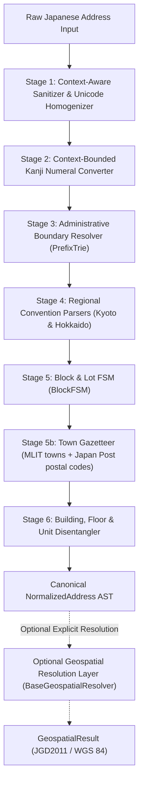

# JADEN — Japanese Address Data Engineering & Normalization Engine

[](https://www.python.org/downloads/)
[](https://opensource.org/licenses/MIT)
[](https://peps.python.org/pep-0561/)
[](https://github.com/SushilRaj0177/JADEN/actions/workflows/ci.yml)

**JADEN** is a deterministic Python engine and CLI for Japanese address canonicalization, structured decomposition, statutory validation, and offline geocoding.

It checks every address down to the town and 丁目 against the national town list (MLIT, 191,100 towns) and Japan Post's postal-code list, both bundled and fully offline. It never guesses: when an address could be in more than one place, JADEN says so and lists the candidates.

[Quickstart](#6-installation--usage) • [What's new in v0.2](#whats-new-in-v02) • [Overview](#1-overview--the-core-engineering-challenge) • [Taxonomy](#2-four-tier-taxonomy-of-truth) • [Architecture](#3-architecture--processing-pipeline) • [Benchmarks](#5-empirical-benchmarks) • [CLI](#command-line-interface-cli) • [Limitations](#8-explicit-boundaries--limitations)

*(日本語のドキュメントは [README_JP.md](README_JP.md) をご覧ください。)*

---

## What's new in v0.2

v0.1 knew Japan's 1,918 municipalities. v0.2 also knows every registered **town and 丁目**, every **postal code**, and the official **readings and romanization** of all of them, from official open data that JADEN downloads, checksums and rebuilds itself (`jaden data update`).

| | v0.1 | v0.2 |
| :--- | :--- | :--- |
| `港区芝公園4-2-8` (港区 exists in 3 cities) | AMBIGUOUS | **東京都港区** — only Tokyo's 港区 has a 芝公園 |
| `寺町通御池上る上本能寺前町488` (no ward) | no LG code | **中京区 (261041)** — the town fixes the ward |
| `東京都港区芝公園9-2-8` | accepted | **MALFORMED** — 芝公園 has only 1–4丁目 |
| `〒100-0001 東京都港区芝公園4-2-8` | accepted | **MALFORMED** — that postal code is 千代田区 |
| `東京都千代田区霞ヶ関1-2-1` | 霞ヶ関 | **霞が関** (registered spelling) |
| `東京都港区六本木6-10` | 6番10号 | **6丁目10番** (六本木 is divided into 丁目) |
| `岩手県盛岡市西見前20-113-1` | 20丁目113番1号 | **lot number 20-113-1** (西見前 has no 丁目) |
| `4-2-8 Shibakoen, Minato-ku, Tokyo` | rejected | **東京都港区芝公園4丁目2番8号** (romaji input) |
| `高崎市立国府小学校` (a school name) | accepted | **UNSUPPORTED** — not an address |
| Output | canonical string | + katakana reading, English address line, postal code, MLIT town ID, offline coordinates |

On **JA-AddrBench**, a new benchmark built from 4,700 real addresses with independent ground truth (see [Benchmarks](#5-empirical-benchmarks)), JADEN v0.2 resolves 18,099 of 18,100 published, prefecture-less, noisy and romaji inputs to the correct municipality and gives **no wrong answer on any of them**. With the municipality left out entirely, it resolves half and returns a candidate list for the rest instead of guessing (1 wrong answer in 4,700).

---

## 1. Overview & The Core Engineering Challenge

### What JADEN Is & What It Solves
Unlike Western street-grid systems (e.g., `123 Main St, Suite 400`), Japanese addressing is fundamentally topological, cadastral, and historical. Standardizing raw Japanese addresses is notoriously difficult:
- **Two competing statutory regimes:** Urban residential block indications (*Gaiku-hoshiki* / 住居表示) vs. rural and unadjusted land-lot numbers (*Chiban* / 地番区域).
- **Regional navigation conventions:** Kyoto street-intersection clauses (*Tōri-mei* / 通り名) and Hokkaido cardinal coordinate grids (条・丁目).
- **Proper noun Kanji numeral collisions:** Place names embedding numbers (`一番街`, `麻布十番`, `六本木`, `八王子`) that naive tokenizers mistakenly convert into block numbers.
- **Omitted-prefecture municipal collisions:** 37 municipality and ward names shared across multiple prefectures (`府中市`, `中央区`, `伊達市`), plus intra-prefecture duplicate ward/town jurisdictions (`南区`, `緑区` in Kanagawa; `北区`, `西区` in Osaka; `泊村` in Hokkaido), which commercial engines often silently misassign.

JADEN parses raw address text into a granular Abstract Syntax Tree (`AddressComponents`), canonicalizing notation, validating against official government registries, and offering optional coordinate resolution.

### What JADEN Can Do
- **Deterministic Canonicalization & Normalization:** Standardizes Unicode variations (NFKC, 11+ dash forms including box dashes and small hyphens, context-aware Katakana prolonged sound marks, embedded newline/CR collapse, postal code prefix stripping) and formats clean, canonical address strings.
- **Granular Syntactic AST Parsing:** Decomposes inputs into prefecture, county, city/ward, oaza/koaza, town, chome, ban, go, banchi, edaban, building, floor, and unit fields.
- **Statutory Registry Verification:** Validates against **1,918 official MIC municipal records** (verified with Modulus 11 check digits) and maps **374 statutory counties** (367 distinct names, 7 shared across prefectures; JIS X 0401/0402).
- **Town & 丁目 Verification (v0.2):** Checks the town and 丁目 against MLIT's list of all **191,100 registered towns and 丁目**, with Japan Post's town list as a fallback; reports nonexistent 丁目, contradictory postal codes, and text that is not an address.
- **Ambiguity Resolution (v0.2):** Uses the town, the postal code and the registered structure to settle which municipality is meant (`港区芝公園`, `中央区銀座`, `大阪府北区梅田`), and stays AMBIGUOUS with a narrowed candidate list when the data cannot decide.
- **Readings & Romaji (v0.2):** Outputs the katakana reading and an English-order address line using Japan Post's official romanization, and accepts romanized input (`4-2-8 Shibakoen, Minato-ku, Tokyo`).
- **Offline Geocoding (v0.2):** Representative points for every town and 丁目 (bundled) and every city block (`jaden data fetch-blocks <pref>`), with no network access.
- **Regional Convention Grammars:** Fully parses Kyoto intersection navigation clauses and Hokkaido cardinal grid coordinates.
- **Ambiguity Detection:** Explicitly flags inputs with ambiguous jurisdictions as ambiguous (`is_ambiguous=True`) and lists candidates with statutory LG codes rather than guessing.
- **Professional CLI & Python API:** First-class CLI (`normalize`, `parse`, `validate`, `geocode`, `data`) supporting human-readable output, JSON piping, dedicated shell exit codes, and standard input reading via `-`.
- **Optional Online Geospatial Layer:** A pluggable, zero-credential coordinate resolver backed by the Geospatial Information Authority of Japan (GSI / 国土地理院), alongside the offline one.

### Local / Offline Core vs. Optional Geospatial Layer
> [!IMPORTANT]
> **Strict Offline Guarantee:** JADEN's core parsing, normalization, and validation engine is **100% local, deterministic, and offline**. It requires zero network connectivity, zero API keys, and zero heavyweight GIS libraries. The town and postal-code data is bundled in the package.
> 
> Network access happens only when you ask for it: `jaden geocode --provider gsi` (the default provider) queries GSI, and `jaden data update` / `jaden data fetch-blocks` download official datasets. `jaden normalize`, `parse`, `validate` and `geocode --provider offline` never touch the network.

### The Core Engineering Challenge
Unlike Western street-grid systems, a normalization engine must resolve four distinct layers of complexity:

| Statutory Regime | Scope & Statutory Basis | Structural Progression |
| :--- | :--- | :--- |
| **住居表示 (Residential)** | **Act on Indication of Residential Address (1962)**<br>Urban: Tokyo 23 wards, Osaka, Nagoya, etc. | 都道府県 $\to$ 市区町村 $\to$ 町名 $\to$ **街区符号 (番)** $\to$ **住居番号 (号)** |
| **地番区域 (Cadastral)** | **Real Property Registration Act (2004)**<br>Rural, agricultural, or unconsolidated urban | 都道府県 $\to$ 市区町村 $\to$ 大字 $\to$ 字/小字 $\to$ **地番 (番地)** $\to$ **支号 (枝番)** |

1. **Dual Statutory Regimes:**
   * **Gaiku-hoshiki (街区方式):** Established by the *Act on Indication of Residential Address (住居表示に関する法律, Act No. 119 of 1962)*. Organized into blocks (*ban* / 番) and house numbers (*go* / 号).
   * **Chiban (地番区域):** Governed by the *Real Property Registration Act (不動産登記法, Act No. 123 of 2004)* and the Civil Code. Organized into land lots (*banchi* / 番地) and branch lots (*edaban* / 枝番), often structured under *Oaza* (大字) and *Koaza* (字 / 小字).
2. **Conventional Navigation Schemes:**
   * **Kyoto Tōri-mei (通り名):** Relative street-intersection navigation (`上る` / `下る` / `東入` / `西入`). Example: `京都府中京区御池通東洞院東入笹屋町436`. Crucially, Kyoto streets frequently embed cardinal characters (`東洞院通`, `西洞院通`, `下立売通`, `上長者町通`).
   * **Hokkaido Cardinal Grids (条・丁目):** Sapporo-style grid coordinates (`北1条西2丁目`).
3. **The CJK Dash Jungle & Proper Noun Preservation:**
   * Over 11 Unicode code points represent dashes in Japanese text (`-`, `－`, `‐`, `―`, `ー`, `～`, `─`, `━`, `﹣`, `﹘`, etc.).
   * The Katakana prolonged sound mark (`ー` / `U+30FC`) is simultaneously a delimiter between block numbers (`1ー2ー3` -> `1-2-3`) and a crucial character in proper nouns (`タワー`, `センター`).
   * Proper place names embed Kanji numbers (`六本木`, `八王子`, `十条`, `四日市`, `三番町`, `一番街`, `麻布十番`, `八重洲`). JADEN's multi-stage FSM protects proper nouns across both compound numeral patterns and single-digit tail notations (e.g., `六本木1`, `十条1`, `一番町1`, `八重洲1`, `麻布十番1-1`), preventing false tokenization into block numbers, while preserving ordinal building names like `第一-3ビル`.
4. **Multi-Jurisdiction Collisions on Omitted Prefectures:**
   * 37 municipal and ward names are shared across multiple prefectures (e.g. `中央区` in Tokyo and 10 designated cities; `府中市` in Tokyo and Hiroshima; `伊達市` in Hokkaido and Fukushima), and 5 name pairs collide intra-prefecture. Many municipality names are also town names elsewhere (`栄町`, `錦町`, `富士見町`). A robust system must use what the address says (town, 丁目, postal code) to decide, and report ambiguity when that still is not enough.

---

## 2. Four-Tier Taxonomy of Truth

To ensure architectural transparency, JADEN categorizes every parsed token and transformation into one of four explicit tiers:

| Tier | Classification | Definition & Examples |
| :---: | :--- | :--- |
| **Tier 1** | 🏛️ **Statutory / Official** | Entities strictly verified against official national registries: JIS X 0401 (Prefecture codes), JIS X 0402 (Municipality codes), and 6-digit Local Government Code with Modulus 11 check digits; county (郡) affiliations from the bundled mapping (provenance not reproducible from this repository); and, from v0.2, towns and 丁目 found in the MLIT town list. |
| **Tier 2** | 📍 **Documented Convention** | Regional navigation conventions and syntactic block parsing: Kyoto Tōri-mei directional clauses, Hokkaido Jo-Chome grid coordinates, and syntactic block numbers (*Chome*, *Ban*, *Go*, *Banchi*, *Edaban*) parsed via deterministic FSM without parcel-polygon maps. |
| **Tier 3** | 🔍 **Heuristic Disambiguation** | Linguistic extraction and heuristics: towns not found in the town list, *Oaza*, *Koaza*, inferred prefectures/wards, and building/floor/unit extraction. |
| **Tier 4** | ⚙️ **System Artifact** | JADEN-specific conventions: Canonical string formatting, confidence scoring (0.0 to 1.0), serialized JSON schema, unparsed tails. |

---

## 3. Architecture & Processing Pipeline

JADEN executes a multi-stage deterministic pipeline:



> [!NOTE]
> **Core Architecture Principle:** JADEN's core parsing engine (`normalize`, `parse`, `validate`) is strictly local, deterministic, and 100% offline. It never executes network calls or requires API keys or GIS dependencies.
>
> **Stage 5b** looks the town up in each municipality that is still possible. It settles ambiguous municipalities when exactly one of them has the town (and 丁目, and postal code), reads the block numbers the way that town is registered (丁目 or lot), and supplies the reading, romanization, MLIT town ID and representative point. `AddressNormalizer(use_gazetteer=False)` turns it off and gives the v0.1 parser-only behaviour.

---

## 4. Administrative Standards & Data Provenance

Administrative reference data in JADEN is based on public government standards and datasets:

1. **Prefecture Codes (JIS X 0401:1973, revised 2014):**
   * Exactly 47 prefectures (`01` 北海道 to `47` 沖縄県) as defined in JIS X 0401.
   * *Note on Provenance:* `src/jaden/data/jis_prefectures.json` is bundled directly without a raw source file in the repository; its provenance is not reproducible from this repository.
2. **Municipality Codes (JIS X 0402:2020 & MIC Local Government Code):**
   * **Issuing Body:** Ministry of Internal Affairs and Communications (総務省自治行政局)
   * **Official File:** 都道府県コード及び市区町村コード (令和6年1月1日更新 / Jan 1, 2024 update)
   * **Source URL:** `https://www.soumu.go.jp/main_content/000925835.xlsx`
   * **Source SHA256:** `7d04c8a7f6a6e76a7823a0414a8422bf2b26bb6070766971df76eab58ea6ff78`
   * **Bundled Record Count:** Exactly **1,918 verified records**:
     - 47 Prefectures
     - 1,747 Municipalities: 23 Special Wards (東京都特別区), 20 Designated Cities (政令指定都市), 772 Standard Cities (市), 743 Towns (町), 189 Villages (村, including Northern Territories / 北方領土 6村)
     - 171 Administrative Wards (行政区, reflecting the Jan 1, 2024 Hamamatsu City consolidation)
   * **Check Digit Formula:** 100% of bundled codes validate against the official Modulus 11 algorithm:
     $$\text{Sum} = \sum_{i=1}^{5} d_i \times w_i, \quad W = [6, 5, 4, 3, 2]$$
     $$R = \text{Sum} \pmod{11}$$
     $$\text{Check Digit} = \begin{cases} (11 - R) \pmod{10} & \text{if } R \le 1 \\ 11 - R & \text{if } R \ge 2 \end{cases}$$
   * **Reproducibility:** The bundled `src/jaden/data/municipalities.json` is reproducible from the bundled `src/jaden/data/soumu_000925835.xlsx` via `src/jaden/data/build_municipalities.py` (pinned SHA256 in `src/jaden/data/provenance.json`).
3. **County (郡) Association:**
   * **Coverage:** 932 towns and villages (743 町 + 189 村):
     - 374 statutory counties (郡) (367 distinct names, 7 shared across prefectures), encompassing 923 county-affiliated towns and villages.
     - 9 Tokyo island municipalities explicitly verified without county jurisdiction (`大島町`, `利島村`, `新島村`, `神津島村`, `三宅村`, `御蔵島村`, `八丈町`, `青ヶ島村`, `小笠原村`).
     - Northern Territories (北方領土) villages mapped to statutory counties (`色丹郡色丹村`, `国後郡泊村`, `国後郡留夜別村`, `択捉郡留別村`, `紗那郡紗那村`, `蘂取郡蘂取村`).
   * *Note on Provenance:* `src/jaden/data/county_mapping.json` is bundled directly without a raw source file in the repository; its provenance is not reproducible from this repository.
4. **Statutory Addressing Acts:**
   * *Act on Indication of Residential Address (昭和37年法律第119号)*: Defines urban *Gaiku-hoshiki* (Chome-Ban-Go).
   * *Real Property Registration Act (平成16年法律第123号)*: Governs cadastral *Chiban* (Oaza-Koaza-Banchi-Edaban).
5. **Digital Agency Address Base Registry (アドレス・ベース・レジストリ):**
   * JADEN models ABR statutory taxonomy (Machi-aza, Gaiku, Chiban). Note: JADEN is an offline linguistic engine and intentionally does not bundle the multi-gigabyte spatial polygon GIS shapefiles of the full ABR.
6. **Town Gazetteer (v0.2):**
   * **Towns:** 大字・町丁目レベル位置参照情報 19.0b (2025年版), MLIT (国土交通省). 191,100 towns and 丁目 with representative points. Free use under the 位置参照情報利用約款; derived works cite 「大字・町丁目レベル位置参照情報 国土交通省」 and the data year.
   * **Postal codes, readings and romaji:** 郵便番号データ (UTF-8 and romaji editions), Japan Post. 124,526 records. 「郵便番号データに限っては日本郵便株式会社は著作権を主張しません。自由に配布していただいて結構です。」
   * **City blocks (optional):** 街区レベル位置参照情報 24.0a, MLIT, downloaded per prefecture by `jaden data fetch-blocks`.
   * **Reproducibility:** `src/jaden/data/build_gazetteer.py` downloads all sources, records each file's URL and SHA256 in `src/jaden/data/gazetteer_provenance.json`, and rebuilds the bundled files; `jaden data update` does the same into your user data directory.
7. **Open Data Attribution & Terms Notice:**
   * **MIC Municipality Data:** Ministry of Internal Affairs and Communications (総務省自治行政局) *都道府県コード及び市区町村コード*. Users should consult the Ministry of Internal Affairs and Communications' own terms of use on their official website.
     Attribution: *本製品の全国地方公共団体マスターデータは、総務省「都道府県コード及び市区町村コード」を加工・構造化して作成したものです。*
   * **GSI Geospatial Data:** Geospatial Information Authority of Japan (国土地理院) Address Search API. Users should consult GSI's own terms of use on their official website.
     Attribution: *出典：国土地理院 (地名検索API)。座標系は世界測地系 JGD2011 (WGS 84 準拠互換, EPSG:6668 / EPSG:4326) に準拠します。*
   * Complete notices are preserved in [NOTICE](NOTICE).

---

## 5. Empirical Benchmarks

### Accuracy: JA-AddrBench (v0.2)

`benchmarks/jabench` builds a benchmark from **real addresses with independent ground truth**: 4,700 schools (100 per prefecture) from MLIT's 国土数値情報 学校データ (2023, CC BY 4.0). Each record carries the address as published, the municipality code of the school, and a surveyed point. Neither the label nor the point comes from the data JADEN uses, so the test is not circular.

Each address is turned into label-preserving variants and into inputs that must be rejected:

| Variant | Example | Items |
| :--- | :--- | ---: |
| `original` | 青森県弘前市末広3-2-1 | 4,700 |
| `no_pref` | 弘前市末広3-2-1 | 4,700 |
| `town_only` (municipality left out) | 末広3-2-1 | 4,700 |
| `noisy` (full-width, dashes, kanji 丁目, の, spaces) | 青森県弘前市 末広三丁目2番1号 | 4,700 |
| `romaji` (Japan Post romanization) | 3-2-1 Suehiro, Hirosaki-shi, Aomori | 3,657 |
| `wrong_pref` — must be rejected | 滋賀県弘前市末広3-2-1 | 4,700 |
| `chome_99` — must be rejected | 青森県弘前市末広99-2-1 | 1,026 |
| `non_address` (school name) — must be rejected | 弘前市立東中学校 | 4,700 |

A system **answers** when it commits to one municipality and **abstains** otherwise (ambiguous, rejected, unresolved). `jaden-parser-only` is the same engine with the gazetteer off, i.e. v0.1 behaviour.

| Valid inputs | JADEN v0.2 accuracy | wrong answers | JADEN parser-only (v0.1) accuracy | wrong answers |
| :--- | ---: | ---: | ---: | ---: |
| original | **100.0%** | 0 | 100.0% | 0 |
| no_pref | **99.98%** | 0 | 99.7% | 0 |
| noisy | **100.0%** | 0 | 100.0% | 0 |
| romaji | **100.0%** | 0 | 0.0% | 0 |
| town_only | **50.4%** | **1** | 0.1% | 100 |

| Invalid inputs (false accepts) | JADEN v0.2 | JADEN parser-only (v0.1) |
| :--- | ---: | ---: |
| wrong_pref | **0 / 4,700** | 0 / 4,700 |
| chome_99 | **74 / 1,026** | 1,026 / 1,026 |
| non_address | **2 / 4,700** | 2,723 / 4,700 |

* When JADEN abstains on `town_only`, it returns a candidate list for 2,125 of 2,328 inputs; the correct municipality is in it **98.6%** of the time (median 8 candidates).
* All 74 `chome_99` acceptances are towns MLIT records as only partly divided into 丁目, where `99-x-y` is a valid lot-number reading (see [Limitations](#8-explicit-boundaries--limitations)).
* **Offline geocoding** against the surveyed school points (correctly resolved items): median error **360 m** with the bundled 丁目/town points (79% within 1 km), and **71 m** with block-level data installed (89% within 1 km; 94% within 1 km for romaji inputs). The school point is the school site, not the address point, so part of this error is the size of the site.

Reproduce:

```bash
python benchmarks/jabench/build_benchmark.py       # downloads P29 + Japan Post data, writes jabench.jsonl
python benchmarks/jabench/evaluate.py              # writes results/report.md and results/scores.json
python benchmarks/jabench/evaluate.py --systems jaden+blocks --blocks-dir ~/.local/share/jaden/blocks
```

Runners for other open-source tools (Geolonia's normalize-japanese-addresses, jageocoder) are in `benchmarks/jabench/baselines`; their results are not reported here until they have been run.

### Speed (v0.1 parser)

### Hardware & Runtime Environment

| Metric / Parameter | Environment Specification |
| :--- | :--- |
| **Operating System** | Windows 11 (10.0.26200) |
| **Processor** | Intel64 Family 6 Model 151 (12 Logical Cores) |
| **Python Runtime** | CPython 3.13.14 (64-bit) |
| **Memory Footprint** | 4.28 MB baseline heap (full registry + tries), 4.48 MB peak batch heap |
| **Corpus Diversity** | 500 unique addresses evaluated over 5,000 operations (10 passes) |

### Empirical Performance Results

| Evaluation Corpus | Unique Addrs | Operations | Throughput (addr/sec) | Latency P50 | Latency P90 | Latency P99 | Mean Latency |
| :--- | :--- | :--- | :--- | :--- | :--- | :--- | :--- |
| **Clean Standard (Gaiku-hoshiki)** | 200 | 2,000 | **35,023.9** | 27.20 μs | 31.20 μs | 44.50 μs | 28.35 μs |
| **Complex Conventional (Kyoto/Hokkaido/Cadastral)** | 150 | 1,500 | **31,500.5** | 31.30 μs | 33.50 μs | 41.00 μs | 31.52 μs |
| **Dirty Real-World (Omitted/Dashes/Buildings)** | 150 | 1,500 | **25,356.2** | 38.40 μs | 43.10 μs | 50.00 μs | 39.19 μs |
| **Aggregate Workload** | **500** | **5,000** | **30,510.3** | **31.30 μs** | **38.40 μs** | **47.00 μs** | **32.55 μs** |

---

## 6. Installation & Usage

### Installation

```bash
# Clone the repository
git clone https://github.com/SushilRaj0177/JADEN.git
cd JADEN

# Install production package (zero external dependencies)
pip install .

# Or install with development and test tooling
pip install ".[dev]"

# Verify CLI installation
jaden normalize "東京都港区六本木1-2-3"
```

### Python Library API

```python
import jaden

# 1. Real-world urban address with landmark building & floor
res1 = jaden.normalize("東京都港区六本木6-10-1六本木ヒルズ森タワー50F")
print(res1.canonical)
# Output: 東京都港区六本木6丁目10番1号 六本木ヒルズ森タワー 50F
print(res1.components.lg_code)        # '131032' (Minato-ku)
print(res1.components.address_regime) # 'gaiku_hoshiki'

# 2. Component AST parsing
components = jaden.parse("京都府中京区御池通東洞院東入笹屋町436")
print(components.city)                      # '京都市'
print(components.ward)                      # '中京区'
print(components.kyoto_direction.street_1) # '御池通'
print(components.banchi)                    # 436

# 3. Validation: the town settles which 府中市 is meant; without a town it stays ambiguous
val = jaden.validate("府中市宮西町2-24")
print(val.status)                # 'ACCEPTED'
print(val.lg_code)               # '132063' (東京都府中市: 広島県府中市 has no 宮西町)
val = jaden.validate("府中市1-1")
print(val.status)                # 'AMBIGUOUS'
print(val.ambiguous_candidates)  # ('東京都府中市 (132063)', '広島県府中市 (342084)')

# 4. County (郡) resolution with omitted prefecture inference
res4 = jaden.normalize("中郡大磯町国府本郷547")
print(res4.canonical)         # '神奈川県中郡大磯町国府本郷547番'
print(res4.components.county) # '中郡'
print(res4.components.city)   # '大磯町'
print(res4.components.lg_code)# '143413'

# 5. Readings, postal code and offline location (v0.2)
res5 = jaden.normalize("東京都港区芝公園4-2-8")
print(res5.kana)                    # 'トウキョウトミナトクシバコウエン'
print(res5.romaji)                  # '4-2-8 Shibakoen, Minato-ku, Tokyo 105-0011'
print(res5.components.postal_code)  # '105-0011'
print(res5.components.machiaza_id)  # '131030002004' (MLIT town ID of 芝公園四丁目)
print(res5.latitude, res5.longitude, res5.location_level)  # 35.656459 139.74764 chome

# 6. Romaji input
print(jaden.normalize("4-6-16 Ginza, Chuo-ku, Tokyo").canonical)  # '東京都中央区銀座4丁目6番16号'

# 7. Offline geocoding (no network)
geo = jaden.geocode("東京都港区芝公園4-2-8", provider="offline")
print(geo.status, geo.metadata["level"])  # SUCCESS chome

# 8. Online geospatial resolution via GSI (JGD2011 / WGS 84 compatible)
geo = jaden.geocode("東京都港区六本木6-10-1")
print(geo.status)                 # 'SUCCESS'
print(geo.coordinates.latitude)  # 35.660206
print(geo.coordinates.longitude) # 139.729202
print(geo.matched_address)       # '東京都港区六本木六丁目１０番'
```

### Command-Line Interface (CLI)

JADEN provides five CLI commands: `normalize`, `parse`, `validate`, `geocode`, and `data`.

#### 1. `normalize`: Canonical Address Formatting
```bash
# Clean human-readable summary
$ jaden normalize "東京都港区六本木1-2-3"
Prefecture: 東京都
City:       港区
Town:       六本木
Chome:      1
Ban:        2
Go:         3
Regime:     gaiku_hoshiki
LG Code:    131032
Confidence: 1.00
Canonical:  東京都港区六本木1丁目2番3号

# v0.2: town verification, postal code, reading, English line and offline location
$ jaden normalize "東京都港区芝公園4-2-8"
Prefecture: 東京都
City:       港区
Town:       芝公園
Chome:      4
Ban:        2
Go:         8
Regime:     gaiku_hoshiki
LG Code:    131032
Postal:     〒105-0011
Verified:   town + 丁目 registered
Confidence: 1.00
Canonical:  東京都港区芝公園4丁目2番8号
Kana:       トウキョウトミナトクシバコウエン
Romaji:     4-2-8 Shibakoen, Minato-ku, Tokyo 105-0011
Location:   35.656459, 139.747640 (chome level, offline)

# Romaji input
$ jaden normalize "4-2-8 Shibakoen, Minato-ku, Tokyo" -c
東京都港区芝公園4丁目2番8号

# Machine-readable JSON
$ jaden normalize "東京都港区六本木1-2-3" --json

# Canonical string only (ideal for shell scripts)
$ jaden normalize "新宿区西新宿2-8-1東京都庁 第一本庁舎" -c
東京都新宿区西新宿2丁目8番1号 東京都庁 第一本庁舎
```

#### 2. `parse`: Granular Component AST Decomposition
```bash
# Pretty-printed syntactic decomposition
$ jaden parse "京都府中京区御池通東洞院東入笹屋町436"

# Structured AST JSON
$ jaden parse "京都府中京区御池通東洞院東入笹屋町436" --json
```

#### 3. `validate`: Statutory Registry & Integrity Verification
```bash
# Valid address verification (Exit code 0)
$ jaden validate "東京都港区六本木1-2-3"
Input:       東京都港区六本木1-2-3
Status:      ACCEPTED
Valid:       Yes
Confidence:  1.00
LG Code:     131032
Regime:      gaiku_hoshiki
Message:     Local government entity verified against official statutory registry.

# The town settles an ambiguous municipality (Exit code 0)
$ jaden validate "港区芝公園4-2-8"
Input:       港区芝公園4-2-8
Status:      ACCEPTED
Valid:       Yes
Confidence:  0.85
LG Code:     131032
Regime:      gaiku_hoshiki
Verified to: chome
Message:     Municipality, town and 丁目 verified against official registries.
Note:        resolved 3 candidate municipalities to 東京都港区 by town '芝公園'

# Ambiguity detection with candidate reporting (Exit code 2)
$ jaden validate "府中市1-1"
Input:       府中市1-1
Status:      AMBIGUOUS
Valid:       No
Confidence:  0.50
Regime:      unspecified
Message:     Omitted prefecture matches 2 statutory municipalities.
Candidates:  2
  • 東京都府中市 (132063)
  • 広島県府中市 (342084)

# A 丁目 that does not exist (Exit code 1)
$ jaden validate "東京都港区芝公園9-2-8"
Input:       東京都港区芝公園9-2-8
Status:      MALFORMED
Valid:       No
Confidence:  1.00
LG Code:     131032
Regime:      gaiku_hoshiki
Message:     Nonexistent 丁目: 芝公園 has only 1–4丁目; 9丁目 does not exist

# A postal code from another municipality (Exit code 1)
$ jaden validate "〒100-0001 東京都港区芝公園4-2-8"
Input:       〒100-0001 東京都港区芝公園4-2-8
Status:      MALFORMED
Valid:       No
Confidence:  1.00
LG Code:     131032
Regime:      gaiku_hoshiki
Message:     Postal code contradicts the address: postal code 100-0001 belongs to 東京都千代田区千代田, not to 港区

# Also require the town to be in the gazetteer
$ jaden validate "東京都港区存在しない町1-1" --strict      # Exit code 3

# Malformed / foreign input rejection (Exit code 1)
$ jaden validate "123 Main St, New York"

# Machine-readable JSON output
$ jaden validate "東京都港区六本木1-2-3" --json
```

#### 4. `geocode`: Optional Geospatial Resolution (JGD2011 / WGS 84 compatible)
```bash
# Human-readable coordinate summary (Exit code 0 on SUCCESS)
$ jaden geocode "東京都港区六本木6-10-1"
Input:       東京都港区六本木6-10-1
Status:      SUCCESS
Provider:    gsi
Coordinates: 35.660206, 139.729202 (Lat, Lon)
Matched:     東京都港区六本木六丁目１０番
Candidates:
  • 東京都港区六本木六丁目１０番

# Machine-readable JSON with WGS 84 latitude & longitude
$ jaden geocode "東京都港区六本木6-10-1" --json

# Ambiguous address candidate reporting (Exit code 1 on non-resolution)
$ jaden geocode "府中市"

# Offline: MLIT representative point of the 丁目 (or of the block, with block data installed)
$ jaden geocode "東京都港区芝公園4-2-8" --provider offline
Input:       東京都港区芝公園4-2-8
Status:      SUCCESS
Provider:    offline
Coordinates: 35.656459, 139.747640 (Lat, Lon)
Precision:   chome
Matched:     東京都港区芝公園4丁目2番8号
```

#### 5. `data`: Gazetteer Data Management
```bash
# What is installed, where it came from, and its required attribution
$ jaden data info

# Download the latest MLIT and Japan Post datasets and rebuild (user data directory)
$ jaden data update

# Install block-level points for prefectures (here Tokyo and Osaka) for block-precision geocoding
$ jaden data fetch-blocks 13 27
```

#### Exit Codes for Shell Automation
| Exit Code | Meaning | Example Scenario |
| :---: | :--- | :--- |
| `0` | **ACCEPTED / SUCCESS** | Valid address verified (`validate`) or coordinates successfully resolved (`geocode`) |
| `1` | **MALFORMED / REJECTED** | Structurally invalid, foreign, or unparseable input (`validate`) |
| `2` | **AMBIGUOUS** | Omitted prefecture or multi-candidate municipal jurisdiction (`validate`) |
| `3` | **UNSUPPORTED** | Structurally unsupported or unparsed trailing tokens (`validate`) |
| `64` | **CLI_USAGE_ERROR** | Missing required arguments, invalid CLI options, or empty stdin input |
| `70` | **INTERNAL_ERROR** | Unhandled internal software exception |

#### Unix Standard Input Piping
```bash
# Pipe address string directly via '-'
echo "東京都港区六本木1-2-3" | jaden normalize - -c
```

---

## 7. Testing & Quality Assurance

JADEN's test suite runs in GitHub Actions on Python 3.10–3.13 on Ubuntu and Windows, plus three further jobs: `ruff` (lint), `mypy` (types), and a job that builds the wheel and runs the tests against the installed package outside the source tree. One live-network GSI test is opt-in (`JADEN_ENABLE_NETWORK_TESTS=1`).

* **All 47 Prefectures:** Deep decomposition asserting prefecture, city/county, town, oaza/koaza, and exact block numbers across all 47 prefectures, plus dedicated `郡` test cases.
* **Gazetteer (v0.2):** Town and 丁目 verification, ambiguity resolution by town and postal code, nonexistent 丁目, contradictory postal codes and towns, lot numbers in towns without 丁目, registered-spelling variants, Japan Post fallback towns, non-address rejection, readings, romaji input and output, offline and block-level geocoding.
* **Adversarial & Edge Case Payloads:** Proper noun collisions (`一番街`, `麻布十番`, `三番町`, `六本木1`, `十条1`, `一番町1`, `八重洲1`), building names (`第一-3ビル`), multi-jurisdiction collisions, cardinal Kyoto streets, `の` delimiters, malformed kanji numerals, and foreign/gibberish input rejection.
* **Parser-only mode:** Structural tests also run with `AddressNormalizer(use_gazetteer=False)` so the v0.1 behaviour stays covered.
* **CLI & Public API:** All commands, `--json`, `-c`, `--strict`, `--provider offline`, `data`, stdin (`-`), and exit codes (0, 1, 2, 3, 64, 70).
* **Geospatial Layer:** `GSIGeocoder`, `OfflineGeocoder`, custom resolvers, HTTP errors, timeouts, and ambiguity short-circuiting.
* **Packaging:** Bundled data files, entry points, and public exports.

```bash
pytest -v
ruff check src tests benchmarks
mypy
```

Accuracy is measured separately on JA-AddrBench (`benchmarks/jabench`, see [Benchmarks](#5-empirical-benchmarks)).

---

## 8. Explicit Boundaries & Limitations

In accordance with our engineering principles, JADEN documents its exact operational boundaries:
1. **Offline by default:** The core engine, the town gazetteer and the offline geocoder are local. JADEN does not bundle boundary polygons; locations are MLIT representative points (block, 丁目 or town), not rooftop coordinates. Block-level points are a separate download per prefecture (`jaden data fetch-blocks`, 0.7–11 MB per prefecture; about 75 MB installed for all 47).
2. **Ambiguity is reported, not guessed:** When the town, 丁目 and postal code still fit more than one municipality (`府中市1-1`, `栄町7-7`, `本町1-8-19`), JADEN returns AMBIGUOUS with the full candidate list. On JA-AddrBench, addresses written without their municipality are resolved about half the time; for the rest the correct municipality is in the candidate list 98.6% of the time.
3. **The town lists are not complete:** About 1.6% of the real addresses in JA-AddrBench use a town the MLIT list does not have; Japan Post's list covers half of those (verified at town level, without coordinates), leaving 0.8% unverified. An unregistered town is a warning, not an error, unless `--strict` is used. Town names written without a prefix the registry uses (`小俣町` for 奄美市`名瀬小俣町`) can still be matched to the wrong place when no municipality is written.
4. **丁目 checks follow the registry:** A 丁目 missing from the MLIT list is MALFORMED. In towns MLIT records as only partly divided into 丁目, an out-of-range first number is read as a lot number instead (e.g. `御望971-1-2`), so a typo there is not caught.
5. **Data vintage:** Municipalities: MIC, 2024-01-01. Towns: MLIT 2025 edition. Postal codes: Japan Post, as downloaded (`jaden data info`). Municipal mergers and new 住居表示 after those dates are unknown until `jaden data update`.
6. **Romaji input:** Needs a municipality (with `-shi`, `-ku`, `City`, … or a recognizable town). Building names in romaji are kept as written.
7. **Kyoto:** Some Kyoto town names occur more than once in the same ward and are told apart only by the street clause; JADEN verifies the town but does not give one point for them.
8. **Private Building Records:** Building names and room numbers are parsed using syntactic heuristics (Tier 3), as no statutory national registry of private commercial building names exists.
9. **Memory:** The gazetteer makes a running engine use about 90 MB (parser-only mode stays at a few MB) and the first address takes about 0.4 s to load the data.
10. **GSI Address Search Rate and Availability:** The online geocoder calls GSI's public `AddressSearch` endpoint; consult GSI's terms and keep request rates reasonable.

### Resolved in v0.2 (from the v0.1 list)
`1の2の3` delimiters, malformed kanji numerals (`五三十`), the non-standard `上ラル`, Obihiro-style grids (verified through the gazetteer), the `--provider` / `--json -c` / `jaden -` CLI issues, testing the installed wheel in CI, and lint/type checks in CI (`ruff`, `mypy`).

---

## License

MIT License. Designed and maintained by Sushil Raj.
