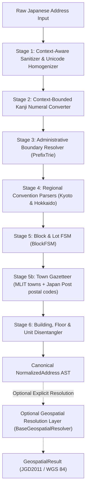

# JADEN — Japanese Address Data Engineering & Normalization Engine

[](https://www.python.org/downloads/)
[](https://opensource.org/licenses/MIT)
[](https://peps.python.org/pep-0561/)
[](https://github.com/SushilRaj0177/JADEN/actions/workflows/ci.yml)

**JADEN** is a deterministic Python toolkit for Japanese addresses: it verifies and normalizes them, corrects typos, matches and deduplicates records, completes partial input, looks up postal codes, finds addresses inside text, and geocodes in both directions. It runs as a library, a CLI, and a JSON API server.

It checks every address down to the town and 丁目 against the national town list (MLIT, 191,100 towns) and Japan Post's postal-code list, both bundled and fully offline. It never guesses: when an address could be in more than one place, JADEN says so and lists the candidates.

[Quickstart](#6-installation--usage) • [What's new in v0.3](#whats-new-in-v03) • [What's new in v0.2](#whats-new-in-v02) • [Overview](#1-overview--the-core-engineering-challenge) • [Taxonomy](#2-four-tier-taxonomy-of-truth) • [Architecture](#3-architecture--processing-pipeline) • [Benchmarks](#5-empirical-benchmarks) • [CLI](#command-line-interface-cli) • [Limitations](#8-explicit-boundaries--limitations)

*(日本語のドキュメントは [README_JP.md](README_JP.md) をご覧ください。)*

---

## What's new in v0.4 (in development): knowing when it does not know

When an address does not name its municipality, the town that remains often exists in many places (錦町 is a registered town in 93 municipalities). v0.4 adds **`jaden.resolve()`**: every candidate municipality with a **calibrated probability**, an answer only when that probability clears a threshold chosen for a **1% wrong-answer rate**, and a candidate set that should hold the right municipality **95%** of the time. The model was fitted on 5 million registered company addresses and calibrated on care-office addresses; the organisation's name can be passed as extra evidence.

```python
r = jaden.resolve("錦町1番2号")
r.answered, [(c.name, round(c.probability, 3)) for c in r.candidates[:3]]
# (False, [('東京都立川市', 0.231), ('埼玉県蕨市', 0.067), ('福島県いわき市', 0.054)])
jaden.resolve("芝公園4-2-8").name      # '東京都港区' (p > 0.99)
```

```bash
jaden resolve "南3条東1-2-1"            # 6 candidates ranked, none above the 1% threshold
```

**Tested once on data it had never seen, under a pre-registered protocol** ([`benchmarks/heldout/PROTOCOL.md`](benchmarks/heldout/PROTOCOL.md)): the address of every welfare facility in the MLIT 2023 file (321,859), as published, without the municipality.

| Town-only input (318,578) | Right | Wrong answers | Wrong among answers |
| :--- | ---: | ---: | ---: |
| JADEN rules | 52.2% | 639 | 0.38% |
| JADEN calibrated | 59.8% | 2,115 | 1.10% |
| JADEN calibrated + facility name | **61.2%** | 2,255 | 1.14% |
| jageocoder | 76.5% | 66,164 | 21.4% |
| Geolonia | 0.03% | 6,256 | 98.4% |
| JADEN calibrated + name, then a language model's proposals that JADEN verifies (projected from a 1,000-input sample) | **71.8%** | ≈3,200 | **1.4%** |

- **Calibration held** on the new data: answers given with probability *p* are right about *p* of the time (expected calibration error 0.015; 0.007 with the name). With the full address, **0 wrong answers in 318,578**.
- **Two guarantees fell slightly short**, as the protocol allowed for when data come from a different publisher: 1.10% wrong for the 1% target, and 93.7% coverage for the 95% candidate sets.
- **Language models:** choosing from JADEN's candidates, a model was wrong on 31.6% of its answers. Alone, Claude Sonnet answered 85% of the hardest leftovers and was wrong on 47% of those answers. When JADEN kept only proposals that are among its verified candidates (and the model was at least 80% sure), **391 of its 399 wrong answers were removed**: 303 answers, 8 wrong. Alone, the models also named municipalities that no longer exist (茶屋町, merged in 2005; 浜松市中区, abolished in 2024).
- The test's error analysis found **two rule defects** behind 486 of the rules' 639 wrong answers; they are fixed after the test, and the numbers above are from the engine before the fix.

The paper: [`paper/jaden-v0.3.md`](paper/jaden-v0.3.md). All tables and figures: [`benchmarks/heldout/results/`](benchmarks/heldout/results/).

## What's new in v0.3

v0.2 made JADEN able to verify one address. v0.3 builds the tools that systems need on top of that: the same engine now answers "are these two records the same place?", "what did the user mean?", "what is at this postal code or coordinate?" and "where are the addresses in this text?", from Python, the command line, or HTTP.

| Need | v0.3 | Example |
| :--- | :--- | :--- |
| Deduplicate customer records (名寄せ) | `jaden.match_key`, `jaden.compare`, `jaden dedupe` | `港区芝公園４丁目２番８号 ３０２号室` and `東京都港区芝公園4-2-8-302` share the key `131032\|芝公園\|4\|2\|8\|302` |
| Fix typos safely | `suggestions`, `--fix` / `autocorrect=True` | `東京都港区芝公演4-2-8` → suggests 芝公園; applied only when exactly one town is one character away |
| Accept kana input | automatic | `港区しばこうえん4丁目2番8号` → 東京都港区芝公園4丁目2番8号 |
| Auto-fill forms from a postal code | `jaden.lookup_postal`, `jaden postal` | `105-0011` → 東京都港区芝公園, reading, romaji |
| Autocomplete | `jaden.suggest`, `jaden suggest` | `東京都港区しば` → 芝, 芝浦, 芝公園, 芝大門 |
| Coordinates → address | `jaden.reverse_geocode`, `jaden reverse` | `35.0116, 135.7681` → 京都市中京区上本能寺前町 (17 m) |
| Find addresses in emails / notes | `jaden.extract_addresses`, `jaden extract` | exact character spans, each one verified |
| Store a compact form | `res.format("hyphen")`, `res.lines()`, `res.precision` | 東京都港区芝公園4-2-8; lossless round trip |
| Use from any language | `jaden serve` | JSON API under `/v1` plus an interactive demo page, standard library only |

Measured on the 4,700 real benchmark addresses (`benchmarks/jabench/evaluate_toolkit.py`, see [Benchmarks](#5-empirical-benchmarks)): all 33,976 noisy spellings get the match key of their clean address; a one-character typo gets the right suggestion 93.9% of the time and autocorrect made **0 wrong corrections** in 2,641 trials; extraction returns the exact span in 99.9% of 23,409 embedded addresses with **0 false positives** in 4,700 texts that only mention a place.

**Tested on real data.** JADEN was run on the registered address of every active corporation in Japan (5,049,462, National Tax Agency) and on the hand-typed address of every long-term-care office (223,161, Ministry of Health, Labour and Welfare). It names the right municipality for **99.98%** of the company addresses and **99.87%** of the care offices. It committed to a wrong municipality for 6 company rows, each one a row whose own municipality column is wrong, and 4 care rows. The failure patterns it exposed are fixed and pinned by tests, apart from those listed under [Real data](#real-data-every-company-and-every-care-office-in-japan-v03).

---

## What's new in v0.2

v0.1 knew Japan's 1,918 municipalities. v0.2 also knows every registered **town and 丁目**, every **postal code**, and the official **readings and romanization** of all of them, from official open data that JADEN downloads, checksums and rebuilds itself (`jaden data update`).

| | v0.1 | v0.2 |
| :--- | :--- | :--- |
| `港区芝公園4-2-8` (港区 exists in 3 cities) | AMBIGUOUS | **東京都港区** — only Tokyo's 港区 has a 芝公園 |
| `寺町通御池上る上本能寺前町488` (no ward) | no LG code | **中京区 (261041)** — the town fixes the ward |
| `東京都港区芝公園9-2-8` | accepted | **MALFORMED** — 芝公園 has only 1–4丁目 |
| `〒100-0001 東京都港区芝公園4-2-8` | accepted | **MALFORMED** — that postal code is 千代田区 |
| `東京都千代田区霞ヶ関1-2-1` | 霞ヶ関 | **霞が関** (registered spelling) |
| `東京都港区六本木6-10` | 6番10号 | **6丁目10番** (六本木 is divided into 丁目) |
| `岩手県盛岡市西見前20-113-1` | 20丁目113番1号 | **lot number 20-113-1** (西見前 has no 丁目) |
| `4-2-8 Shibakoen, Minato-ku, Tokyo` | rejected | **東京都港区芝公園4丁目2番8号** (romaji input) |
| `高崎市立国府小学校` (a school name) | accepted | **UNSUPPORTED** — not an address |
| `埼玉県浦和市高砂3-15-1` (浦和市 merged in 2001) | rejected | **さいたま市浦和区高砂3丁目15番1号** — former names resolved by town |
| `浜松市北区細江町気賀305` (ward abolished 2024) | accepted as 浜松市 | **浜松市浜名区** — 北区 was split; the town decides |
| `東京都港区芝公園4-2-8-101` | building "-101" | **room 101** |
| `北海道網走市潮見188 703号室` | lot 188703 | **lot 188, room 703号室** |
| `札幌市中央区南3西4` | unrecognized | **南3条西4丁目** (Sapporo shorthand) |
| `住所：日本、東京都港区芝公園4-2-8` | rejected | form label and country removed |
| Output | canonical string | + katakana reading, English address line, postal code, MLIT town ID, offline coordinates |

On **JA-AddrBench**, a new benchmark built from 4,700 real addresses with independent ground truth (see [Benchmarks](#5-empirical-benchmarks)), JADEN v0.2 resolves 18,099 of 18,100 published, prefecture-less, noisy and romaji inputs to the correct municipality and gives **no wrong answer on any of them**. With the municipality left out entirely, it resolves half and returns a candidate list for the rest instead of guessing (1 wrong answer in 4,700). All 411 real addresses still written with Hamamatsu's abolished wards resolve to the right ward, and on 34,032 real addresses with real-world noise added (rooms, buildings, floors, form labels, spacing, full-width text) the result is unchanged and the building, floor and room are extracted correctly in every case.

For files, `jaden batch customers.csv -o checked.csv` processes a whole spreadsheet (UTF-8 or Shift_JIS) and appends the results as columns.

---

## 1. Overview & The Core Engineering Challenge

### What JADEN Is & What It Solves
Unlike Western street-grid systems (e.g., `123 Main St, Suite 400`), Japanese addressing is fundamentally topological, cadastral, and historical. Standardizing raw Japanese addresses is notoriously difficult:
- **Two competing statutory regimes:** Urban residential block indications (*Gaiku-hoshiki* / 住居表示) vs. rural and unadjusted land-lot numbers (*Chiban* / 地番区域).
- **Regional navigation conventions:** Kyoto street-intersection clauses (*Tōri-mei* / 通り名) and Hokkaido cardinal coordinate grids (条・丁目).
- **Proper noun Kanji numeral collisions:** Place names embedding numbers (`一番街`, `麻布十番`, `六本木`, `八王子`) that naive tokenizers mistakenly convert into block numbers.
- **Omitted-prefecture municipal collisions:** 37 municipality and ward names shared across multiple prefectures (`府中市`, `中央区`, `伊達市`), plus intra-prefecture duplicate ward/town jurisdictions (`南区`, `緑区` in Kanagawa; `北区`, `西区` in Osaka; `泊村` in Hokkaido), which commercial engines often silently misassign.

JADEN parses raw address text into a granular Abstract Syntax Tree (`AddressComponents`), canonicalizing notation, validating against official government registries, and offering optional coordinate resolution.

### What JADEN Can Do
- **Deterministic Canonicalization & Normalization:** Standardizes Unicode variations (NFKC, 11+ dash forms including box dashes and small hyphens, context-aware Katakana prolonged sound marks, embedded newline/CR collapse, postal code prefix stripping) and formats clean, canonical address strings.
- **Granular Syntactic AST Parsing:** Decomposes inputs into prefecture, county, city/ward, oaza/koaza, town, chome, ban, go, banchi, edaban, building, floor, and unit fields.
- **Statutory Registry Verification:** Validates against **1,918 official MIC municipal records** (verified with Modulus 11 check digits) and maps **374 statutory counties** (367 distinct names, 7 shared across prefectures; JIS X 0401/0402).
- **Town & 丁目 Verification (v0.2):** Checks the town and 丁目 against MLIT's list of all **191,100 registered towns and 丁目**, with Japan Post's town list as a fallback; reports nonexistent 丁目, contradictory postal codes, and text that is not an address.
- **Ambiguity Resolution (v0.2):** Uses the town, the postal code and the registered structure to settle which municipality is meant (`港区芝公園`, `中央区銀座`, `大阪府北区梅田`), and stays AMBIGUOUS with a narrowed candidate list when the data cannot decide.
- **Readings & Romaji (v0.2):** Outputs the katakana reading and an English-order address line using Japan Post's official romanization, and accepts romanized input (`4-2-8 Shibakoen, Minato-ku, Tokyo`).
- **Offline Geocoding (v0.2):** Representative points for every town and 丁目 (bundled) and every city block (`jaden data fetch-blocks <pref>`), with no network access.
- **Former Municipality Names (v0.2):** 1,829 names that disappeared in mergers and reorganizations since 2000 (`浦和市`, `清水市`, `浜松市中区`) map to the municipalities their area now belongs to; the town picks among them.
- **Real-World Input (v0.2):** Rooms, floors and building names in all the usual forms, form labels, country prefixes, Sapporo shorthand, Iwate 地割, lot-series lots (`乙394`), and numbered town names (`忠和1条`, `古町通6番町`).
- **Batch Processing (v0.2):** `jaden batch` for CSV, TSV, JSONL and text files, with encoding detection and parallel workers.
- **Regional Convention Grammars:** Fully parses Kyoto intersection navigation clauses and Hokkaido cardinal grid coordinates.
- **Ambiguity Detection:** Explicitly flags inputs with ambiguous jurisdictions as ambiguous (`is_ambiguous=True`) and lists candidates with statutory LG codes rather than guessing.
- **Professional CLI & Python API:** First-class CLI (`normalize`, `parse`, `validate`, `geocode`, `data`) supporting human-readable output, JSON piping, dedicated shell exit codes, and standard input reading via `-`.
- **Optional Online Geospatial Layer:** A pluggable, zero-credential coordinate resolver backed by the Geospatial Information Authority of Japan (GSI / 国土地理院), alongside the offline one.

### Local / Offline Core vs. Optional Geospatial Layer
> [!IMPORTANT]
> **Strict Offline Guarantee:** JADEN's core parsing, normalization, and validation engine is **100% local, deterministic, and offline**. It requires zero network connectivity, zero API keys, and zero heavyweight GIS libraries. The town and postal-code data is bundled in the package.
> 
> Network access happens only when you ask for it: `jaden geocode --provider gsi` (the default provider) queries GSI, and `jaden data update` / `jaden data fetch-blocks` download official datasets. `jaden normalize`, `parse`, `validate` and `geocode --provider offline` never touch the network.

### The Core Engineering Challenge
Unlike Western street-grid systems, a normalization engine must resolve four distinct layers of complexity:

| Statutory Regime | Scope & Statutory Basis | Structural Progression |
| :--- | :--- | :--- |
| **住居表示 (Residential)** | **Act on Indication of Residential Address (1962)**<br>Urban: Tokyo 23 wards, Osaka, Nagoya, etc. | 都道府県 $\to$ 市区町村 $\to$ 町名 $\to$ **街区符号 (番)** $\to$ **住居番号 (号)** |
| **地番区域 (Cadastral)** | **Real Property Registration Act (2004)**<br>Rural, agricultural, or unconsolidated urban | 都道府県 $\to$ 市区町村 $\to$ 大字 $\to$ 字/小字 $\to$ **地番 (番地)** $\to$ **支号 (枝番)** |

1. **Dual Statutory Regimes:**
   * **Gaiku-hoshiki (街区方式):** Established by the *Act on Indication of Residential Address (住居表示に関する法律, Act No. 119 of 1962)*. Organized into blocks (*ban* / 番) and house numbers (*go* / 号).
   * **Chiban (地番区域):** Governed by the *Real Property Registration Act (不動産登記法, Act No. 123 of 2004)* and the Civil Code. Organized into land lots (*banchi* / 番地) and branch lots (*edaban* / 枝番), often structured under *Oaza* (大字) and *Koaza* (字 / 小字).
2. **Conventional Navigation Schemes:**
   * **Kyoto Tōri-mei (通り名):** Relative street-intersection navigation (`上る` / `下る` / `東入` / `西入`). Example: `京都府中京区御池通東洞院東入笹屋町436`. Crucially, Kyoto streets frequently embed cardinal characters (`東洞院通`, `西洞院通`, `下立売通`, `上長者町通`).
   * **Hokkaido Cardinal Grids (条・丁目):** Sapporo-style grid coordinates (`北1条西2丁目`).
3. **The CJK Dash Jungle & Proper Noun Preservation:**
   * Over 11 Unicode code points represent dashes in Japanese text (`-`, `－`, `‐`, `―`, `ー`, `～`, `─`, `━`, `﹣`, `﹘`, etc.).
   * The Katakana prolonged sound mark (`ー` / `U+30FC`) is simultaneously a delimiter between block numbers (`1ー2ー3` -> `1-2-3`) and a crucial character in proper nouns (`タワー`, `センター`).
   * Proper place names embed Kanji numbers (`六本木`, `八王子`, `十条`, `四日市`, `三番町`, `一番街`, `麻布十番`, `八重洲`). JADEN's multi-stage FSM protects proper nouns across both compound numeral patterns and single-digit tail notations (e.g., `六本木1`, `十条1`, `一番町1`, `八重洲1`, `麻布十番1-1`), preventing false tokenization into block numbers, while preserving ordinal building names like `第一-3ビル`.
4. **Multi-Jurisdiction Collisions on Omitted Prefectures:**
   * 37 municipal and ward names are shared across multiple prefectures (e.g. `中央区` in Tokyo and 10 designated cities; `府中市` in Tokyo and Hiroshima; `伊達市` in Hokkaido and Fukushima), and 5 name pairs collide intra-prefecture. Many municipality names are also town names elsewhere (`栄町`, `錦町`, `富士見町`). A robust system must use what the address says (town, 丁目, postal code) to decide, and report ambiguity when that still is not enough.

---

## 2. Four-Tier Taxonomy of Truth

To ensure architectural transparency, JADEN categorizes every parsed token and transformation into one of four explicit tiers:

| Tier | Classification | Definition & Examples |
| :---: | :--- | :--- |
| **Tier 1** | 🏛️ **Statutory / Official** | Entities strictly verified against official national registries: JIS X 0401 (Prefecture codes), JIS X 0402 (Municipality codes), and 6-digit Local Government Code with Modulus 11 check digits; county (郡) affiliations from the bundled mapping (provenance not reproducible from this repository); and, from v0.2, towns and 丁目 found in the MLIT town list. |
| **Tier 2** | 📍 **Documented Convention** | Regional navigation conventions and syntactic block parsing: Kyoto Tōri-mei directional clauses, Hokkaido Jo-Chome grid coordinates, and syntactic block numbers (*Chome*, *Ban*, *Go*, *Banchi*, *Edaban*) parsed via deterministic FSM without parcel-polygon maps. |
| **Tier 3** | 🔍 **Heuristic Disambiguation** | Linguistic extraction and heuristics: towns not found in the town list, *Oaza*, *Koaza*, inferred prefectures/wards, and building/floor/unit extraction. |
| **Tier 4** | ⚙️ **System Artifact** | JADEN-specific conventions: Canonical string formatting, confidence scoring (0.0 to 1.0), serialized JSON schema, unparsed tails. |

---

## 3. Architecture & Processing Pipeline

JADEN executes a multi-stage deterministic pipeline:



> [!NOTE]
> **Core Architecture Principle:** JADEN's core parsing engine (`normalize`, `parse`, `validate`) is strictly local, deterministic, and 100% offline. It never executes network calls or requires API keys or GIS dependencies.
>
> **Stage 5b** looks the town up in each municipality that is still possible. It settles ambiguous municipalities when exactly one of them has the town (and 丁目, and postal code), reads the block numbers the way that town is registered (丁目 or lot), and supplies the reading, romanization, MLIT town ID and representative point. `AddressNormalizer(use_gazetteer=False)` turns it off and gives the v0.1 parser-only behaviour.

---

## 4. Administrative Standards & Data Provenance

Administrative reference data in JADEN is based on public government standards and datasets:

1. **Prefecture Codes (JIS X 0401:1973, revised 2014):**
   * Exactly 47 prefectures (`01` 北海道 to `47` 沖縄県) as defined in JIS X 0401.
   * *Note on Provenance:* `src/jaden/data/jis_prefectures.json` is bundled directly without a raw source file in the repository; its provenance is not reproducible from this repository.
2. **Municipality Codes (JIS X 0402:2020 & MIC Local Government Code):**
   * **Issuing Body:** Ministry of Internal Affairs and Communications (総務省自治行政局)
   * **Official File:** 都道府県コード及び市区町村コード (令和6年1月1日更新 / Jan 1, 2024 update)
   * **Source URL:** `https://www.soumu.go.jp/main_content/000925835.xlsx`
   * **Source SHA256:** `7d04c8a7f6a6e76a7823a0414a8422bf2b26bb6070766971df76eab58ea6ff78`
   * **Bundled Record Count:** Exactly **1,918 verified records**:
     - 47 Prefectures
     - 1,747 Municipalities: 23 Special Wards (東京都特別区), 20 Designated Cities (政令指定都市), 772 Standard Cities (市), 743 Towns (町), 189 Villages (村, including Northern Territories / 北方領土 6村)
     - 171 Administrative Wards (行政区, reflecting the Jan 1, 2024 Hamamatsu City consolidation)
   * **Check Digit Formula:** 100% of bundled codes validate against the official Modulus 11 algorithm:
     $$\text{Sum} = \sum_{i=1}^{5} d_i \times w_i, \quad W = [6, 5, 4, 3, 2]$$
     $$R = \text{Sum} \pmod{11}$$
     $$\text{Check Digit} = \begin{cases} (11 - R) \pmod{10} & \text{if } R \le 1 \\ 11 - R & \text{if } R \ge 2 \end{cases}$$
   * **Reproducibility:** The bundled `src/jaden/data/municipalities.json` is reproducible from the bundled `src/jaden/data/soumu_000925835.xlsx` via `src/jaden/data/build_municipalities.py` (pinned SHA256 in `src/jaden/data/provenance.json`).
3. **County (郡) Association:**
   * **Coverage:** 932 towns and villages (743 町 + 189 村):
     - 374 statutory counties (郡) (367 distinct names, 7 shared across prefectures), encompassing 923 county-affiliated towns and villages.
     - 9 Tokyo island municipalities explicitly verified without county jurisdiction (`大島町`, `利島村`, `新島村`, `神津島村`, `三宅村`, `御蔵島村`, `八丈町`, `青ヶ島村`, `小笠原村`).
     - Northern Territories (北方領土) villages mapped to statutory counties (`色丹郡色丹村`, `国後郡泊村`, `国後郡留夜別村`, `択捉郡留別村`, `紗那郡紗那村`, `蘂取郡蘂取村`).
   * *Note on Provenance:* `src/jaden/data/county_mapping.json` is bundled directly without a raw source file in the repository; its provenance is not reproducible from this repository.
4. **Statutory Addressing Acts:**
   * *Act on Indication of Residential Address (昭和37年法律第119号)*: Defines urban *Gaiku-hoshiki* (Chome-Ban-Go).
   * *Real Property Registration Act (平成16年法律第123号)*: Governs cadastral *Chiban* (Oaza-Koaza-Banchi-Edaban).
5. **Digital Agency Address Base Registry (アドレス・ベース・レジストリ):**
   * JADEN models ABR statutory taxonomy (Machi-aza, Gaiku, Chiban). Note: JADEN is an offline linguistic engine and intentionally does not bundle the multi-gigabyte spatial polygon GIS shapefiles of the full ABR.
6. **Town Gazetteer (v0.2):**
   * **Towns:** 大字・町丁目レベル位置参照情報 19.0b (2025年版), MLIT (国土交通省). 191,100 towns and 丁目 with representative points. Free use under the 位置参照情報利用約款; derived works cite 「大字・町丁目レベル位置参照情報 国土交通省」 and the data year.
   * **Postal codes, readings and romaji:** 郵便番号データ (UTF-8 and romaji editions), Japan Post. 124,526 records. 「郵便番号データに限っては日本郵便株式会社は著作権を主張しません。自由に配布していただいて結構です。」
   * **City blocks (optional):** 街区レベル位置参照情報 24.0a, MLIT, downloaded per prefecture by `jaden data fetch-blocks`.
   * **Reproducibility:** `src/jaden/data/build_gazetteer.py` downloads all sources, records each file's URL and SHA256 in `src/jaden/data/gazetteer_provenance.json`, and rebuilds the bundled files; `jaden data update` does the same into your user data directory.
7. **Open Data Attribution & Terms Notice:**
   * **MIC Municipality Data:** Ministry of Internal Affairs and Communications (総務省自治行政局) *都道府県コード及び市区町村コード*. Users should consult the Ministry of Internal Affairs and Communications' own terms of use on their official website.
     Attribution: *本製品の全国地方公共団体マスターデータは、総務省「都道府県コード及び市区町村コード」を加工・構造化して作成したものです。*
   * **GSI Geospatial Data:** Geospatial Information Authority of Japan (国土地理院) Address Search API. Users should consult GSI's own terms of use on their official website.
     Attribution: *出典：国土地理院 (地名検索API)。座標系は世界測地系 JGD2011 (WGS 84 準拠互換, EPSG:6668 / EPSG:4326) に準拠します。*
   * Complete notices are preserved in [NOTICE](NOTICE).

---

## 5. Empirical Benchmarks

### Accuracy: JA-AddrBench (v0.2)

`benchmarks/jabench` builds a benchmark from **real addresses with independent ground truth**: 4,700 schools (100 per prefecture) from MLIT's 国土数値情報 学校データ (2023, CC BY 4.0). Each record carries the address as published, the municipality code of the school, and a surveyed point. Neither the label nor the point comes from the data JADEN uses, so the test is not circular.

Each address is turned into label-preserving variants and into inputs that must be rejected:

| Variant | Example | Items |
| :--- | :--- | ---: |
| `original` | 青森県弘前市末広3-2-1 | 4,700 |
| `no_pref` | 弘前市末広3-2-1 | 4,700 |
| `town_only` (municipality left out) | 末広3-2-1 | 4,700 |
| `noisy` (full-width, dashes, kanji 丁目, の, spaces) | 青森県弘前市 末広三丁目2番1号 | 4,700 |
| `romaji` (Japan Post romanization) | 3-2-1 Suehiro, Hirosaki-shi, Aomori | 3,657 |
| `wrong_pref` — must be rejected | 滋賀県弘前市末広3-2-1 | 4,700 |
| `chome_99` — must be rejected | 青森県弘前市末広99-2-1 | 1,026 |
| `non_address` (school name) — must be rejected | 弘前市立東中学校 | 4,700 |

A system **answers** when it commits to one municipality and **abstains** otherwise (ambiguous, rejected, unresolved). `jaden-parser-only` is the same engine with the gazetteer off, i.e. v0.1 behaviour.

| Valid inputs | JADEN v0.2 accuracy | wrong answers | JADEN parser-only (v0.1) accuracy | wrong answers |
| :--- | ---: | ---: | ---: | ---: |
| original | **100.0%** | 0 | 100.0% | 0 |
| no_pref | **99.98%** | 0 | 99.7% | 0 |
| noisy | **100.0%** | 0 | 100.0% | 0 |
| romaji | **100.0%** | 0 | 0.0% | 0 |
| town_only | **51.5%** | **1** | 0.1% | 100 |

| Invalid inputs (false accepts) | JADEN v0.2 | JADEN parser-only (v0.1) |
| :--- | ---: | ---: |
| wrong_pref | **0 / 4,700** | 0 / 4,700 |
| chome_99 | **74 / 1,026** | 1,026 / 1,026 |
| non_address | **2 / 4,700** | 2,723 / 4,700 |

* When JADEN abstains on `town_only`, it returns a candidate list for 2,156 of 2,277 inputs; the correct municipality is in it **98.6%** of the time (median 8 candidates).
* All 74 `chome_99` acceptances are towns MLIT records as only partly divided into 丁目, where `99-x-y` is a valid lot-number reading (see [Limitations](#8-explicit-boundaries--limitations)).
* **Former names:** the `former_name` variant contains all 411 schools whose published address still uses one of Hamamatsu's wards abolished on 2024-01-01; JADEN resolves all 411 to the ward their area became (parser-only mode: 8.3%).
* **Real-world noise** (`build_reallife.py`, `evaluate_reallife.py`): each clean address with a room as a fourth number, a building with the room glued on, a building and floor, `号室`, `Apt`, spaces between components, form labels and country prefixes, and full-width text — 34,032 inputs. The address must stay the same and the building, floor and room must be extracted exactly: **34,032 / 34,032 pass**.
* **Offline geocoding** against the surveyed school points (correctly resolved items): median error **360 m** with the bundled 丁目/town points (79% within 1 km), and **71 m** with block-level data installed (89% within 1 km; 94% within 1 km for romaji inputs). The school point is the school site, not the address point, so part of this error is the size of the site.

Reproduce:

```bash
python benchmarks/jabench/build_benchmark.py       # downloads P29 + Japan Post data, writes jabench.jsonl
python benchmarks/jabench/evaluate.py              # writes results/report.md and results/scores.json
python benchmarks/jabench/evaluate.py --systems jaden+blocks --blocks-dir ~/.local/share/jaden/blocks
```

For Geolonia and jageocoder on the same benchmark, see [Comparison with other tools](#comparison-with-other-tools-v03).

### Toolkit: matching, typos, extraction, lookups (v0.3)

`benchmarks/jabench/evaluate_toolkit.py` derives each test from the same 4,700 real addresses (and their 34,032 noisy variants), so the expected answer is always known.

| Test | How it is built | Result |
| :--- | :--- | :--- |
| Matching | every noisy spelling must get the house-level `match_key` of its clean address | **33,976 / 33,976** |
| | rooms written four ways (`-305`, `メゾン桜305`, `305号室`, `Apt 305`) must share a key | 0 inconsistent |
| | distinct published addresses sharing a key | 5 pairs of 4,692, each the same place written two ways |
| Typos | one character of the town replaced by another kanji | right address in `suggestions`: **93.9%** (2,479 / 2,641) |
| | with autocorrect | applied and right 71.5%, **applied and wrong 0**, left alone 28.5% |
| Kana | the town rewritten in hiragana | same result **99.9%** (3,927 / 3,929), wrong town 0 |
| Hyphen form | `format("hyphen")` normalized again | same result **4,700 / 4,700** |
| Extraction | the address inside a sentence, a labelled block, parentheses, after a postal code, with building and room | found 100%, exact span **99.9%** in each context |
| | a school name with a date, phone number and price but no address | **0 false positives** in 4,700 |
| Autocomplete | municipality plus the first 2 characters of the town | real town in the first 10: 90.9% |
| Postal lookup | the postal code JADEN fills in, looked up again | same municipality 4,609 / 4,609 |
| Reverse geocoding | the surveyed school point | municipality 98.5%, town 67.6% (bundled town points); **99.2% / 87.3%** with block data |

Notes on reading these numbers: autocorrect leaves 28.5% alone because two registered towns are one character away, or none is; that is the intended behaviour. Autocomplete drops to 76.8% after 3 characters only where a municipality has more than 10 towns sharing those characters (e.g. Hokkaido's `春光一条` … `春光台五条`); raise `limit` to see them all. Reverse geocoding returns the nearest registered point, not the containing boundary, so the town is wrong near borders; block data narrows that.

```bash
python benchmarks/jabench/evaluate_toolkit.py                 # writes results/toolkit_report.md
python benchmarks/jabench/evaluate_toolkit.py --blocks-dir ~/.local/share/jaden/blocks
```

### Real data: every company and every care office in Japan (v0.3)

JA-AddrBench uses clean, published addresses. To see how JADEN copes with addresses as real systems hold them, it was run on two public datasets that carry their own answer key, independent of the address text and of JADEN's data:

| Dataset | Addresses | Written by | Answer key used |
| :--- | ---: | :--- | :--- |
| National Tax Agency, 法人番号公表サイト: every active corporation (data of 2026-10-30) | 5,049,462 | the commercial registry: clean, but kept as registered, often decades ago | municipality code, postal code |
| Ministry of Health, Labour and Welfare, 介護サービス情報公表システム: every long-term-care office (end of June 2026) | 223,161 | office staff, by hand: prefecture or municipality often left out, building glued to the number, typos | municipality code, building column (方書), coordinates, office number |

"Wrong" means JADEN committed to a municipality other than the row's; "city found, ward not" means it named the right designated city but not the ward; "ambiguous" means it returned a candidate list; "rejected" means it refused the input. Rows whose own columns contradict the typed text are not scored. For the care offices the table also shows the engine before this testing (v0.3.0 as first completed, commit `bc46e89`), run through the same scripts:

| Input | Addresses | Right municipality | Wrong | City found, ward not | Ambiguous, truth in the list | Rejected |
| :--- | ---: | ---: | ---: | ---: | ---: | ---: |
| Companies: registered address | 5,049,462 | **99.98%** | 6 | 0 | 0.00% | 648 |
| Companies: without the prefecture | 5,049,462 | **99.74%** | 40 | 0 | 0.24% | 658 |
| Companies: postal code in front | 5,046,277 | **99.98%** | 0 | 0 | 0.00% | 623 |
| Care offices: as typed (prefecture or municipality often missing) | 223,161 | 97.24% → **97.88%** | 20 → 13 | 225 → 11 | 1.78% → 1.83% | 1,729 → 420 |
| Care offices: with the row's prefecture and municipality | 223,161 | 99.34% → **99.87%** | 10 → 4 | 225 → 11 | 0.00% → 0.01% | 1,123 → 120 |

On a 1-in-50 sample of the company data, the engine before this testing named the right municipality for 99.81% of full addresses (0 wrong, 183 rejected); it now does for 99.99% (0 wrong, 10 rejected).

| Check | Before | Now |
| :--- | ---: | ---: |
| Care: town verified against the registry | 99.09% | **99.28%** |
| Companies: town verified against the registry | 98.79% ¹ | **98.94% ¹** |
| Care: building, floor and room cut where the 方書 column cuts them | 98.82% | **99.73%** |
| Care: one office typed differently but with the same numbers gets one match key | 92.70% | **94.98%** |
| Companies: postal code JADEN fills in equals the registered one (both name a town's code) | 98.62% ¹ | **99.82% ¹** |
| Care: distance from JADEN's offline point to the published one, median (丁目 / town level) | 157 m / 535 m | 157 m / 533 m |

¹ On the 1-in-50 sample of the company data (100,997 addresses), where both engines were run. On all 5,049,462 company addresses, the postal code JADEN fills in equals the registered one in 99.81% of the cases where both name a town's code.

**What the real data taught JADEN** (every case is now a test in `tests/test_real_data_cases.py`):

- Municipality names in variant spellings: 茅ケ崎市 for 茅ヶ崎市, 保土ヶ谷区 for 保土ケ谷区, 塩釜市 for 塩竈市, 須惠町 for 須恵町, 諌早市 for 諫早市, and the registry notation 八丈島八丈町.
- Mistyped heads, read only when the town after them is registered there: 東大阪 (市 left out), 浜松市中央小池町 (区 left out), 烏取市 (one character off), 大坂府, ｼ静岡県 (a stray character), 札幌市札幌市南区 (typed twice), 新潟県新潟市燕市 (two municipalities), 粕屋郡 (county one character off), 名西郡浦庄 (county without its municipality).
- Buildings glued to the house number: `谷口212堀切マンション101号室` is 谷口 212 with room 101, not a town called 谷口212堀切マンション; `具志2-4-13階` is 2-4-1 and 3階.
- A 丁目 the registry does not list yet, or records as a 字 name, is accepted with a warning instead of being rejected.
- Town forms: Sapporo's 平和通7丁目南, Sakai's 北条町1丁, a 字 typed without 字 (吉良町中野郷中), 市ヶ谷加賀町 for 市谷加賀町, 武蔵丘 for 武蔵ケ丘, 小舟町 for 日本橋小舟町, Kyoto clauses with several turns, and places without a lot number (番外地, 無番地).
- Postal codes of towns split between codes (北一条西 1–19丁目 / 20–28丁目) are chosen by 丁目.
- Japan Post's romaji file changed to letter-by-letter spelling (`SHIBAKOUEN`); the data build converts it back to the Hepburn spelling used on mail.

**What is left.** On the company data, the addresses JADEN cannot verify down to the town mostly use names replaced since the company registered (the registry holds only current names), or carry a pre-war address in brackets. Each of the 6 "wrong" answers on full addresses is a row whose municipality column disagrees with the address it holds (入間市 for an address in 入間郡越生町, 羽島市 for one in 羽島郡岐南町, 福岡市中央区 for one in 南区); JADEN reads the address correctly. Without the prefecture, 40 addresses go to a wrong place, most of them old town names that now exist only in a same-named ward elsewhere (`北区中里町`, `中央区入船町`). On the care data, the remaining rejections are damaged heads (`庫県`, `鈴岡県`, `ちばけん`, a space after every character), most remaining wrong answers are rows whose typed address and own columns point to different places, and town-only inputs that fit several places are returned as AMBIGUOUS with the right municipality among the candidates, not guessed.

```bash
python benchmarks/realdata/download.py care companies   # about 360 MB, into ~/.cache/jaden-realdata
python benchmarks/realdata/evaluate_care.py             # about a minute on 4 processes
python benchmarks/realdata/evaluate_companies.py        # 20 minutes on 4 processes; --every 50 for a sample
```

Reports with examples of every outcome: `benchmarks/realdata/results/`.

### Comparison with other tools (v0.3)

The same inputs were given to two other open-source tools: [Geolonia normalize-japanese-addresses](https://github.com/geolonia/normalize-japanese-addresses) 3.1.3 and [jageocoder](https://github.com/t-sagara/jageocoder) 2.2.1.1 with its `gaiku_all_v22.20260417` dictionary. Every tool is scored by the same rule against each row's own municipality code: **right**, **wrong** (another municipality) or **no answer** (no single municipality; for JADEN, ambiguous or rejected). The real-data inputs are all 223,161 care offices and a 1-in-50 sample of the companies (100,997).

| Input | JADEN right / wrong ¹ / no answer | Geolonia | jageocoder |
| :--- | :--- | :--- | :--- |
| Companies, registered address | 99.99% / **0** / 0.01% | 99.99% / **0** / 0.01% | 100.00% / **0** / 0.00% |
| Companies, without the prefecture | 99.74% / **1** / 0.26% | 99.96% / **24** / 0.01% | 99.92% / **78** / 0.00% |
| Companies, postal code in front ² | 99.99% / **0** / 0.01% | 0.00% / **0** / 100% | 0.00% / **107** / 99.89% |
| Care offices, as typed | 97.88% / **22** / 2.05% | 94.76% / **226** / 5.08% | 98.53% / **1,920** / 0.50% |
| Care offices, with the row's prefecture and municipality | 99.88% / **18** / 0.06% | 99.40% / **2** / 0.55% | 99.48% / **81** / 0.39% |

¹ Wrong answers that the other two tools do not share. When all three read an address as the same other municipality, the row's own code is most likely what is wrong (`北海道網走郡美幌町…` filed under 網走市); there are 119 such rows as typed and 107 with the columns, counted against every tool in the full report. ² Neither other tool skips a postal code in front of the address; without it they score as on the registered address.

On JA-AddrBench (4,700 school addresses and their variants):

| Variant | JADEN right / wrong | Geolonia | jageocoder |
| :--- | :--- | :--- | :--- |
| original, no prefecture, noisy | 100% / 0 | 100% / 0 | 100% / 0 |
| town only (no prefecture or municipality) | 51.5% / **0.0%** | 0.1% / 2.1% | **76.9%** / 19.6% |
| romaji | **100%** / 0 | 0% / 0 | 0% / 27.9% |
| former names (Hamamatsu's abolished wards) | **100%** / 0 | 8.3% / 0 | 97.1% / 2.9% |
| median distance to the school point | 360 m; 71 m with block data | 128 m | **65 m** |
| flags an address whose 丁目 does not exist (`末広99-2-1`) | 92.8% | 0% | 0% |
| flags a school name that is not an address (`弘前市立東中学校`) | 99.96% | 47.5% | 32.5% |

What this shows:

- **Complete addresses:** all three name the right municipality for practically every address. The differences are in addresses that are incomplete, old, or not addresses at all.
- **Missing information:** jageocoder always picks a place. When the text fits several, that choice is often wrong: 1,920 wrong municipalities on the hand-typed care addresses and 19.6% of town-only inputs, against 22 and 0 for JADEN. JADEN instead returns the candidates; the right one is among them for 4,092 of its 4,568 care no-answers. Geolonia answers less often than JADEN and is wrong more often.
- **Where the others are ahead:** jageocoder answers more town-only inputs correctly (76.9% vs 51.5%) and has the most precise points (65 m; JADEN 71 m with block data). With the columns added, Geolonia makes the fewest disputed errors (2); JADEN's 18 are rows that name two municipalities (`茨城県阿見町` + `水戸市河和田町58`), where JADEN follows the typed address and Geolonia the first name.
- **Invalid input:** for a 丁目 that does not exist or a school name, Geolonia and jageocoder return the municipality they found without saying that the text is not a complete, real address. That is a design choice, not a wrong municipality; JADEN reports it.
- **Speed:** JADEN read all 749,259 real-data inputs in 63 s on 4 processes. jageocoder runs about 600 per second on 3 processes; Geolonia about 390 per second at town level and 56 per second at its default house level, fetching its data from Geolonia's servers while it runs. With block data loaded, JADEN runs about 440 per second per process.

How the other tools' output was read, so each is scored on what it decided (details in `benchmarks/jabench/baselines/README.md`): jageocoder's fallback node for text it does not match is not counted as an answer; names and codes that changed only in spelling or numbering (檮原/梼原, 浜松市天竜区's pre-2024 code) are mapped to the current municipality; Geolonia runs at town level for the real data, which gives the same municipality as its default on all 33,294 benchmark inputs.

```bash
python benchmarks/realdata/compare_tools.py inputs --out DIR      # inputs and JADEN's answers
# run the two tools on DIR/inputs.jsonl (benchmarks/jabench/baselines/README.md), then:
python benchmarks/realdata/compare_tools.py score --dir DIR --external geolonia=DIR/geolonia.jsonl jageocoder=DIR/jageocoder.jsonl
```

Full tables and examples of every tool's wrong answers: `benchmarks/realdata/results/comparison_report.md`, `benchmarks/jabench/results/report.md`.

### Speed (v0.1 parser)

### Hardware & Runtime Environment

| Metric / Parameter | Environment Specification |
| :--- | :--- |
| **Operating System** | Windows 11 (10.0.26200) |
| **Processor** | Intel64 Family 6 Model 151 (12 Logical Cores) |
| **Python Runtime** | CPython 3.13.14 (64-bit) |
| **Memory Footprint** | 4.28 MB baseline heap (full registry + tries), 4.48 MB peak batch heap |
| **Corpus Diversity** | 500 unique addresses evaluated over 5,000 operations (10 passes) |

### Empirical Performance Results

| Evaluation Corpus | Unique Addrs | Operations | Throughput (addr/sec) | Latency P50 | Latency P90 | Latency P99 | Mean Latency |
| :--- | :--- | :--- | :--- | :--- | :--- | :--- | :--- |
| **Clean Standard (Gaiku-hoshiki)** | 200 | 2,000 | **35,023.9** | 27.20 μs | 31.20 μs | 44.50 μs | 28.35 μs |
| **Complex Conventional (Kyoto/Hokkaido/Cadastral)** | 150 | 1,500 | **31,500.5** | 31.30 μs | 33.50 μs | 41.00 μs | 31.52 μs |
| **Dirty Real-World (Omitted/Dashes/Buildings)** | 150 | 1,500 | **25,356.2** | 38.40 μs | 43.10 μs | 50.00 μs | 39.19 μs |
| **Aggregate Workload** | **500** | **5,000** | **30,510.3** | **31.30 μs** | **38.40 μs** | **47.00 μs** | **32.55 μs** |

---

## 6. Installation & Usage

### Installation

```bash
# Clone the repository
git clone https://github.com/SushilRaj0177/JADEN.git
cd JADEN

# Install production package (zero external dependencies)
pip install .

# Or install with development and test tooling
pip install ".[dev]"

# Verify CLI installation
jaden normalize "東京都港区六本木1-2-3"
```

### Python Library API

```python
import jaden

# 1. Real-world urban address with landmark building & floor
res1 = jaden.normalize("東京都港区六本木6-10-1六本木ヒルズ森タワー50F")
print(res1.canonical)
# Output: 東京都港区六本木6丁目10番1号 六本木ヒルズ森タワー 50F
print(res1.components.lg_code)        # '131032' (Minato-ku)
print(res1.components.address_regime) # 'gaiku_hoshiki'

# 2. Component AST parsing
components = jaden.parse("京都府中京区御池通東洞院東入笹屋町436")
print(components.city)                      # '京都市'
print(components.ward)                      # '中京区'
print(components.kyoto_direction.street_1) # '御池通'
print(components.banchi)                    # 436

# 3. Validation: the town settles which 府中市 is meant; without a town it stays ambiguous
val = jaden.validate("府中市宮西町2-24")
print(val.status)                # 'ACCEPTED'
print(val.lg_code)               # '132063' (東京都府中市: 広島県府中市 has no 宮西町)
val = jaden.validate("府中市1-1")
print(val.status)                # 'AMBIGUOUS'
print(val.ambiguous_candidates)  # ('東京都府中市 (132063)', '広島県府中市 (342084)')

# 4. County (郡) resolution with omitted prefecture inference
res4 = jaden.normalize("中郡大磯町国府本郷547")
print(res4.canonical)         # '神奈川県中郡大磯町国府本郷547番'
print(res4.components.county) # '中郡'
print(res4.components.city)   # '大磯町'
print(res4.components.lg_code)# '143413'

# 5. Readings, postal code and offline location (v0.2)
res5 = jaden.normalize("東京都港区芝公園4-2-8")
print(res5.kana)                    # 'トウキョウトミナトクシバコウエン'
print(res5.romaji)                  # '4-2-8 Shibakoen, Minato-ku, Tokyo 105-0011'
print(res5.components.postal_code)  # '105-0011'
print(res5.components.machiaza_id)  # '131030002004' (MLIT town ID of 芝公園四丁目)
print(res5.latitude, res5.longitude, res5.location_level)  # 35.656459 139.74764 chome

# 6. Romaji input
print(jaden.normalize("4-6-16 Ginza, Chuo-ku, Tokyo").canonical)  # '東京都中央区銀座4丁目6番16号'

# 7. Offline geocoding (no network)
geo = jaden.geocode("東京都港区芝公園4-2-8", provider="offline")
print(geo.status, geo.metadata["level"])  # SUCCESS chome

# 8. Matching (v0.3): one key per place, whatever the spelling
print(jaden.match_key("港区芝公園４丁目２番８号 ３０２号室"))   # '131032|芝公園|4|2|8|302'
cmp = jaden.compare("東京都港区芝公園4-2-8", "東京都港区芝公園4-2-8 102号室")
print(cmp.verdict, cmp.level, cmp.missing)                   # same_building house ('unit',)
print(jaden.find_duplicates(["東京都港区芝公園4-2-8", "港区芝公園４－２－８", "東京タワー"]))  # [1, 1, None]

# 9. Typos (v0.3): offered by default, applied on request
print(jaden.normalize("東京都港区芝公演4-2-8").suggestions)   # ('東京都港区芝公園4丁目2番8号',)
fixed = jaden.normalize("東京都港区芝公演4-2-8", autocorrect=True)
print(fixed.canonical, fixed.components.town_corrected_from)  # 東京都港区芝公園4丁目2番8号 芝公演

# 10. Kana input, compact form, label lines, precision (v0.3)
res10 = jaden.normalize("港区しばこうえん4丁目2番8号 101号室")
print(res10.format("hyphen"))   # '東京都港区芝公園4-2-8 101号室'
print(res10.format("en"))       # '#101, 4-2-8 Shibakoen, Minato-ku, Tokyo 105-0011'
print(res10.lines())            # ('〒105-0011', '東京都港区芝公園4丁目2番8号', '101号室')
print(res10.precision)          # 'unit'

# 11. Lookups (v0.3)
print(jaden.lookup_postal("105-0011")[0].address)                 # '東京都港区芝公園'
print([s.text for s in jaden.suggest("東京都港区芝公園")])          # ['東京都港区芝公園1丁目', ..., '東京都港区芝公園4丁目']
hit = jaden.reverse_geocode(35.0116, 135.7681)[0]
print(hit.address, hit.level, hit.distance_m)                     # 京都府京都市中京区上本能寺前町 town 17.1

# 12. Addresses inside text (v0.3)
found = jaden.extract_addresses("会場は東京都港区芝公園4-2-8の東京タワーです。")[0]
print(found.start, found.end, found.text, found.canonical)        # 3 16 東京都港区芝公園4-2-8 東京都港区芝公園4丁目2番8号

# 13. Online geospatial resolution via GSI (JGD2011 / WGS 84 compatible)
geo = jaden.geocode("東京都港区六本木6-10-1")
print(geo.status)                 # 'SUCCESS'
print(geo.coordinates.latitude)  # 35.660206
print(geo.coordinates.longitude) # 139.729202
print(geo.matched_address)       # '東京都港区六本木六丁目１０番'
```

### Command-Line Interface (CLI)

JADEN's CLI covers single addresses (`normalize`, `parse`, `validate`, `geocode`), files (`batch`, `dedupe`, `extract`), lookups (`postal`, `suggest`, `reverse`, `compare`), the API server (`serve`) and data management (`data`).

#### 1. `normalize`: Canonical Address Formatting
```bash
# Human-readable summary: verified town, postal code, reading, English line and offline location
$ jaden normalize "東京都港区六本木1-2-3"
Prefecture: 東京都
City:       港区
Town:       六本木
Chome:      1
Ban:        2
Go:         3
Regime:     gaiku_hoshiki
LG Code:    131032
Postal:     〒106-0032
Verified:   town + 丁目 registered
Confidence: 1.00
Canonical:  東京都港区六本木1丁目2番3号
Kana:       トウキョウトミナトクロッポンギ
Romaji:     1-2-3 Roppongi, Minato-ku, Tokyo 106-0032
Location:   35.665061, 139.740792 (chome level, offline)

# Romaji input
$ jaden normalize "4-2-8 Shibakoen, Minato-ku, Tokyo" -c
東京都港区芝公園4丁目2番8号

# Machine-readable JSON
$ jaden normalize "東京都港区六本木1-2-3" --json

# Canonical string only (ideal for shell scripts)
$ jaden normalize "新宿区西新宿2-8-1東京都庁 第一本庁舎" -c
東京都新宿区西新宿2丁目8番1号 東京都庁 第一本庁舎
```

#### 2. `parse`: Granular Component AST Decomposition
```bash
# Pretty-printed syntactic decomposition
$ jaden parse "京都府中京区御池通東洞院東入笹屋町436"

# Structured AST JSON
$ jaden parse "京都府中京区御池通東洞院東入笹屋町436" --json
```

#### 3. `validate`: Statutory Registry & Integrity Verification
```bash
# Valid address verification (Exit code 0)
$ jaden validate "東京都港区六本木1-2-3"
Input:       東京都港区六本木1-2-3
Status:      ACCEPTED
Valid:       Yes
Confidence:  1.00
LG Code:     131032
Regime:      gaiku_hoshiki
Verified to: chome
Precision:   house
Message:     Municipality, town and 丁目 verified against official registries.

# The town settles an ambiguous municipality (Exit code 0)
$ jaden validate "港区芝公園4-2-8"
Input:       港区芝公園4-2-8
Status:      ACCEPTED
Valid:       Yes
Confidence:  0.85
LG Code:     131032
Regime:      gaiku_hoshiki
Verified to: chome
Precision:   house
Message:     Municipality, town and 丁目 verified against official registries.
Note:        resolved 3 candidate municipalities to 東京都港区 by town '芝公園'

# Ambiguity detection with candidate reporting (Exit code 2)
$ jaden validate "府中市1-1"
Input:       府中市1-1
Status:      AMBIGUOUS
Valid:       No
Confidence:  0.50
Regime:      unspecified
Precision:   house
Message:     Omitted prefecture matches 2 statutory municipalities.
Note:        the municipality is ambiguous: the text is returned as written, not interpreted
Candidates:  2
  • 東京都府中市 (132063)
  • 広島県府中市 (342084)

# A 丁目 that does not exist (Exit code 1)
$ jaden validate "東京都港区芝公園9-2-8"
Input:       東京都港区芝公園9-2-8
Status:      MALFORMED
Valid:       No
Confidence:  1.00
LG Code:     131032
Regime:      gaiku_hoshiki
Precision:   house
Message:     Nonexistent 丁目: 芝公園 has only 1–4丁目; 9丁目 does not exist

# A postal code from another municipality (Exit code 1)
$ jaden validate "〒100-0001 東京都港区芝公園4-2-8"
Input:       〒100-0001 東京都港区芝公園4-2-8
Status:      MALFORMED
Valid:       No
Confidence:  1.00
LG Code:     131032
Regime:      gaiku_hoshiki
Precision:   house
Message:     Postal code contradicts the address: postal code 100-0001 belongs to 東京都千代田区千代田, not to 港区

# Also require the town to be in the gazetteer
$ jaden validate "東京都港区存在しない町1-1" --strict      # Exit code 3

# Malformed / foreign input rejection (Exit code 1)
$ jaden validate "123 Main St, New York"

# Machine-readable JSON output
$ jaden validate "東京都港区六本木1-2-3" --json
```

#### 4. `geocode`: Optional Geospatial Resolution (JGD2011 / WGS 84 compatible)
```bash
# Human-readable coordinate summary (Exit code 0 on SUCCESS)
$ jaden geocode "東京都港区六本木6-10-1"
Input:       東京都港区六本木6-10-1
Status:      SUCCESS
Provider:    gsi
Coordinates: 35.660206, 139.729202 (Lat, Lon)
Matched:     東京都港区六本木六丁目１０番
Candidates:
  • 東京都港区六本木六丁目１０番

# Machine-readable JSON with WGS 84 latitude & longitude
$ jaden geocode "東京都港区六本木6-10-1" --json

# Ambiguous address candidate reporting (Exit code 1 on non-resolution)
$ jaden geocode "府中市"

# Offline: MLIT representative point of the 丁目 (or of the block, with block data installed)
$ jaden geocode "東京都港区芝公園4-2-8" --provider offline
Input:       東京都港区芝公園4-2-8
Status:      SUCCESS
Provider:    offline
Coordinates: 35.656459, 139.747640 (Lat, Lon)
Precision:   chome
Matched:     東京都港区芝公園4丁目2番8号
```

#### 5. `data`: Gazetteer Data Management
```bash
# What is installed, where it came from, and its required attribution
# (after an upgrade it also lists block data built by an older version, to fetch again)
$ jaden data info

# Download the latest MLIT and Japan Post datasets and rebuild (user data directory)
$ jaden data update

# Install block-level points for prefectures (here Tokyo and Osaka) for block-precision geocoding
$ jaden data fetch-blocks 13 27
```

#### 6. `batch`: Files of Addresses
```bash
# CSV in (UTF-8 or Shift_JIS, detected), the address column found by name (住所 / address / 所在地)
$ jaden batch customers.csv -o checked.csv
6 rows in 0.5s (12/s): ACCEPTED 4, AMBIGUOUS 1, UNSUPPORTED 1

# Pick the column, write Excel-friendly UTF-8 with BOM, use 4 worker processes
$ jaden batch customers.csv --column 3 -o checked.csv --output-encoding utf-8-sig --jobs 4

# Text file with one address per line, JSONL out
$ jaden batch addresses.txt -o checked.jsonl
```
Every input row is written back unchanged, followed by `jaden_status`, `jaden_canonical`, `jaden_lg_code`, the address components, `jaden_building` / `jaden_floor` / `jaden_unit`, `jaden_postal_code`, `jaden_kana`, `jaden_romaji`, `jaden_latitude` / `jaden_longitude`, `jaden_verification_level`, `jaden_former_municipality`, `jaden_candidates` and `jaden_message`. From Python, `jaden.batch.flat_record(normalize(a), validate(a))` returns the same flat record.

#### 7. `compare` and `dedupe`: Matching (名寄せ)
```bash
$ jaden compare "東京都港区芝公園4-2-8 グランドメゾン芝公園302" "港区芝公園４丁目２番８号　グランドメゾン芝公園　３０２号室"
A:        東京都港区芝公園4丁目2番8号 グランドメゾン芝公園 302
B:        東京都港区芝公園4丁目2番8号 グランドメゾン芝公園 302号室
Verdict:  same
Agree to: unit

$ jaden compare "東京都港区芝公園4-2-8 101" "東京都港区芝公園4-2-8 102号室"
A:        東京都港区芝公園4丁目2番8号 101
B:        東京都港区芝公園4丁目2番8号 102号室
Verdict:  same_building
Agree to: house
Conflict: unit
Note:     different rooms in the same building

# Group the rows of a file that have the same address
$ jaden dedupe customers.csv -o grouped.csv
7 rows: 2 duplicate groups covering 4 rows; 2 rows could not be keyed at the unit level
```
`compare` exits 0 for the same address, 1 for different, 2 for the same building or possibly the same, 3 when one input is not an address. `dedupe` appends `jaden_match_key`, `jaden_group` and `jaden_group_size`; `--level house` ignores room numbers, `--level town` groups by town.

Verdicts: **same** (agree down to the block / house number, and on the room if either has one), **same_building** (rooms differ or only one side has a room), **possibly_same** (nothing conflicts but one side is less specific, an ambiguous municipality could be the other's, or only one side names the 字), **different** (the result names the level that conflicts), **undetermined** (not an address).

#### 8. `postal`, `suggest`, `reverse`: Lookups
```bash
$ jaden postal 105-0011
〒105-0011  東京都港区芝公園
            トウキョウトミナトクシバコウエン
            Shibakoen, Minato-ku, Tokyo

$ jaden suggest "東京都港区しば"
東京都港区芝
東京都港区芝浦
東京都港区芝公園  〒105-0011
東京都港区芝大門  〒105-0012

$ jaden reverse 35.0116 135.7681
京都府京都市中京区上本能寺前町  (town point, 17 m away)  〒604-0925
```

#### 9. `extract`: Addresses Inside Text
```bash
$ jaden extract mail.txt
2:13-26	ACCEPTED	東京都港区芝公園4丁目2番8号	'東京都港区芝公園4-2-8'
3:46-83	ACCEPTED	大阪府大阪市北区梅田3丁目1番1号 大阪ステーションシティ 5F	'〒530-0001 大阪市北区梅田3-1-1 大阪ステーションシティ 5F'
```
Each line gives the line number, the character span in the file, the status, the canonical address and the text as written. `東京タワー`, dates, prices and phone numbers are not addresses and are not returned.

#### 10. Typos and Formats
```bash
# A misspelt town is reported with the likely correction ...
$ jaden validate "東京都港区芝公演4-2-8"
...
Suggestion:  東京都港区芝公園4丁目2番8号
Note:        town '芝公演' is not registered in 港区
Note:        did you mean 芝公園? '芝公演' is one character away

# ... and corrected with --fix when exactly one registered town is one character away
$ jaden normalize "東京都港区芝公演4-2-8" --fix -c
東京都港区芝公園4丁目2番8号

# The compact form most systems store
$ jaden normalize "東京都港区芝公園4丁目2番8号" -c --style hyphen
東京都港区芝公園4-2-8
```

#### 11. `serve`: JSON API and Demo Page
```bash
$ jaden serve --port 8000
JADEN API listening on http://127.0.0.1:8000  (demo page at /, endpoints at /v1)

$ curl -G http://127.0.0.1:8000/v1/normalize --data-urlencode "q=港区芝公園4-2-8 101号室"
{"input": "港区芝公園4-2-8 101号室", "status": "ACCEPTED", "valid": true, ...,
 "canonical": "東京都港区芝公園4丁目2番8号 101号室", "hyphenated": "東京都港区芝公園4-2-8 101号室",
 "english": "#101, 4-2-8 Shibakoen, Minato-ku, Tokyo 105-0011", "postal_code": "105-0011",
 "precision": "unit", "location": {"latitude": 35.656459, "longitude": 139.74764, "level": "chome"}, ...}
```

| Endpoint | Purpose |
| :--- | :--- |
| `GET /v1/normalize?q=` (`&fix=1`, `&strict=1`) | one complete record: status, canonical, compact and English forms, reading, postal code, location, components, candidates, suggestions |
| `GET /v1/validate?q=` | validation result only |
| `GET /v1/geocode?q=` | offline coordinates |
| `GET /v1/suggest?q=&limit=` | autocomplete |
| `GET /v1/postal/<code>` | postal code → addresses |
| `GET /v1/reverse?lat=&lon=&limit=` | coordinate → nearest town / 丁目 / block |
| `GET /v1/compare?a=&b=` | verdict, agreed level, conflict, match keys |
| `POST /v1/extract` `{"text": "..."}` | addresses with character spans |
| `POST /v1/batch` `{"addresses": [...]}` | up to `--max-batch` addresses (default 1,000) |
| `GET /v1`, `GET /health` | endpoint list, data versions, liveness |

Every endpoint also accepts a JSON body by POST. Errors are JSON (`{"error": {"code", "message"}}`) with 400, 404 or 413. The server uses only the Python standard library and the local data; it binds to `127.0.0.1` unless `--host` says otherwise, has no authentication of its own, and sends CORS headers only with `--cors`. Opening `http://127.0.0.1:8000/` shows a demo page for all of the above.

#### Exit Codes for Shell Automation
| Exit Code | Meaning | Example Scenario |
| :---: | :--- | :--- |
| `0` | **ACCEPTED / SUCCESS** | Valid address verified (`validate`) or coordinates successfully resolved (`geocode`) |
| `1` | **MALFORMED / REJECTED** | Structurally invalid, foreign, or unparseable input (`validate`) |
| `2` | **AMBIGUOUS** | Omitted prefecture or multi-candidate municipal jurisdiction (`validate`) |
| `3` | **UNSUPPORTED** | Structurally unsupported or unparsed trailing tokens (`validate`) |
| `64` | **CLI_USAGE_ERROR** | Missing required arguments, invalid CLI options, or empty stdin input |
| `70` | **INTERNAL_ERROR** | Unhandled internal software exception |

#### Unix Standard Input Piping
```bash
# Pipe address string directly via '-'
echo "東京都港区六本木1-2-3" | jaden normalize - -c
```

---

## 7. Testing & Quality Assurance

JADEN's test suite runs in GitHub Actions on Python 3.10–3.13 on Ubuntu and Windows, plus three further jobs: `ruff` (lint), `mypy` (types), and a job that builds the wheel and runs the tests against the installed package outside the source tree. One live-network GSI test is opt-in (`JADEN_ENABLE_NETWORK_TESTS=1`).

* **All 47 Prefectures:** Deep decomposition asserting prefecture, city/county, town, oaza/koaza, and exact block numbers across all 47 prefectures, plus dedicated `郡` test cases.
* **Gazetteer (v0.2):** Town and 丁目 verification, ambiguity resolution by town and postal code, nonexistent 丁目, contradictory postal codes and towns, lot numbers in towns without 丁目, registered-spelling variants, Japan Post fallback towns, non-address rejection, readings, romaji input and output, offline and block-level geocoding.
* **Adversarial & Edge Case Payloads:** Proper noun collisions (`一番街`, `麻布十番`, `三番町`, `六本木1`, `十条1`, `一番町1`, `八重洲1`), building names (`第一-3ビル`), multi-jurisdiction collisions, cardinal Kyoto streets, `の` delimiters, malformed kanji numerals, and foreign/gibberish input rejection.
* **Toolkit (v0.3):** Matching verdicts and keys, dedupe files, typo suggestions and autocorrect limits, kana towns, precision and formats, postal lookup, autocomplete, reverse geocoding, text extraction, and every API endpoint over a real socket (including errors, limits and concurrent requests).
* **Real data (`tests/test_real_data_cases.py`):** every pattern found by the real-data evaluations below is pinned by a test: variant spellings of municipality names, mistyped and repeated names, buildings glued to house numbers, glued floors and rooms, unlisted 丁目, Sakai and Sapporo town forms, unmarked 字, postal codes of split towns, and inputs that must stay unresolved.
* **README examples:** Every `$ jaden ...` example shown in this README (and the Japanese one) is run by the test suite and its output compared with what is printed here.
* **Parser-only mode:** Structural tests also run with `AddressNormalizer(use_gazetteer=False)` so the v0.1 behaviour stays covered.
* **CLI & Public API:** All commands, `--json`, `-c`, `--strict`, `--provider offline`, `data`, stdin (`-`), and exit codes (0, 1, 2, 3, 64, 70).
* **Geospatial Layer:** `GSIGeocoder`, `OfflineGeocoder`, custom resolvers, HTTP errors, timeouts, and ambiguity short-circuiting.
* **Packaging:** Bundled data files, entry points, and public exports.

```bash
pytest -v
ruff check src tests benchmarks
mypy
```

Accuracy is measured separately on JA-AddrBench (`benchmarks/jabench`, see [Benchmarks](#5-empirical-benchmarks)).

---

## 8. Explicit Boundaries & Limitations

In accordance with our engineering principles, JADEN documents its exact operational boundaries:
1. **Offline by default:** The core engine, the town gazetteer and the offline geocoder are local. JADEN does not bundle boundary polygons; locations are MLIT representative points (block, 丁目 or town), not rooftop coordinates. Block-level points are a separate download per prefecture (`jaden data fetch-blocks`, 0.7–11 MB per prefecture; about 75 MB installed for all 47).
2. **Ambiguity is reported, not guessed:** When the town, 丁目 and postal code still fit more than one municipality (`府中市1-1`, `栄町7-7`, `本町1-8-19`), JADEN returns AMBIGUOUS with the full candidate list. On JA-AddrBench, addresses written without their municipality are resolved about half the time; for the rest the correct municipality is in the candidate list 98.6% of the time.
3. **The town lists are not complete:** About 1.6% of the real addresses in JA-AddrBench use a town the MLIT list does not have; Japan Post's list covers half of those (verified at town level, without coordinates), leaving 0.8% unverified. An unregistered town is a warning, not an error, unless `--strict` is used. Town names written without a prefix the registry uses (`小俣町` for 奄美市`名瀬小俣町`) can still be matched to the wrong place when no municipality is written.
4. **丁目 checks follow the registry, with room for what it lacks:** Real addresses use 丁目 the MLIT list does not have yet, and towns whose 丁目 are recorded as 字 names. A 丁目 up to two past the last registered one, or up to 20 in a town the list does not divide, is accepted with a warning and `chome_unlisted` set (verification level `town`; `--strict` refuses it). A 丁目 further out (`芝公園9丁目`) is MALFORMED. In towns MLIT records as only partly divided into 丁目, an out-of-range first number is read as a lot number instead (e.g. `御望971-1-2`), so a typo there is not caught.
5. **Former names:** Names that disappeared since 2000-10-01 are covered; names from earlier mergers are not. Without a written prefecture, a former town or village name is used only with its county (`磐田郡浅羽町`), because such names usually live on as town names elsewhere.
6. **Data vintage:** Municipalities: MIC, 2024-01-01. Towns: MLIT 2025 edition. Postal codes: Japan Post, as downloaded (`jaden data info`). Municipal mergers and new 住居表示 after those dates are unknown until `jaden data update`.
7. **Romaji input:** Needs a municipality (with `-shi`, `-ku`, `City`, … or a recognizable town). Building names in romaji are kept as written.
8. **Kyoto:** Some Kyoto town names occur more than once in the same ward and are told apart only by the street clause; JADEN verifies the town but does not give one point for them.
9. **Private Building Records:** Building names and room numbers are parsed using syntactic heuristics (Tier 3), as no statutory national registry of private commercial building names exists.
10. **Memory:** The gazetteer makes a running engine use about 90 MB (parser-only mode stays at a few MB) and the first address takes about 0.4 s to load the data.
11. **Repairs need proof from the registry:** A municipality written without 市 / 区, one character off, typed twice, after a stray character, or followed by a second municipality name is read as a registered one only when the town after it is registered there and the text does not read as written; the result carries a note saying what was read, and a slightly lower confidence. Town-only input (no prefecture or municipality) is resolved only when the town is registered in one place; a 字 written straight after its 大字 counts only after an 大字 named for a former town or village.
12. **Typo correction is deliberately narrow:** Only the town is checked, only one-character differences are considered, and autocorrect applies a correction only when it is the single candidate and the name has three or more characters. Homophone mistakes two or more characters long, and misspelt municipality names, are not corrected.
13. **Matching is exact, not fuzzy:** Two addresses match when their resolved components agree. An address that cannot be resolved to one municipality has no key. When only one side writes the 字 below a town, the verdict is `possibly_same`, because lot numbers often restart in each 字. Building names never decide a match.
14. **Reverse geocoding is nearest-point:** It returns the nearest registered point, not the area containing the coordinate. On the benchmark the municipality is right 98.5% of the time and the town 67.6% with the bundled points (99.2% / 87.3% with block data). Use `distance_m` to judge a result.
15. **Extraction is rule-based:** A span ends at punctuation, labels, dates and sentence particles. A building name on the line after the address is not included, and an address written across several lines is found only when the postal code is on its own line above it.
16. **The API server is a building block:** It has no authentication, rate limiting or TLS; put it behind your own gateway before exposing it beyond localhost.
17. **GSI Address Search Rate and Availability:** The online geocoder calls GSI's public `AddressSearch` endpoint; consult GSI's terms and keep request rates reasonable.

### Resolved in v0.2 (from the v0.1 list)
`1の2の3` delimiters, malformed kanji numerals (`五三十`), the non-standard `上ラル`, Obihiro-style grids (verified through the gazetteer), the `--provider` / `--json -c` / `jaden -` CLI issues, testing the installed wheel in CI, and lint/type checks in CI (`ruff`, `mypy`).

---

## License

MIT License. Designed and maintained by Sushil Raj.
