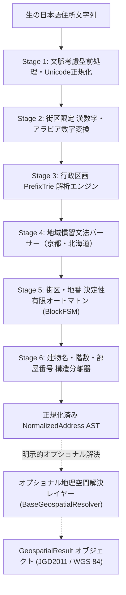

# JADEN — 日本の住所データエンジニアリング＆正規化エンジン

[](https://www.python.org/downloads/)
[](https://opensource.org/licenses/MIT)
[](https://peps.python.org/pep-0561/)
[](https://github.com/SushilRaj0177/JADEN/actions/workflows/ci.yml)

**JADEN (Japanese Address Data Engineering & Normalization Engine)** は、日本の住所表記における構造的多様性、歴史的表記揺れ、および法的体系の違いを決定論的に解決するPython製住所正規化エンジンおよびCLIツールです。

v0.2 からは、国土交通省の大字・町丁目レベル位置参照情報（全国 191,100 件）と日本郵便の郵便番号データを同梱し、町名・丁目まで完全オフラインで照合します。複数の場所に当てはまる住所は推測せず、「曖昧」として候補を返します。

[クイックスタート](#6-インストールおよび利用方法) • [v0.2 の新機能](#v02-の新機能) • [概要と課題](#1-概要と日本の住所が抱える技術的課題) • [アーキテクチャ](#3-アーキテクチャと処理パイプライン) • [実測ベンチマーク](#5-実測ベンチマーク結果) • [CLI](#コマンドラインインターフェース-cli) • [制限事項](#8-システムの境界と制限事項limitations)

*(English documentation is available at [README.md](README.md).)*

---

## v0.2 の新機能

v0.1 は全国 1,918 の市区町村を扱っていました。v0.2 はさらに、全国の**町名・丁目**、**郵便番号**、そしてそれらの公式な**読み仮名とローマ字表記**を扱います。データは公的オープンデータから JADEN 自身がダウンロード・検証（SHA256）・再構築します（`jaden data update`）。

| 入力 | v0.1 | v0.2 |
| :--- | :--- | :--- |
| `港区芝公園4-2-8`（港区は3都市に存在） | 曖昧 | **東京都港区**（芝公園があるのは東京都港区のみ） |
| `寺町通御池上る上本能寺前町488`（区の省略） | 団体コードなし | **中京区 (261041)**（町名から区を特定） |
| `東京都港区芝公園9-2-8` | 受理 | **MALFORMED**（芝公園は1〜4丁目のみ） |
| `〒100-0001 東京都港区芝公園4-2-8` | 受理 | **MALFORMED**（その郵便番号は千代田区） |
| `東京都千代田区霞ヶ関1-2-1` | 霞ヶ関 | **霞が関**（登録表記） |
| `東京都港区六本木6-10` | 6番10号 | **6丁目10番**（六本木は丁目に分かれている） |
| `岩手県盛岡市西見前20-113-1` | 20丁目113番1号 | **地番 20-113-1**（西見前に丁目はない） |
| `4-2-8 Shibakoen, Minato-ku, Tokyo` | 拒否 | **東京都港区芝公園4丁目2番8号**（ローマ字入力） |
| `高崎市立国府小学校`（学校名） | 受理 | **UNSUPPORTED**（住所ではない） |
| 出力 | 正規化文字列 | ＋読み仮名、英語表記、郵便番号、町字ID、オフライン座標 |

独立した正解データを持つ実在住所 4,700 件のベンチマーク **JA-AddrBench** の結果は [実測ベンチマーク](#5-実測ベンチマーク結果) をご覧ください。

---

## 1. 概要と日本の住所が抱える技術的課題

### JADENの役割と解決する課題
欧米型の「通り名＋番地」（例: `123 Main St, Suite 400`）とは異なり、日本の住所体系は歴史的・行政的に二重の法体系と独自の地域慣習を持っています。実世界の住所テキスト処理には以下の本質的困難が伴います:
- **二重の法定住所体系:** 都市部の住居表示（街区方式: 丁目・番・号）と、未実施区域の地番（地番区域: 大字・字・番地・枝番）。
- **地域固有の空間座標システム:** 京都市の通り名（東西・南北の交差点からの相対位置）および北海道の条丁目グリッド（北N条西M丁目）。
- **固有名詞中の漢数字衝突:** 「一番街」「麻布十番」「六本木」「八王子」など、地名自体に数字が含まれる場合の誤分割。
- **都道府県省略時の自治体名衝突:** 全国で37存在する同名市区町村・行政区（「府中市」「中央区」「伊達市」など）、および同一府県内の重複区・村（神奈川県「南区」「緑区」、大阪府「北区」「西区」、北海道「泊村」）の曖昧性。

JADENは、入力住所を決定論的に抽象構文木（`AddressComponents` AST）へと分解し、表記を標準化し、公的台帳に基づき厳密に検証するとともに、必要に応じてオプショナルな地理空間座標解決を提供します。

### JADENができること
- **決定論的正規化・標準化:** Unicode表記揺れ（NFKC、罫線・小ハイフンを含む11種類以上のダッシュ記号、文脈考慮型カタカナ長音符、改行・復帰コードの空白化、郵便番号プレフィックス「〒」の除去）を統一し、正規化文字列を生成。
- **構文AST分解:** 都道府県、郡、市区町村、大字・字、町名、丁目、街区符号（番）、住居番号（号）、地番（番地）、枝番、建物名、階数、部屋番号への完全分解。
- **法定台帳による適合検証:** **総務省公表の全1,918市区町村・行政区**（モジュラス11検査数字による適合検証済み）および**374法定郡**（367固有名称、7重複; JIS X 0401/0402）との適合照合。
- **地域慣習文法の完全サポート:** 方位文字（東・西・南・北）を含む京都通り名交差点構文および北海道の碁盤目座標を正確にパース。
- **不確実性の明示的報告:** 都道府県が省略された同名自治体を勝手に推測せず、`is_ambiguous=True` および候補一覧（地方公共団体コード付き）として透明に報告。
- **プロフェッショナルなCLI & Python API:** 人間可読テキスト、JSON出力、標準入力パイプ（`-`）、専用シェル終了コード（0, 1, 2, 3, 64, 70）に対応したCLI（`normalize`, `parse`, `validate`, `geocode`）。
- **オプショナルな地理空間座標解決:** 国土地理院（GSI）公式住所検索APIをバックエンドとした、認証不要・外部依存ゼロのJGD2011 / WGS 84世界測地系互換（EPSG:6668 / EPSG:4326）座標解決（`jaden geocode` / `jaden.geocode()`）。

### 完全オフラインのコア機能とオプショナルな座標解決
> [!IMPORTANT]
> **完全オフライン保証:** JADENのコア正規化・パース・検証エンジン（`normalize`, `parse`, `validate`）は**100%ローカル・決定論的・完全オフライン**で動作します。外部API通信、APIキー設定、重厚なGISライブラリのインストールは一切不要です。
> 
> 地理空間座標解決は、**完全に分離されたオプショナルレイヤー**です。通常のパース・正規化コマンドの実行時にネットワーク通信が発生することは一切ありません。座標解決は、明示的に `jaden geocode` または `jaden.geocode()` を呼び出した場合にのみ実行されます。

### 日本の住所が抱える技術的課題
欧米型の「通り名＋番地」とは異なり、正規化エンジンは以下の4層の複雑性を解決する必要があります:

| 法的体系 | 根拠法令および適用地域 | 階層構造 |
| :--- | :--- | :--- |
| **住居表示（街区方式）** | **住居表示に関する法律（昭和37年法律第119号）**<br>都市部（東京23区、政令市など） | 都道府県 $\to$ 市区町村 $\to$ 町名 $\to$ **街区符号（番）** $\to$ **住居番号（号）** |
| **地番区域（不動産登記法）** | **不動産登記法（平成16年法律第123号）**<br>地方部・未実施都市部 | 都道府県 $\to$ 市区町村 $\to$ 大字 $\to$ 字/小字 $\to$ **地番（番地）** $\to$ **支号（枝番）** |

1. **二重の法的枠組み:**
   * **住居表示に関する法律（昭和37年法律第119号）:** 都市部の「街区方式」（街区符号［番］＋住居番号［号］）。
   * **不動産登記法（平成16年法律第123号）および民法:** 未実施区域における「地番」（大字・字＋番地＋枝番）。
2. **地域固有の空間座標システム:**
   * **京都市の通り名（公称町名との二重性）:** 「寺町通御池上る」のように、東西・南北の交差点からの相対位置を示す通り名表記。京都市中心部の通り名には「東洞院通」「西洞院通」「下立売通」「上長者町通」のように東西南北や上下の方位文字を含む通りが多く存在し、単純な除外文字正規表現では破壊されます。
   * **北海道の碁盤目座標（条・丁目）:** 札幌市や旭川市などで用いられる東西南北のグリッド（例: 「北1条西2丁目」）。
3. **Unicodeハイフンの混沌と固有名詞の保護:**
   * 日本語入力環境では11種類以上のダッシュ・ハイフン異体字（`-`, `－`, `‐`, `―`, `ー`, `～`, `─`, `━`, `﹣`, `﹘` など）が無秩序に混在します。
   * カタカナ長音符（`ー` / `U+30FC`）は、数字間ではハイフン（`1ー2ー3` $\to$ `1-2-3`）として機能する一方、カタカナ外来語（`タワー`, `センター`）では文字列の破壊を防ぐため厳密に維持する必要があります。
   * 地名や商店街、施設名に数字・番が含まれる場合（`六本木`, `八王子`, `十条`, `四日市`, `三番町`, `一番街`, `麻布十番`, `八重洲`）、JADENの多段FSMは数字末尾の単一数字記法（`六本木1`, `十条1`, `一番町1`, `八重洲1`, `麻布十番1-1`）を含めて固有名詞を完全保護し、街区番号としての誤分解を防止します。また「第一-3ビル」のような序数付き建物名も改変から保護します。
4. **都道府県省略時の自治体名衝突:**
   * 日本全国で同一の市区町村・行政区名を持つ自治体は37存在し（例: `中央区` は東京特別区および政令指定都市10区の計11自治体、`府中市` は東京都と広島県、`伊達市` は北海道と福島県）、同一府県内でも5組の同名区・村が重複します（神奈川県 `南区`/`緑区`、大阪府 `北区`/`西区`、北海道 `泊村`）。都道府県が省略された入力に対し、根拠なく特定の自治体と即断することは許されず、不確実性を `is_ambiguous=True` および候補一覧として明示する必要があります。

---

## 2. 4階層の事実分類（Taxonomy of Truth）

JADENは、推測と確定事実を混同しないため、抽出されたすべての構成要素を以下の4階層に厳密に分類します。

| 階層 | 名称 | 定義と具体例 |
| :---: | :--- | :--- |
| **Tier 1** | 🏛️ **法定・公的基準（Statutory）** | 公式な公的台帳に基づき厳密に検証された構成要素: JIS X 0401（都道府県コード）、JIS X 0402（市区町村コード）、総務省 全国地方公共団体コード（モジュラス11検査数字）、および内包マッピングに基づく郡（郡の所属関係、由来は本リポジトリからは再現不可）。 |
| **Tier 2** | 📍 **公認地域慣習・構文ブロック（Documented Convention）** | 地域固有の慣習体系および決定論的FSMに基づく構文的街区番号: 京都市の通り名（上る・下る・東入・西入）、北海道の条丁目グリッド（北N条西M丁目）、および構文的ブロック番号（丁目、番、号、番地、枝番）。 |
| **Tier 3** | 🔍 **ヒューリスティック推定（Heuristic Disambiguation）** | 言語的抽出および文脈的推定要素: 町字（町名）、大字、字・小字、省略された都道府県・区の推定、建物名・階数・部屋番号の分離。 |
| **Tier 4** | ⚙️ **システム定義（System Artifact）** | JADEN独自の処理成果物: 正規化出力フォーマット、確信度スコア（0.0〜1.0）、シリアライズJSONスキーマ、未解析文字列。 |

---

## 3. アーキテクチャと処理パイプライン



> [!NOTE]
> **コアアーキテクチャ原則:** JADENのコア正規化エンジン（`normalize`, `parse`, `validate`）は100%ローカル・決定論的・完全オフラインです。ネットワーク通信の実行、APIキー設定、GIS重厚依存を一切行いません。地理空間座標解決は、`jaden.geocode()` または CLI `jaden geocode` を明示的に呼び出した場合にのみ動作する完全に分離された任意レイヤーです。

---

## 4. 準拠規格およびデータ出典

JADENが参照する行政区画マスターデータは、公的機関が公表している規格およびデータセットに基づいています:

1. **都道府県コード (JIS X 0401:1973 / 2014年改正):**
   * 47都道府県（`01` 北海道 〜 `47` 沖縄県）。
   * *由来に関する留意事項:* `src/jaden/data/jis_prefectures.json` はリポジトリ内に生成元ファイルを含んでおらず、その由来は本リポジトリからは再現できません。
2. **全国地方公共団体コード (JIS X 0402:2020 & 総務省仕様):**
   * **提供元機関:** 総務省自治行政局
   * **典拠ファイル:** 都道府県コード及び市区町村コード（令和6年1月1日更新）
   * **公式URL:** `https://www.soumu.go.jp/main_content/000925835.xlsx`
   * **SHA256ハッシュ:** `7d04c8a7f6a6e76a7823a0414a8422bf2b26bb6070766971df76eab58ea6ff78`
   * **収録団体数:** **1,918件**（令和6年1月1日 浜松市の行政区再編を反映）
     - 47都道府県
     - 1,747市区町村: 特別区23、政令指定都市20、一般市772、町743、村189（北方領土6村を含む）
     - 171行政区（政令指定都市内の区）
   * **検査数字検証:** 収録されたすべてのコードが総務省公式モジュラス11アルゴリズムに100%適合。
     $$\text{Sum} = \sum_{i=1}^{5} d_i \times w_i, \quad W = [6, 5, 4, 3, 2]$$
     $$R = \text{Sum} \pmod{11}$$
     $$\text{Check Digit} = \begin{cases} (11 - R) \pmod{10} & \text{if } R \le 1 \\ 11 - R & \text{if } R \ge 2 \end{cases}$$
   * **再現性:** 内包する `src/jaden/data/municipalities.json` は、同梱の `src/jaden/data/soumu_000925835.xlsx` から `src/jaden/data/build_municipalities.py` により直接再生成・検証可能です（`src/jaden/data/provenance.json` にSHA256ハッシュを記録）。
3. **郡（郡名）の紐付け:**
   * **収録対象:** 全932町村（町743、村189）:
     - 374の法定郡（367固有名称、7重複）を923の郡所属町村に紐付け。
     - 郡に属さない東京都島嶼部9町村（`大島町`, `利島村`, `新島村`, `神津島村`, `三宅村`, `御蔵島村`, `八丈町`, `青ヶ島村`, `小笠原村`）をnullとして明示管理。
     - 北方領土6村を法定郡に紐付け（`色丹郡色丹村`, `国後郡泊村`, `国後郡留夜別村`, `択捉郡留別村`, `紗那郡紗那村`, `蘂取郡蘂取村`）。
   * *由来に関する留意事項:* `src/jaden/data/county_mapping.json` はリポジトリ内に生成元ファイルを含んでおらず、その由来は本リポジトリからは再現できません。
4. **住所関連法令:**
   * *住居表示に関する法律（昭和37年法律第119号）*: 街区方式（丁目・番・号）。
   * *不動産登記法（平成16年法律第123号）*: 地番区域（大字・字・番地・枝番）。
5. **デジタル庁 アドレス・ベース・レジストリ:**
   * JADENは町字・街区・地番の概念モデルに準拠しています。なお、数ギガバイトに及ぶ空間ポリゴン境界データは軽量オフラインエンジンとしての設計思想に基づき内包していません。
6. **オープンデータ帰属表示および利用条件に関する留意事項:**
   * **総務省 市区町村データ:** 総務省自治行政局「都道府県コード及び市区町村コード」。利用条件については総務省の公式ウェブサイト上の利用規約をご確認ください。
     帰属表示: *本製品の全国地方公共団体マスターデータは、総務省「都道府県コード及び市区町村コード」を加工・構造化して作成したものです。*
   * **国土地理院 地理空間データ:** 国土地理院「住所検索API」。利用条件については国土地理院の公式ウェブサイト上の利用規約をご確認ください。
     帰属表示: *出典：国土地理院 (地名検索API)。座標系は世界測地系 JGD2011 (WGS 84 準拠互換, EPSG:6668 / EPSG:4326) に準拠します。*
   * 正式な帰属表示および留意事項の詳細は [NOTICE](NOTICE) をご覧ください。

---

## 5. 実測ベンチマーク結果

### 精度: JA-AddrBench（v0.2）

`benchmarks/jabench` は、**独立した正解を持つ実在住所**からベンチマークを構築します。国土数値情報 学校データ（2023年、CC BY 4.0）から各都道府県100校、計4,700件を抽出し、公表された住所・学校の市区町村コード・測量座標を用います。正解も座標も JADEN が使うデータとは別の出典です。

| 入力（変種） | 例 | 件数 | JADEN v0.2 | 辞書なし（v0.1相当） |
| :--- | :--- | ---: | ---: | ---: |
| 公表住所 | 青森県弘前市末広3-2-1 | 4,700 | 100.0%（誤答0） | 100.0%（誤答0） |
| 都道府県なし | 弘前市末広3-2-1 | 4,700 | 99.98%（誤答0） | 99.7%（誤答0） |
| 表記ゆれ | 青森県弘前市 末広三丁目2番1号 | 4,700 | 100.0%（誤答0） | 100.0%（誤答0） |
| ローマ字 | 3-2-1 Suehiro, Hirosaki-shi, Aomori | 3,657 | 100.0%（誤答0） | 0.0% |
| 市区町村なし | 末広3-2-1 | 4,700 | 50.4%（誤答1） | 0.1%（誤答100） |

| 拒否すべき入力（誤って受理した件数） | JADEN v0.2 | 辞書なし（v0.1相当） |
| :--- | ---: | ---: |
| 都道府県の誤り（滋賀県弘前市末広3-2-1） | 0 / 4,700 | 0 / 4,700 |
| 99丁目（青森県弘前市末広99-2-1） | 74 / 1,026 | 1,026 / 1,026 |
| 学校名（弘前市立東中学校） | 2 / 4,700 | 2,723 / 4,700 |

* 市区町村なしの入力で回答を保留した場合、2,328件中2,125件で候補一覧を返し、正しい市区町村が含まれる割合は **98.6%**（候補数の中央値8）。
* 99丁目を受理した74件は、すべて国土交通省のデータで一部のみ丁目に分かれている町で、地番としての読みが成り立つものです。
* **オフライン座標**（学校の測量座標との距離、正しく特定できた住所）: 同梱の丁目・町代表点で中央値 **360 m**（1 km以内79%）、街区データ導入時は中央値 **71 m**（1 km以内89%）。

再現方法: `python benchmarks/jabench/build_benchmark.py` → `python benchmarks/jabench/evaluate.py`

### 速度（v0.1 パーサー）

`benchmarks/run_benchmark.py` を用いた再現可能なベンチマーク結果です。同一文字列のキャッシュループを排除し、**500件の固有かつ代表的な住所コーパス**を用いて測定しています。計測ループ中はプロファイラ（`tracemalloc`）を停止し、計測オーバーヘッドを排除しています。

> [!NOTE]
> **ベンチマークの範囲:** 評価コーパスは合成データであり、本ベンチマークは処理速度、レイテンシ、およびメモリ割り当てを測定するものです。正解データに対するパース精度の測定ではありません。

### 測定環境

| 項目 | 測定環境スペック |
| :--- | :--- |
| **OS** | Windows 11 (10.0.26200) |
| **CPU** | Intel64 Family 6 Model 151 (12論理コア) |
| **Python実行環境** | CPython 3.13.14 (64-bit) |
| **基準メモリ使用量** | 4.28 MB（全1,918団体Trieおよび郡マッピング展開後） |
| **バッチ処理ピークメモリ** | 4.48 MB（バッチ処理中ピークヒープ） |
| **評価コーパス規模** | 500件の固有住所 $\times$ 10パス = 計5,000回評価 |

### 実測スループットおよびレイテンシ

| 評価コーパス分類 | 固有件数 | 総処理回数 | スループット (addr/sec) | レイテンシ P50 | レイテンシ P90 | レイテンシ P99 | 平均レイテンシ |
| :--- | :--- | :--- | :--- | :--- | :--- | :--- | :--- |
| **標準街区方式 (Gaiku-hoshiki)** | 200 | 2,000 | **35,023.9** | 27.20 μs | 31.20 μs | 44.50 μs | 28.35 μs |
| **地域慣習・地番 (Kyoto/Hokkaido/Cadastral)** | 150 | 1,500 | **31,500.5** | 31.30 μs | 33.50 μs | 41.00 μs | 31.52 μs |
| **実環境ダーティ入力 (Omitted/Dashes/Buildings)** | 150 | 1,500 | **25,356.2** | 38.40 μs | 43.10 μs | 50.00 μs | 39.19 μs |
| **総合ワークロード** | **500** | **5,000** | **30,510.3** | **31.30 μs** | **38.40 μs** | **47.00 μs** | **32.55 μs** |

---

## 6. インストールと利用方法

### インストール

```bash
# リポジトリのクローン
git clone https://github.com/SushilRaj0177/JADEN.git
cd JADEN

# 本番パッケージのインストール（外部依存パッケージなし）
pip install .

# 開発・テスト用ツールの同時インストール
pip install ".[dev]"

# インストール検証
jaden normalize "東京都港区六本木1-2-3"
```

### Python API

```python
import jaden

# 1. 都市部住居表示（正規化・代表要素の抽出）
res1 = jaden.normalize("東京都港区六本木6-10-1六本木ヒルズ森タワー50F")
print(res1.canonical)
# 出力: 東京都港区六本木6丁目10番1号 六本木ヒルズ森タワー 50F
print(res1.components.lg_code)        # '131032' (港区)
print(res1.components.address_regime) # 'gaiku_hoshiki'

# 2. 構文要素のAST分解（parse）
components = jaden.parse("京都府中京区御池通東洞院東入笹屋町436")
print(components.city)                      # '京都市'
print(components.ward)                      # '中京区'
print(components.kyoto_direction.street_1) # '御池通'
print(components.banchi)                    # 436

# 3. 検証（validate）: 町名で府中市を特定。町名がなければ曖昧のまま
val = jaden.validate("府中市宮西町2-24")
print(val.status)                # 'ACCEPTED'
print(val.lg_code)               # '132063'（東京都府中市。広島県府中市に宮西町はない）
val = jaden.validate("府中市1-1")
print(val.status)                # 'AMBIGUOUS'
print(val.ambiguous_candidates)  # ('東京都府中市 (132063)', '広島県府中市 (342084)')

# 読み仮名・英語表記・郵便番号・オフライン座標（v0.2）
res = jaden.normalize("東京都港区芝公園4-2-8")
print(res.kana)                    # 'トウキョウトミナトクシバコウエン'
print(res.romaji)                  # '4-2-8 Shibakoen, Minato-ku, Tokyo 105-0011'
print(res.components.postal_code)  # '105-0011'
print(res.latitude, res.longitude, res.location_level)  # 35.656459 139.74764 chome

# ローマ字入力（v0.2）
print(jaden.normalize("4-6-16 Ginza, Chuo-ku, Tokyo").canonical)  # '東京都中央区銀座4丁目6番16号'

# 4. 郡名解決および都道府県補完
res4 = jaden.normalize("中郡大磯町国府本郷547")
print(res4.canonical)         # '神奈川県中郡大磯町国府本郷547番'
print(res4.components.county) # '中郡'
print(res4.components.city)   # '大磯町'
print(res4.components.lg_code)# '143413'

# 5. オプショナル地理空間座標解決（国土地理院API / JGD2011・WGS 84互換）
geo = jaden.geocode("東京都港区六本木6-10-1")
print(geo.status)                 # 'SUCCESS'
print(geo.coordinates.latitude)  # 35.660206
print(geo.coordinates.longitude) # 139.729202
print(geo.matched_address)       # '東京都港区六本木六丁目１０番'
```

### コマンドラインインターフェース (CLI)

JADENは、4つの高速CLIサブコマンド（`normalize`, `parse`, `validate`, `geocode`）を提供します。

#### 1. `normalize`: 正規化表記の生成
```bash
# ターミナル向け可読サマリー出力
$ jaden normalize "東京都港区六本木1-2-3"
Prefecture: 東京都
City:       港区
Town:       六本木
Chome:      1
Ban:        2
Go:         3
Regime:     gaiku_hoshiki
LG Code:    131032
Confidence: 1.00
Canonical:  東京都港区六本木1丁目2番3号

# 機械可読JSON形式出力
$ jaden normalize "東京都港区六本木1-2-3" --json

# 正規化文字列のみの出力（シェルスクリプト変数代入用）
$ jaden normalize "新宿区西新宿2-8-1東京都庁 第一本庁舎" -c
東京都新宿区西新宿2丁目8番1号 東京都庁 第一本庁舎
```

#### 2. `parse`: 階層的構文AST分解
```bash
# 構文木・階層別分解のターミナル表示
$ jaden parse "京都府中京区御池通東洞院東入笹屋町436"

# 構文AST JSON形式出力
$ jaden parse "京都府中京区御池通東洞院東入笹屋町436" --json
```

#### 3. `validate`: 法定台帳照合・構造整合性検証
```bash
# 有効住所の検証（終了コード 0）
$ jaden validate "東京都港区六本木1-2-3"
Input:       東京都港区六本木1-2-3
Status:      ACCEPTED
Valid:       Yes
Confidence:  1.00
LG Code:     131032
Regime:      gaiku_hoshiki
Message:     Local government entity verified against official statutory registry.

# 都道府県省略による衝突・曖昧性の検出（終了コード 2）
$ jaden validate "府中市1-1"
Input:       府中市1-1
Status:      AMBIGUOUS
Valid:       No
Confidence:  0.50
Regime:      unspecified
Message:     Omitted prefecture matches 2 statutory municipalities.
Candidates:  2
  • 東京都府中市 (132063)
  • 広島県府中市 (342084)

# 存在しない丁目（終了コード 1）
$ jaden validate "東京都港区芝公園9-2-8"
Input:       東京都港区芝公園9-2-8
Status:      MALFORMED
Valid:       No
Confidence:  1.00
LG Code:     131032
Regime:      gaiku_hoshiki
Message:     Nonexistent 丁目: 芝公園 has only 1–4丁目; 9丁目 does not exist

# 外部外国住所・不正文字列の拒絶（終了コード 1）
$ jaden validate "123 Main St, New York"

# 機械可読JSON形式出力
$ jaden validate "東京都港区六本木1-2-3" --json
```

#### 4. `geocode`: 任意地理空間座標解決（JGD2011 / WGS 84互換）
```bash
# ターミナル向け座標サマリー表示（成功時 終了コード 0）
$ jaden geocode "東京都港区六本木6-10-1"
Input:       東京都港区六本木6-10-1
Status:      SUCCESS
Provider:    gsi
Coordinates: 35.660206, 139.729202 (Lat, Lon)
Matched:     東京都港区六本木六丁目１０番
Candidates:
  • 東京都港区六本木六丁目１０番

# WGS 84 緯度・経度を含む機械可読JSON形式出力
$ jaden geocode "東京都港区六本木6-10-1" --json

# 複数候補が存在する曖昧住所の検出（非解決時 終了コード 1）
$ jaden geocode "府中市"
```

#### シェル自動化向け終了コード仕様
| 終了コード | 判定種別 | 状態説明 |
| :---: | :--- | :--- |
| `0` | **ACCEPTED / SUCCESS** | 法定行政コード検証完了（`validate`）、または座標解決成功（`geocode`） |
| `1` | **MALFORMED / REJECTED** | 構造的に不正な文字列、外国住所、確信度0.0、または座標解決失敗 |
| `2` | **AMBIGUOUS** / 曖昧 | 都道府県省略により複数自治体に衝突（`validate` 専用） |
| `3` | **UNSUPPORTED** / 未対応 | 未解析トークン残存、または構文的未対応（`validate` 専用） |
| `64` | **CLI_USAGE_ERROR** | 必須引数の不足、無効なCLIオプション、または空の標準入力 |
| `70` | **INTERNAL_ERROR** | 未処理の内部ソフトウェア例外 |

#### 標準入力パイプ処理
```bash
# '-' を指定して標準入力から直接パイプ処理
echo "東京都港区六本木1-2-3" | jaden normalize - -c
```

---

## 7. テストと品質保証

全223件のテストスイート（222件のオフラインテスト合格、1件のオプトイン・ネットワークテスト）を完備しています。GitHub Actions CIにより、全コミットおよびプルリクエストにおいてUbuntuおよびWindows上のPython 3.10〜3.13で全件自動実行・検証されます:

* **全47都道府県の網羅的検証:** 都道府県、郡、市区町村、町名、大字・字、地域慣習、および街区・番地号（`chome`, `ban`, `go`, `banchi`, `edaban`）の完全分解検証に加え、複数都道県にまたがる郡（神奈川、東京、北海道、埼玉、長野、沖縄、滋賀）の専用検証。
* **対抗的検証（Adversarial Suite）および回帰検証:** 固有名詞衝突（`一番街`, `麻布十番`, `三番町`, `六本木1`, `十条1`, `一番町1`, `八重洲1`）、建物名（`第一-3ビル`）、自治体名衝突（`中央区`, `府中市`, `伊達市`, `泊村`）、方位含有京都通り（`東洞院通`, `下立売通`）、無効入力の確信度0.0拒絶。
* **CLI・公開API網羅検証:** サブコマンド（`normalize`, `parse`, `validate`, `geocode`）、`--json`出力、`-c`正規化文字列出力、標準入力パイプ（`-`）、シェル終了コード（0, 1, 2, 3, 64, 70）の完全検証。
* **地理空間レイヤー網羅検証:** `GSIGeocoder` 単体テスト、`BaseGeospatialResolver` プラガブル拡張性、HTTPエラー処理、通信断線、タイムアウト耐性、複数候補曖昧性・不正住所のネットワーク短絡（ゼロ通信）、コアパーサー完全オフライン独立性、建物名・部屋番号の事前除去、CLI `geocode` 出力の完全検証。
* **パッケージング・配布アセット・メタデータ整合性検証:** スタンドアロン配布データ読み込み、実行可能エントリポイント、公開シンボルエクスポートの検証。
* **モジュラス11アルゴリズム完全適合検証。**

```bash
pytest -v
```

---

## 8. システムの境界と制限事項（Limitations）

設計の透明性を担保するため、JADENの技術的限界を明記します。
1. **オフライン前提:** コアエンジン、町名辞書、オフライン座標はすべてローカルで動作します。境界ポリゴンは同梱しておらず、座標は国土交通省の代表点（街区・丁目・町）であり、建物単位の座標ではありません。街区レベルの代表点は都道府県ごとに別途ダウンロードします（`jaden data fetch-blocks`、1都道府県あたり約0.7〜11 MB、全国で約75 MB）。
2. **曖昧さは推測せずに報告:** 町名・丁目・郵便番号を使っても複数の市区町村に当てはまる場合（`府中市1-1`、`栄町7-7`、`本町1-8-19`）は、候補一覧付きで AMBIGUOUS を返します。JA-AddrBench では、市区町村を省いた住所の約半数を特定し、残りでは正しい市区町村が98.6%の割合で候補に含まれます。
3. **町名辞書は完全ではない:** 実在の学校住所の約1.6%は、国土交通省の一覧にない町名を使っています。その多くは日本郵便の一覧で補完します（町レベルの照合、座標なし）。未登録の町名は警告扱いで、`--strict` 指定時のみエラーとなります。登録名の一部を省いた町名（奄美市`名瀬小俣町`を`小俣町`と書く等）は、市区町村も省かれると別の場所に一致することがあります。
4. **丁目の検査は登録データに従う:** 一覧にない丁目は MALFORMED です。一部だけが丁目に分かれている町では、範囲外の最初の数字を地番として読みます（例: `御望971-1-2`）。そのため、そうした町での打ち間違いは検出できません。
5. **データの時点:** 市区町村は総務省（2024年1月1日）、町名は国土交通省（2025年版）、郵便番号は日本郵便（取得時点、`jaden data info` で確認可能）。それ以降の合併や住居表示の変更は `jaden data update` まで反映されません。
6. **ローマ字入力:** 市区町村（`-shi`、`-ku`、`City` 等）または識別可能な町名が必要です。ローマ字の建物名はそのまま残します。
7. **京都:** 同じ区の中に同名の町が複数ある場合、通り名でしか区別できません。町名は照合しますが、座標は1点に絞りません。
8. **民間建物名の構文的推定:** 民間商業ビルの公的全国台帳は存在しないため、建物名および部屋番号は構文規則（Tier 3）による推定です。
9. **メモリ:** 町名辞書を使うとメモリ使用量は約90 MB、最初の1件はデータ読み込みに約0.4秒かかります（辞書を使わないモードでは数MB）。
10. **国土地理院住所検索APIの利用条件:** オンライン座標解決は国土地理院の公開APIを利用します。利用規約を確認し、適切なリクエスト間隔を設けてください。

### v0.2 で解決した v0.1 の制限事項
「1の2の3」表記、不正な漢数字（「五三十」）、非標準の「上ラル」、帯広方式のグリッド（町名辞書で照合）、CLI の `--provider` / `--json -c` / `jaden -`、CI でのインストール済みパッケージ検証、CI での静的解析（`ruff`、`mypy`）。

---

## ライセンス

MIT License. Designed and maintained by Sushil Raj.
