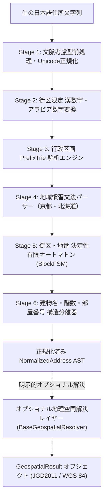

# JADEN — 日本の住所データエンジニアリング＆正規化エンジン

[](https://www.python.org/downloads/)
[](https://opensource.org/licenses/MIT)
[](https://peps.python.org/pep-0561/)
[](https://github.com/SushilRaj0177/JADEN/actions/workflows/ci.yml)

**JADEN (Japanese Address Data Engineering & Normalization Engine)** は、日本の住所表記における構造的多様性、歴史的表記揺れ、および法的体系の違いを決定論的に解決するPython製住所正規化エンジンおよびCLIツールです。

v0.2 からは、国土交通省の大字・町丁目レベル位置参照情報（全国 191,100 件）と日本郵便の郵便番号データ（住所の郵便番号。大口事業所個別番号は含みません）を同梱し、町名・丁目まで完全オフラインで照合します。複数の場所に当てはまる住所は推測せず、「曖昧」として候補を返します。

v0.3 では、その照合エンジンの上に実務で必要な道具を加えました。名寄せ（同一住所の判定）、打ち間違いの訂正候補、ひらがな入力、郵便番号検索、入力補完、座標からの逆引き、文章中の住所抽出、そして HTTP API とデモページです。すべて標準ライブラリのみで動作します。

[クイックスタート](#6-インストールと利用方法) • [v0.3 の新機能](#v03-の新機能) • [v0.2 の新機能](#v02-の新機能) • [概要と課題](#1-概要と日本の住所が抱える技術的課題) • [アーキテクチャ](#3-アーキテクチャと処理パイプライン) • [実測ベンチマーク](#5-実測ベンチマーク結果) • [CLI](#コマンドラインインターフェース-cli) • [制限事項](#8-システムの境界と制限事項limitations)

*(English documentation is available at [README.md](README.md).)*

---

## v0.4 の新機能（開発中）: わからないときに、わからないと言える

市区町村が書かれていない住所では、残った町名が多くの場所にあります（錦町は 93 の市区町村に登録）。v0.4 では **`jaden.resolve()`** を追加しました。候補の市区町村ごとに **較正された確率** を示し、**誤答率 1%** に合わせた閾値を超えたときだけ答え、正解を **95%** の確率で含む候補集合を返します。モデルは登記された 500 万社の住所で学習し、介護事業所の住所で較正しています。事業所名などを追加の手がかりとして渡せます。

```python
r = jaden.resolve("錦町1番2号")
r.answered, [(c.name, round(c.probability, 3)) for c in r.candidates[:3]]
# (False, [('東京都立川市', 0.231), ('埼玉県蕨市', 0.067), ('福島県いわき市', 0.054)])
jaden.resolve("芝公園4-2-8").name      # '東京都港区' (p > 0.99)
```

**事前登録したプロトコルで、一度も使っていないデータに対して一回だけ評価**しました（[`benchmarks/heldout/PROTOCOL.md`](benchmarks/heldout/PROTOCOL.md)）。国土数値情報 福祉施設データ（2023 年）の全施設 321,859 件の住所を、公表どおり市区町村なしで使っています。

| 町名からの入力（318,578 件） | 正解 | 誤答数 | 回答中の誤答率 |
| :--- | ---: | ---: | ---: |
| JADEN ルール | 52.2% | 639 | 0.38% |
| JADEN 較正済み | 59.8% | 2,115 | 1.10% |
| JADEN 較正済み + 施設名 | **61.2%** | 2,255 | 1.14% |
| jageocoder | 76.5% | 66,164 | 21.4% |
| Geolonia | 0.03% | 6,256 | 98.4% |
| JADEN 較正済み + 施設名、残りは言語モデルの提案を JADEN が検証（1,000 件の標本から推計） | **71.8%** | 約 3,200 | **1.4%** |

- **較正は新しいデータでも保たれました**（期待較正誤差 0.015、施設名ありで 0.007）。住所が完全な場合は **318,578 件中誤答 0**。
- **二つの保証はわずかに届きませんでした**（発行元が異なるデータでは起こりうるとプロトコルに記載）: 目標 1% に対して誤答率 1.10%、95% の候補集合の被覆率は 93.7%。
- **言語モデル:** JADEN の候補から選ばせると回答の 31.6% が誤り。Claude Sonnet 単独では最も難しい残りの 85% に答え、その 47% が誤りでした。JADEN の検証済み候補に含まれ、モデルの確信度が 80 以上の提案だけを残すと、**399 件の誤答のうち 391 件が除かれ**、303 件の回答で誤答は 8 件でした。単独のモデルは、もう存在しない市区町村（2005 年に合併した茶屋町、2024 年に廃止された浜松市中区）も答えていました。
- テストの誤り分析で、ルールの誤答 639 件中 486 件の原因となる **二つの欠陥** が見つかり、テスト後に修正しました（上の数値は修正前のエンジンのもの）。

**二つ目の事前登録テスト**（[`benchmarks/heldout2/PROTOCOL.md`](benchmarks/heldout2/PROTOCOL.md)）は、ルールに 10 回の修正を加えた後に、厚生労働省「医療情報ネット」オープンデータ（2026 年 6 月）の医療機関 206,041 件で行いました。住所は各施設が自ら入力したもので、88% は開発に使ったどの住所とも一致しません。

| 入力（206,041 件） | JADEN ルール: 正解 / 誤答 | 修正前 | jageocoder | Geolonia |
| :--- | :--- | :--- | :--- | :--- |
| 完全な住所 | 99.95% / **0** | 99.95% / 0 | 99.97% / 0 | 99.99% / 0 |
| 都道府県なし | 99.87% / **0** | 99.88% / 0 | 99.97% / 2 | 99.97% / 50 |
| 町名のみ（205,830 件） | 48.8% / **279**（回答の 0.28%） | 48.9% / 774 | 75.8% / 45,343 | 0.06% / 4,385 |

較正済みリゾルバは今回は目標 1% を満たし（回答中の誤答 0.72%）、95% の候補集合の被覆率は再び 93.8% でした。修正で町名のみの誤答は 64% 減り、修正が壊したものも一つ見つかりました: 番地のない「町名＋建物名＋階」の住所 28 件が拒否されるようになりました。レポートと実行記録: [`benchmarks/heldout2/results/`](benchmarks/heldout2/results/)。

論文: [`paper/arxiv/jaden.pdf`](paper/arxiv/jaden.pdf)（LaTeX ソースも同じ場所。以前の草稿は [`paper/jaden-v0.3.md`](paper/jaden-v0.3.md)）。すべての表と図: [`benchmarks/heldout/results/`](benchmarks/heldout/results/)、[`benchmarks/heldout2/results/`](benchmarks/heldout2/results/)。

## v0.3 の新機能

v0.2 は 1 件の住所を照合できるようになりました。v0.3 は、その上にシステムが必要とする機能を載せます。「この 2 件は同じ場所か」「利用者は何と書きたかったのか」「この郵便番号・座標には何があるか」「この文章のどこに住所があるか」に、Python・コマンドライン・HTTP のいずれからでも答えます。

| 用途 | v0.3 | 例 |
| :--- | :--- | :--- |
| 顧客データの名寄せ | `jaden.match_key`, `jaden.compare`, `jaden dedupe` | `港区芝公園４丁目２番８号 ３０２号室` と `東京都港区芝公園4-2-8-302` は同じキー `131032\|芝公園\|4\|2\|8\|302` |
| 打ち間違いの安全な訂正 | `suggestions`, `--fix` / `autocorrect=True` | `東京都港区芝公演4-2-8` → 芝公園を提案。1 文字違いの町が 1 つだけのときに限り適用 |
| ひらがな・カタカナ入力 | 自動 | `港区しばこうえん4丁目2番8号` → 東京都港区芝公園4丁目2番8号 |
| 郵便番号からの自動入力 | `jaden.lookup_postal`, `jaden postal` | `105-0011` → 東京都港区芝公園、読み、ローマ字 |
| 入力補完 | `jaden.suggest`, `jaden suggest` | `東京都港区しば` → 芝、芝浦、芝公園、芝大門 |
| 座標 → 住所 | `jaden.reverse_geocode`, `jaden reverse` | `35.0116, 135.7681` → 京都市中京区上本能寺前町（17 m） |
| メール・メモから住所を抽出 | `jaden.extract_addresses`, `jaden extract` | 文字位置つき、1 件ずつ照合済み |
| 短い形式で保存 | `res.format("hyphen")`, `res.lines()`, `res.precision` | 東京都港区芝公園4-2-8（再正規化しても同じ結果） |
| 送り状の印字・桁数制限のある入力欄 | `res.label(width=20, max_lines=3)`、`jaden normalize ... --label 20x3`、`/v1/label` | 都道府県・市区町村・町名・建物・部屋の区切りで改行し、数字の途中では切らない。文字数または Shift_JIS のバイト数で数え、全角数字にも対応。収まらない部分を返す |
| 他の言語から利用 | `jaden serve` | `/v1` 以下の JSON API とデモページ（標準ライブラリのみ） |
| 項目別の入力フォームを確認 | `jaden.check_fields(postal_code=, prefecture=, city=, line1=, line2=)` | 各項目を相互に照合。郵便番号や市区町村の誤りを正しい値とともに報告し、訂正済みの項目を返す |
| AI アシスタントから利用 | `jaden mcp` | MCP ツール: 正規化・検証・候補推定・項目別確認・抽出・郵便番号・比較・補完 |

実在住所 4,700 件での測定結果（`benchmarks/jabench/evaluate_toolkit.py`、詳細は [実測ベンチマーク](#5-実測ベンチマーク結果)）: 表記ゆれ 33,976 件すべてが元の住所と同じ名寄せキーになり、町名の 1 文字誤りは 93.9% で正しい候補を提示、自動訂正の**誤訂正は 2,640 件中 0 件**。文章に埋め込んだ住所 23,409 件の 99.9% で範囲が完全に一致し、地名に触れるだけで住所を含まない文章 4,700 件での**誤検出は 0 件**でした。

**実データでの検証。** 国税庁 法人番号公表サイトの全法人の登記住所（5,049,462 件）と、厚生労働省 介護サービス情報公表システムの全介護事業所の手入力住所（223,161 件）で JADEN を実行しました。正しい市区町村を答えた割合は法人 **99.98%**、介護事業所 **99.87%** です。誤った市区町村を答えたのは法人 6 件（いずれも行の市区町村の列そのものが誤り）と介護事業所 4 件で、見つかった失敗パターンは、[実データ](#実データ-全国の法人と介護事業所の住所v03) に残る課題として挙げたものを除き、修正してテストに加えています。

---

## v0.2 の新機能

v0.1 は全国 1,918 の市区町村を扱っていました。v0.2 はさらに、全国の**町名・丁目**、**郵便番号**、そして日本郵便が公開している公式な**読み仮名とローマ字表記**を扱います（約 5% の町には公開された読みがなく、その場合は英語表記の中に町名を日本語のまま書き、読み仮名は返しません）。データは公的オープンデータから JADEN 自身がダウンロード・検証（SHA256）・再構築します（`jaden data update`）。

| 入力 | v0.1 | v0.2 |
| :--- | :--- | :--- |
| `港区芝公園4-2-8`（港区は3都市に存在） | 曖昧 | **東京都港区**（芝公園があるのは東京都港区のみ） |
| `寺町通御池上る上本能寺前町488`（区の省略） | 団体コードなし | **中京区 (261041)**（町名から区を特定） |
| `東京都港区芝公園9-2-8` | 受理 | **MALFORMED**（芝公園は1〜4丁目のみ） |
| `〒100-0001 東京都港区芝公園4-2-8` | 受理 | **MALFORMED**（その郵便番号は千代田区） |
| `東京都千代田区霞ヶ関1-2-1` | 霞ヶ関 | **霞が関**（登録表記） |
| `東京都港区六本木6-10` | 6番10号 | **6丁目10番**（六本木は丁目に分かれている） |
| `岩手県盛岡市西見前20-113-1` | 20丁目113番1号 | **地番 20-113-1**（西見前に丁目はない） |
| `4-2-8 Shibakoen, Minato-ku, Tokyo` | 拒否 | **東京都港区芝公園4丁目2番8号**（ローマ字入力） |
| `とうきょうとちよだくかすみがせき1-2-1` | 拒否 | **東京都千代田区霞が関1丁目2番1号**（すべて仮名で入力） |
| `高崎市立国府小学校`（学校名） | 受理 | **UNSUPPORTED**（住所ではない） |
| `埼玉県浦和市高砂3-15-1`（2001年に合併した浦和市） | 拒否 | **さいたま市浦和区高砂3丁目15番1号**（旧市町村名を町名で解決） |
| `浜松市北区細江町気賀305`（2024年に廃止された区） | 浜松市として受理 | **浜松市浜名区**（分割された北区を町名で判定） |
| `東京都港区芝公園4-2-8-101` | 建物名「-101」 | **部屋番号 101** |
| `北海道網走市潮見188 703号室` | 地番188703 | **地番188、部屋703号室** |
| `札幌市中央区南3西4` | 認識不可 | **南3条西4丁目**（札幌の略記） |
| `住所：日本、東京都港区芝公園4-2-8` | 拒否 | ラベルと国名を除去 |
| 出力 | 正規化文字列 | ＋読み仮名、英語表記、郵便番号、町字ID、オフライン座標 |

独立した正解データを持つ実在住所 4,700 件のベンチマーク **JA-AddrBench** の結果は [実測ベンチマーク](#5-実測ベンチマーク結果) をご覧ください。廃止前の浜松市の区名のままの実在住所 411 件はすべて正しい区に解決し、実在住所に部屋番号・建物名・階・ラベル・空白・全角文字を加えた 34,032 件では、住所の結果が変わらず建物名・階・部屋番号も全件正しく分離されます。

ファイル単位の処理は `jaden batch customers.csv -o checked.csv` で行えます（UTF-8 / Shift_JIS を自動判定し、結果を列として追加）。

---

## 1. 概要と日本の住所が抱える技術的課題

### JADENの役割と解決する課題
欧米型の「通り名＋番地」（例: `123 Main St, Suite 400`）とは異なり、日本の住所体系は歴史的・行政的に二重の法体系と独自の地域慣習を持っています。実世界の住所テキスト処理には以下の本質的困難が伴います:
- **二重の法定住所体系:** 都市部の住居表示（街区方式: 丁目・番・号）と、未実施区域の地番（地番区域: 大字・字・番地・枝番）。
- **地域固有の空間座標システム:** 京都市の通り名（東西・南北の交差点からの相対位置）および北海道の条丁目グリッド（北N条西M丁目）。
- **固有名詞中の漢数字衝突:** 「一番街」「麻布十番」「六本木」「八王子」など、地名自体に数字が含まれる場合の誤分割。
- **都道府県省略時の自治体名衝突:** 全国で37存在する同名市区町村・行政区（「府中市」「中央区」「伊達市」など）、および同一府県内の重複区・村（神奈川県「南区」「緑区」、大阪府「北区」「西区」、北海道「泊村」）の曖昧性。

JADENは、入力住所を決定論的に抽象構文木（`AddressComponents` AST）へと分解し、表記を標準化し、公的台帳に基づき厳密に検証するとともに、必要に応じてオプショナルな地理空間座標解決を提供します。

### JADENができること
- **決定論的正規化・標準化:** Unicode表記揺れ（NFKC、罫線・小ハイフンを含む11種類以上のダッシュ記号、文脈考慮型カタカナ長音符、改行・復帰コードの空白化、郵便番号プレフィックス「〒」の除去）を統一し、正規化文字列を生成。
- **構文AST分解:** 都道府県、郡、市区町村、大字・字、町名、丁目、街区符号（番）、住居番号（号）、地番（番地）、枝番、建物名、階数、部屋番号への完全分解。
- **法定台帳による適合検証:** **総務省公表の全1,918市区町村・行政区**（モジュラス11検査数字による適合検証済み）および**374法定郡**（367固有名称、7重複; JIS X 0401/0402）との適合照合。
- **地域慣習文法の完全サポート:** 方位文字（東・西・南・北）を含む京都通り名交差点構文および北海道の碁盤目座標を正確にパース。
- **不確実性の明示的報告:** 都道府県が省略された同名自治体を勝手に推測せず、`is_ambiguous=True` および候補一覧（地方公共団体コード付き）として透明に報告。
- **プロフェッショナルなCLI & Python API:** 人間可読テキスト、JSON出力、標準入力パイプ（`-`）、専用シェル終了コード（0, 1, 2, 3, 64, 70）に対応したCLI（`normalize`, `parse`, `validate`, `geocode`）。
- **オプショナルな地理空間座標解決:** 国土地理院（GSI）公式住所検索APIをバックエンドとした、認証不要・外部依存ゼロのJGD2011 / WGS 84世界測地系互換（EPSG:6668 / EPSG:4326）座標解決（`jaden geocode` / `jaden.geocode()`）。

### 完全オフラインのコア機能とオプショナルな座標解決
> [!IMPORTANT]
> **完全オフライン保証:** JADENのコア正規化・パース・検証エンジン（`normalize`, `parse`, `validate`）は**100%ローカル・決定論的・完全オフライン**で動作します。外部API通信、APIキー設定、重厚なGISライブラリのインストールは一切不要です。
> 
> 地理空間座標解決は、**完全に分離されたオプショナルレイヤー**です。通常のパース・正規化コマンドの実行時にネットワーク通信が発生することは一切ありません。座標解決は、明示的に `jaden geocode` または `jaden.geocode()` を呼び出した場合にのみ実行されます。

### 日本の住所が抱える技術的課題
欧米型の「通り名＋番地」とは異なり、正規化エンジンは以下の4層の複雑性を解決する必要があります:

| 法的体系 | 根拠法令および適用地域 | 階層構造 |
| :--- | :--- | :--- |
| **住居表示（街区方式）** | **住居表示に関する法律（昭和37年法律第119号）**<br>都市部（東京23区、政令市など） | 都道府県 $\to$ 市区町村 $\to$ 町名 $\to$ **街区符号（番）** $\to$ **住居番号（号）** |
| **地番区域（不動産登記法）** | **不動産登記法（平成16年法律第123号）**<br>地方部・未実施都市部 | 都道府県 $\to$ 市区町村 $\to$ 大字 $\to$ 字/小字 $\to$ **地番（番地）** $\to$ **支号（枝番）** |

1. **二重の法的枠組み:**
   * **住居表示に関する法律（昭和37年法律第119号）:** 都市部の「街区方式」（街区符号［番］＋住居番号［号］）。
   * **不動産登記法（平成16年法律第123号）および民法:** 未実施区域における「地番」（大字・字＋番地＋枝番）。
2. **地域固有の空間座標システム:**
   * **京都市の通り名（公称町名との二重性）:** 「寺町通御池上る」のように、東西・南北の交差点からの相対位置を示す通り名表記。京都市中心部の通り名には「東洞院通」「西洞院通」「下立売通」「上長者町通」のように東西南北や上下の方位文字を含む通りが多く存在し、単純な除外文字正規表現では破壊されます。
   * **北海道の碁盤目座標（条・丁目）:** 札幌市や旭川市などで用いられる東西南北のグリッド（例: 「北1条西2丁目」）。
3. **Unicodeハイフンの混沌と固有名詞の保護:**
   * 日本語入力環境では11種類以上のダッシュ・ハイフン異体字（`-`, `－`, `‐`, `―`, `ー`, `～`, `─`, `━`, `﹣`, `﹘` など）が無秩序に混在します。
   * カタカナ長音符（`ー` / `U+30FC`）は、数字間ではハイフン（`1ー2ー3` $\to$ `1-2-3`）として機能する一方、カタカナ外来語（`タワー`, `センター`）では文字列の破壊を防ぐため厳密に維持する必要があります。
   * 地名や商店街、施設名に数字・番が含まれる場合（`六本木`, `八王子`, `十条`, `四日市`, `三番町`, `一番街`, `麻布十番`, `八重洲`）、JADENの多段FSMは数字末尾の単一数字記法（`六本木1`, `十条1`, `一番町1`, `八重洲1`, `麻布十番1-1`）を含めて固有名詞を完全保護し、街区番号としての誤分解を防止します。また「第一-3ビル」のような序数付き建物名も改変から保護します。
4. **都道府県省略時の自治体名衝突:**
   * 日本全国で同一の市区町村・行政区名を持つ自治体は37存在し（例: `中央区` は東京特別区および政令指定都市10区の計11自治体、`府中市` は東京都と広島県、`伊達市` は北海道と福島県）、同一府県内でも5組の同名区・村が重複します（神奈川県 `南区`/`緑区`、大阪府 `北区`/`西区`、北海道 `泊村`）。都道府県が省略された入力に対し、根拠なく特定の自治体と即断することは許されず、不確実性を `is_ambiguous=True` および候補一覧として明示する必要があります。

---

## 2. 4階層の事実分類（Taxonomy of Truth）

JADENは、推測と確定事実を混同しないため、抽出されたすべての構成要素を以下の4階層に厳密に分類します。

| 階層 | 名称 | 定義と具体例 |
| :---: | :--- | :--- |
| **Tier 1** | 🏛️ **法定・公的基準（Statutory）** | 公式な公的台帳に基づき厳密に検証された構成要素: JIS X 0401（都道府県コード）、JIS X 0402（市区町村コード）、総務省 全国地方公共団体コード（モジュラス11検査数字）、および内包マッピングに基づく郡（郡の所属関係、由来は本リポジトリからは再現不可）。 |
| **Tier 2** | 📍 **公認地域慣習・構文ブロック（Documented Convention）** | 地域固有の慣習体系および決定論的FSMに基づく構文的街区番号: 京都市の通り名（上る・下る・東入・西入）、北海道の条丁目グリッド（北N条西M丁目）、および構文的ブロック番号（丁目、番、号、番地、枝番）。 |
| **Tier 3** | 🔍 **ヒューリスティック推定（Heuristic Disambiguation）** | 言語的抽出および文脈的推定要素: 町字（町名）、大字、字・小字、省略された都道府県・区の推定、建物名・階数・部屋番号の分離。 |
| **Tier 4** | ⚙️ **システム定義（System Artifact）** | JADEN独自の処理成果物: 正規化出力フォーマット、確信度スコア（0.0〜1.0）、シリアライズJSONスキーマ、未解析文字列。 |

---

## 3. アーキテクチャと処理パイプライン



> [!NOTE]
> **コアアーキテクチャ原則:** JADENのコア正規化エンジン（`normalize`, `parse`, `validate`）は100%ローカル・決定論的・完全オフラインです。ネットワーク通信の実行、APIキー設定、GIS重厚依存を一切行いません。地理空間座標解決は、`jaden.geocode()` または CLI `jaden geocode` を明示的に呼び出した場合にのみ動作する完全に分離された任意レイヤーです。

---

## 4. 準拠規格およびデータ出典

JADENが参照する行政区画マスターデータは、公的機関が公表している規格およびデータセットに基づいています:

1. **都道府県コード (JIS X 0401:1973 / 2014年改正):**
   * 47都道府県（`01` 北海道 〜 `47` 沖縄県）。
   * *由来に関する留意事項:* `src/jaden/data/jis_prefectures.json` はリポジトリ内に生成元ファイルを含んでおらず、その由来は本リポジトリからは再現できません。
2. **全国地方公共団体コード (JIS X 0402:2020 & 総務省仕様):**
   * **提供元機関:** 総務省自治行政局
   * **典拠ファイル:** 都道府県コード及び市区町村コード（令和6年1月1日更新）
   * **公式URL:** `https://www.soumu.go.jp/main_content/000925835.xlsx`
   * **SHA256ハッシュ:** `7d04c8a7f6a6e76a7823a0414a8422bf2b26bb6070766971df76eab58ea6ff78`
   * **収録団体数:** **1,918件**（令和6年1月1日 浜松市の行政区再編を反映）
     - 47都道府県
     - 1,747市区町村: 特別区23、政令指定都市20、一般市772、町743、村189（北方領土6村を含む）
     - 171行政区（政令指定都市内の区）
   * **検査数字検証:** 収録されたすべてのコードが総務省公式モジュラス11アルゴリズムに100%適合。
     $$\text{Sum} = \sum_{i=1}^{5} d_i \times w_i, \quad W = [6, 5, 4, 3, 2]$$
     $$R = \text{Sum} \pmod{11}$$
     $$\text{Check Digit} = \begin{cases} (11 - R) \pmod{10} & \text{if } R \le 1 \\ 11 - R & \text{if } R \ge 2 \end{cases}$$
   * **再現性:** 内包する `src/jaden/data/municipalities.json` は、同梱の `src/jaden/data/soumu_000925835.xlsx` から `src/jaden/data/build_municipalities.py` により直接再生成・検証可能です（`src/jaden/data/provenance.json` にSHA256ハッシュを記録）。
3. **郡（郡名）の紐付け:**
   * **収録対象:** 全932町村（町743、村189）:
     - 374の法定郡（367固有名称、7重複）を923の郡所属町村に紐付け。
     - 郡に属さない東京都島嶼部9町村（`大島町`, `利島村`, `新島村`, `神津島村`, `三宅村`, `御蔵島村`, `八丈町`, `青ヶ島村`, `小笠原村`）をnullとして明示管理。
     - 北方領土6村を法定郡に紐付け（`色丹郡色丹村`, `国後郡泊村`, `国後郡留夜別村`, `択捉郡留別村`, `紗那郡紗那村`, `蘂取郡蘂取村`）。
   * *由来に関する留意事項:* `src/jaden/data/county_mapping.json` はリポジトリ内に生成元ファイルを含んでおらず、その由来は本リポジトリからは再現できません。
4. **住所関連法令:**
   * *住居表示に関する法律（昭和37年法律第119号）*: 街区方式（丁目・番・号）。
   * *不動産登記法（平成16年法律第123号）*: 地番区域（大字・字・番地・枝番）。
5. **デジタル庁 アドレス・ベース・レジストリ:**
   * JADENは町字・街区・地番の概念モデルに準拠しています。なお、数ギガバイトに及ぶ空間ポリゴン境界データは軽量オフラインエンジンとしての設計思想に基づき内包していません。
6. **オープンデータ帰属表示および利用条件に関する留意事項:**
   * **総務省 市区町村データ:** 総務省自治行政局「都道府県コード及び市区町村コード」。利用条件については総務省の公式ウェブサイト上の利用規約をご確認ください。
     帰属表示: *本製品の全国地方公共団体マスターデータは、総務省「都道府県コード及び市区町村コード」を加工・構造化して作成したものです。*
   * **国土地理院 地理空間データ:** 国土地理院「住所検索API」。利用条件については国土地理院の公式ウェブサイト上の利用規約をご確認ください。
     帰属表示: *出典：国土地理院 (地名検索API)。座標系は世界測地系 JGD2011 (WGS 84 準拠互換, EPSG:6668 / EPSG:4326) に準拠します。*
   * 正式な帰属表示および留意事項の詳細は [NOTICE](NOTICE) をご覧ください。

---

## 5. 実測ベンチマーク結果

### 精度: JA-AddrBench（v0.2）

`benchmarks/jabench` は、**独立した正解を持つ実在住所**からベンチマークを構築します。国土数値情報 学校データ（2023年、CC BY 4.0）から各都道府県100校、計4,700件を抽出し、公表された住所・学校の市区町村コード・測量座標を用います。正解も座標も JADEN が使うデータとは別の出典です。

| 入力（変種） | 例 | 件数 | JADEN | 辞書なし（パーサーのみ） |
| :--- | :--- | ---: | ---: | ---: |
| 公表住所 | 青森県弘前市末広3-2-1 | 4,700 | 100.0%（誤答0） | 100.0%（誤答0） |
| 都道府県なし | 弘前市末広3-2-1 | 4,700 | 99.98%（誤答0） | 99.7%（誤答0） |
| 表記ゆれ | 青森県弘前市 末広三丁目2番1号 | 4,700 | 100.0%（誤答0） | 100.0%（誤答0） |
| ローマ字 | 3-2-1 Suehiro, Hirosaki-shi, Aomori | 3,657 | 100.0%（誤答0） | 0.0% |
| 市区町村なし | 末広3-2-1 | 4,700 | 51.6%（誤答1） | 0.1%（誤答100） |

| 拒否すべき入力（誤って受理した件数） | JADEN | 辞書なし（パーサーのみ） |
| :--- | ---: | ---: |
| 都道府県の誤り（滋賀県弘前市末広3-2-1） | 0 / 4,700 | 0 / 4,700 |
| 99丁目（青森県弘前市末広99-2-1） | 70 / 1,026 | 1,026 / 1,026 |
| 学校名（弘前市立東中学校） | 0 / 4,700 | 158 / 4,700 |

* 市区町村なしの入力で回答を保留した場合、2,276件中2,156件で候補一覧を返し、正しい市区町村が含まれる割合は **98.9%**（候補数の中央値8）。
* 99丁目の入力を受理した70件は、どれも99丁目としてではなく地番として読んだものです（99丁目は存在せず、登録上の最大は84丁目）。69件は国土交通省のデータで一部のみ丁目に分かれている町、1件は登録データにない町です。
* **オフライン座標**（学校の測量座標との距離、正しく特定できた住所）: 同梱の丁目・町代表点で中央値 **360 m**（1 km以内79%）、街区データ導入時は中央値 **71 m**（1 km以内89%）。

再現方法: `python benchmarks/jabench/build_benchmark.py` → `python benchmarks/jabench/evaluate.py`

### ツールキット: 名寄せ・誤字・抽出・検索（v0.3）

`benchmarks/jabench/evaluate_toolkit.py` は、同じ実在住所 4,700 件（とその表記ゆれ 34,032 件）から各テストを作るため、正解が常に分かっています。

| テスト | 作り方 | 結果 |
| :--- | :--- | :--- |
| 名寄せ | 表記ゆれが、元の住所と同じ号レベルの `match_key` になること | **33,976 / 33,976** |
| | 部屋番号の 4 通りの書き方（`-305`、`メゾン桜305`、`305号室`、`Apt 305`）が同じキーになること | 不一致 0 |
| | 異なる公表住所が同じキーになった組 | 4,692 件中 5 組（いずれも同じ場所の別表記） |
| 誤字 | 町名の 1 文字を別の漢字に置換 | 正しい住所が `suggestions` に含まれる: **93.9%**（2,478 / 2,640） |
| | 自動訂正あり | 正しく訂正 71.6%、**誤訂正 0**、訂正せず 28.4% |
| かな | 町名をひらがなで記述 | 同じ結果 **99.9%**（3,925 / 3,927）、別の町への誤り 0 |
| ハイフン形式 | `format("hyphen")` を再度正規化 | 同じ結果 **4,700 / 4,700** |
| 抽出 | 文中、ラベル付き、括弧内、郵便番号の後、建物名・部屋番号付き | 検出 100%、範囲の完全一致は各条件で **99.9%** |
| | 学校名と日付・電話番号・金額だけで住所を含まない文章 | 4,700 件中 **誤検出 0** |
| 入力補完 | 市区町村＋町名の最初の 2 文字 | 正しい町が上位 10 件に含まれる: 90.8% |
| 郵便番号検索 | JADEN が付けた郵便番号を逆に検索 | 同じ市区町村 4,609 / 4,609 |
| 逆ジオコーディング | 学校の測量座標 | 市区町村 98.5%、町 67.6%（同梱の代表点）、街区データ導入時 **99.2% / 87.3%** |

数値の読み方: 自動訂正が 28.4% を訂正しないのは、1 文字違いの登録町名が複数あるか、ひとつもないためで、意図した動作です。入力補完は 3 文字入力後に 76.7% へ下がりますが、これは同じ文字で始まる町が 10 を超える市区町村（北海道の `春光一条`〜`春光台五条` など）に限られ、`limit` を増やせばすべて表示されます。逆ジオコーディングは「その座標を含む区域」ではなく最も近い登録代表点を返すため、境界付近では町が異なることがあります。

### 実データ: 全国の法人と介護事業所の住所（v0.3）

JA-AddrBench は公表された整った住所を使います。実際のシステムに入っている住所でどうなるかを確かめるため、住所の文字列とも JADEN のデータとも独立した正解を持つ、2つの公開データで JADEN を実行しました。

| データ | 件数 | 書いた人 | 正解として使う列 |
| :--- | ---: | :--- | :--- |
| 国税庁 法人番号公表サイト 全件データ（活動中の全法人、2026-10-30 時点） | 5,049,462 | 登記: 整っているが、登記した当時の表記のまま（数十年前のことも多い） | 市区町村コード、郵便番号 |
| 厚生労働省 介護サービス情報公表システム（全介護事業所、2026年６月末時点） | 223,161 | 事業所の担当者の手入力: 都道府県・市区町村の省略、番地に続く建物名、誤字 | 市区町村コード、方書（建物名等）、緯度経度、事業所番号 |

「誤り」は JADEN が行の市区町村以外を答えた件数、「市まで」は政令指定都市までは正しいが区を特定できなかった件数、「曖昧」は候補一覧を返した件数、「拒否」は入力を受け付けなかった件数です。行の列そのものが入力文字列と食い違う行は採点していません。介護事業所については、今回のテスト前のエンジン（最初に完成した v0.3.0、コミット `bc46e89`）を同じスクリプトで実行した結果も示します。

| 入力 | 件数 | 市区町村が正しい | 誤り | 市まで（区は不明） | 曖昧（正解は候補内） | 拒否 |
| :--- | ---: | ---: | ---: | ---: | ---: | ---: |
| 法人: 登記住所 | 5,049,462 | **99.98%** | 6 | 0 | 0.00% | 672 |
| 法人: 都道府県なし | 5,049,462 | **99.73%** | 40 | 0 | 0.25% | 657 |
| 法人: 郵便番号付き | 5,046,277 | **99.98%** | 0 | 0 | 0.00% | 648 |
| 介護事業所: 入力されたまま（都道府県・市区町村の省略が多い） | 223,161 | 97.24% → **97.88%** | 20 → 13 | 225 → 0 | 1.78% → 1.85% | 1,729 → 416 |
| 介護事業所: 行の都道府県・市区町村を補う | 223,161 | 99.34% → **99.87%** | 10 → 4 | 225 → 0 | 0.00% → 0.01% | 1,123 → 120 |

法人データの 50 件に 1 件の標本では、テスト前のエンジンは登記住所の 99.81% で正しい市区町村を答え（誤り 0、拒否 183）、現在は 99.98%（誤り 0、拒否 10）です。

| 確認項目 | テスト前 | 現在 |
| :--- | ---: | ---: |
| 介護: 町名を登録データで照合できた割合 | 99.09% | **99.28%** |
| 法人: 町名を登録データで照合できた割合 | 98.79% ¹ | **98.95% ¹** |
| 介護: 建物名・階・部屋番号を方書の列と同じ位置で切り分けた割合 | 98.82% | **99.72%** |
| 介護: 同じ事業所の別表記（番地の数字は同じ）が同じ名寄せキーになる割合 | 92.70% | **95.92%** |
| 法人: JADEN が補う郵便番号が登記の郵便番号と一致する割合（双方が町の番号の場合） | 98.62% ¹ | **99.83% ¹** |
| 介護: JADEN のオフライン座標と公表座標の距離の中央値（丁目 / 町） | 157 m / 535 m | 157 m / 532 m |

¹ 両方のエンジンを実行した、法人データの 50 件に 1 件の標本（100,997 件）での値。法人データ全 5,049,462 件では、双方が町の郵便番号の場合に JADEN が補う郵便番号が登記と一致する割合は 99.82% です。

**実データから JADEN が学んだこと**（すべて `tests/test_real_data_cases.py` のテストになっています）:

- 市区町村名の表記ゆれ: 茅ケ崎市（茅ヶ崎市）、保土ヶ谷区（保土ケ谷区）、塩釜市（塩竈市）、須惠町（須恵町）、諌早市（諫早市）、登録上の表記 八丈島八丈町。
- 書き誤った市区町村名（その後の町名が登録されている場合のみ補正）: 東大阪（市の省略）、浜松市中央小池町（区の省略）、烏取市（1文字違い）、大坂府、ｼ静岡県（余計な文字）、札幌市札幌市南区（二重入力）、新潟県新潟市燕市（市区町村名の連続）、粕屋郡（郡名の1文字違い）、名西郡浦庄（郡名だけで町村名なし）。
- 番地に続けて書かれた建物名: `谷口212堀切マンション101号室` は 谷口212・101号室（谷口212堀切マンションという町ではない）、`具志2-4-13階` は 2-4-1・3階。
- 登録データにまだない丁目や、字として登録されている丁目は、拒否せず警告付きで受理。
- 町名の書き方: 札幌市の 平和通7丁目南、堺市の 北条町1丁、「字」なしの字（吉良町中野郷中）、市ヶ谷加賀町（市谷加賀町）、武蔵丘（武蔵ケ丘）、小舟町（日本橋小舟町）、複数の方向を含む京都の通り名、地番のない場所（番外地、無番地）。
- 複数の郵便番号に分かれた町（北一条西 1〜19丁目 / 20〜28丁目）は丁目で郵便番号を選択。
- 日本郵便のローマ字データが 1 文字ずつの綴り（`SHIBAKOUEN`）に変わったため、データ構築時に郵便物で使うヘボン式に戻しています。

**残っている課題。** 法人データで町名まで照合できない住所の多くは、登記後に変わった町名（登録データには現行の町名しかありません）か、括弧書きの戦前の住所です。登記住所で「誤り」となった 6 件は、いずれも行の市区町村の列が、その行の住所と食い違っている行です（入間郡越生町の住所に入間市、羽島郡岐南町の住所に羽島市、南区の住所に福岡市中央区）。JADEN の読みが正しい結果です。都道府県を除いた場合は 40 件が別の場所になり、その多くは、いまは別の同名の区にしかない旧町名（`北区中里町`、`中央区入船町`）です。介護データで残る拒否は先頭が壊れた入力（`庫県`、`鈴岡県`、`ちばけん`、1文字ごとの空白）、残る誤りの多くは入力された住所と行の列が別の場所を指している行です。町名だけで複数の場所に当てはまる入力は、推測せず、正しい市区町村を候補に含めて AMBIGUOUS として返します。

```bash
python benchmarks/realdata/download.py care companies   # 約 360 MB、~/.cache/jaden-realdata に保存
python benchmarks/realdata/evaluate_care.py             # 4 プロセスで約 1 分
python benchmarks/realdata/evaluate_companies.py        # 4 プロセスで約 20 分。--every 50 で標本
```

各結果の例を含むレポート: `benchmarks/realdata/results/`。

### 他のツールとの比較（v0.3）

同じ入力を、他の2つのオープンソースツール [Geolonia normalize-japanese-addresses](https://github.com/geolonia/normalize-japanese-addresses) 3.1.3 と [jageocoder](https://github.com/t-sagara/jageocoder) 2.2.1.1（辞書 `gaiku_all_v22.20260417`）にも与えました。どのツールも、各行の市区町村コードに対して同じ基準で採点しています: **正解**、**誤り**（別の市区町村）、**回答なし**（市区町村を1つに決めない。JADEN では曖昧または拒否）。実データは介護事業所の全 223,161 件と、法人の 50 件に 1 件の標本（100,997 件）です。

| 入力 | JADEN 正解 / 誤り ¹ / 回答なし | Geolonia | jageocoder |
| :--- | :--- | :--- | :--- |
| 法人: 登記住所 | 99.99% / **0** / 0.01% | 99.99% / **0** / 0.01% | 100.00% / **0** / 0.00% |
| 法人: 都道府県なし | 99.73% / **1** / 0.26% | 99.96% / **24** / 0.01% | 99.92% / **78** / 0.00% |
| 法人: 郵便番号付き ² | 99.99% / **0** / 0.01% | 0.00% / **0** / 100% | 0.00% / **107** / 99.89% |
| 介護事業所: 入力されたまま | 97.89% / **17** / 2.05% | 94.76% / **226** / 5.08% | 98.53% / **1,920** / 0.50% |
| 介護事業所: 行の都道府県・市区町村を補う | 99.88% / **16** / 0.06% | 99.40% / **2** / 0.55% | 99.48% / **81** / 0.39% |

¹ 他の2つのツールと共通しない誤り。3つとも同じ別の市区町村と読む場合は、行のコード自体が誤っている可能性が高いためです（`北海道網走郡美幌町…` が網走市として登録）。このような行は入力されたままで 119 件、列を補って 107 件あり、詳細レポートではどのツールの誤りにも数えています。² 他の2つのツールは住所の前の郵便番号を読み飛ばしません。郵便番号がなければ登記住所と同じ結果になります。

JA-AddrBench（学校 4,700 件とその変形）では:

| 変形 | JADEN 正解 / 誤り | Geolonia | jageocoder |
| :--- | :--- | :--- | :--- |
| 元の住所・都道府県なし・ノイズあり | 100% / 0 | 100% / 0 | 100% / 0 |
| 町名から（都道府県・市区町村なし） | 51.6% / **0.0%** | 0.1% / 2.1% | **76.9%** / 19.6% |
| ローマ字 | **100%** / 0 | 0% / 0 | 0% / 27.9% |
| 旧名称（廃止された浜松市の区） | **100%** / 0 | 8.3% / 0 | 97.1% / 2.9% |
| 学校の座標までの距離の中央値 | 360 m（街区データあり 71 m） | 128 m | **65 m** |
| 存在しない丁目（`末広99-2-1`）を指摘 | 93.2% | 0% | 0% |
| 住所ではない学校名（`弘前市立東中学校`）を指摘 | 100% | 47.5% | 32.5% |

わかること:

- **完全な住所:** 3つとも、ほぼすべての住所で正しい市区町村を答えます。差が出るのは、情報が欠けた住所、古い住所、住所ではない文字列です。
- **情報が欠けている場合:** jageocoder は必ずどこかを選びます。複数の場所に当てはまる文字列では、その選択がよく外れます。手入力の介護事業所住所で 1,920 件、町名からの入力で 19.6% が誤りで、JADEN はそれぞれ 17 件と 0 です。JADEN は代わりに候補を返し、介護事業所の回答なし 4,581 件のうち 4,127 件で正解が候補に含まれます。Geolonia は JADEN より回答が少なく、誤りは多くなります。
- **他のツールが優れている点:** 町名からの入力では jageocoder の正解が多く（76.9% 対 51.6%）、座標も最も正確です（65 m。JADEN は街区データありで 71 m）。列を補った介護事業所では Geolonia の誤りが最も少なく（2 件）、JADEN の 16 件は2つの市区町村を含む行（`茨城県阿見町` + `水戸市河和田町58`）で、JADEN は入力された住所に、Geolonia は最初の名前に従っています。
- **不正な入力:** 存在しない丁目や学校名に対し、Geolonia と jageocoder は見つけた市区町村を返し、完全な実在住所ではないことは示しません。これは設計の違いで、市区町村の誤りではありません。JADEN はこれを報告します。
- **速度:** JADEN は実データの全 749,259 件を 4 プロセスで 97 秒で処理しました。jageocoder は 3 プロセスで毎秒約 600 件、Geolonia は町レベルで毎秒約 390 件、既定の住居レベルで毎秒 56 件で、実行中に Geolonia のサーバーからデータを取得します。街区データを読み込むと、JADEN は 1 プロセスあたり毎秒約 390 件です。

各ツールの出力の読み方（各ツールが決めたことで採点するため。詳細は `benchmarks/jabench/baselines/README.md`）: jageocoder が一致しない文字列に返す既定のノードは回答に数えません。表記や番号だけが変わった名前とコード（檮原/梼原、浜松市天竜区の 2024 年以前のコード）は現在の市区町村に対応させています。実データでは Geolonia を町レベルで実行しており、ベンチマークの全 33,294 件で既定と同じ市区町村になることを確認しています。

```bash
python benchmarks/realdata/compare_tools.py inputs --out DIR      # 入力と JADEN の回答
# 2つのツールを DIR/inputs.jsonl で実行してから（benchmarks/jabench/baselines/README.md）:
python benchmarks/realdata/compare_tools.py score --dir DIR --external geolonia=DIR/geolonia.jsonl jageocoder=DIR/jageocoder.jsonl
```

すべての表と各ツールの誤りの例: `benchmarks/realdata/results/comparison_report.md`、`benchmarks/jabench/results/report.md`。

### 速度（v0.1 パーサー）

`benchmarks/run_benchmark.py` を用いた再現可能なベンチマーク結果です。同一文字列のキャッシュループを排除し、**500件の固有かつ代表的な住所コーパス**を用いて測定しています。計測ループ中はプロファイラ（`tracemalloc`）を停止し、計測オーバーヘッドを排除しています。

> [!NOTE]
> **ベンチマークの範囲:** 評価コーパスは合成データであり、本ベンチマークは処理速度、レイテンシ、およびメモリ割り当てを測定するものです。正解データに対するパース精度の測定ではありません。

### 測定環境

| 項目 | 測定環境スペック |
| :--- | :--- |
| **OS** | Windows 11 (10.0.26200) |
| **CPU** | Intel64 Family 6 Model 151 (12論理コア) |
| **Python実行環境** | CPython 3.13.14 (64-bit) |
| **基準メモリ使用量** | 4.28 MB（全1,918団体Trieおよび郡マッピング展開後） |
| **バッチ処理ピークメモリ** | 4.48 MB（バッチ処理中ピークヒープ） |
| **評価コーパス規模** | 500件の固有住所 $\times$ 10パス = 計5,000回評価 |

### 実測スループットおよびレイテンシ

| 評価コーパス分類 | 固有件数 | 総処理回数 | スループット (addr/sec) | レイテンシ P50 | レイテンシ P90 | レイテンシ P99 | 平均レイテンシ |
| :--- | :--- | :--- | :--- | :--- | :--- | :--- | :--- |
| **標準街区方式 (Gaiku-hoshiki)** | 200 | 2,000 | **35,023.9** | 27.20 μs | 31.20 μs | 44.50 μs | 28.35 μs |
| **地域慣習・地番 (Kyoto/Hokkaido/Cadastral)** | 150 | 1,500 | **31,500.5** | 31.30 μs | 33.50 μs | 41.00 μs | 31.52 μs |
| **実環境ダーティ入力 (Omitted/Dashes/Buildings)** | 150 | 1,500 | **25,356.2** | 38.40 μs | 43.10 μs | 50.00 μs | 39.19 μs |
| **総合ワークロード** | **500** | **5,000** | **30,510.3** | **31.30 μs** | **38.40 μs** | **47.00 μs** | **32.55 μs** |

---

## 6. インストールと利用方法

### インストール

```bash
# リポジトリのクローン
git clone https://github.com/SushilRaj0177/JADEN.git
cd JADEN

# 本番パッケージのインストール（外部依存パッケージなし）
pip install .

# 開発・テスト用ツールの同時インストール
pip install ".[dev]"

# インストール検証
jaden normalize "東京都港区六本木1-2-3"
```

### Python API

```python
import jaden

# 1. 都市部住居表示（正規化・代表要素の抽出）
res1 = jaden.normalize("東京都港区六本木6-10-1六本木ヒルズ森タワー50F")
print(res1.canonical)
# 出力: 東京都港区六本木6丁目10番1号 六本木ヒルズ森タワー 50F
print(res1.components.lg_code)        # '131032' (港区)
print(res1.components.address_regime) # 'gaiku_hoshiki'

# 2. 構文要素のAST分解（parse）
components = jaden.parse("京都府中京区御池通東洞院東入笹屋町436")
print(components.city)                      # '京都市'
print(components.ward)                      # '中京区'
print(components.kyoto_direction.street_1) # '御池通'
print(components.banchi)                    # 436

# 3. 検証（validate）: 町名で府中市を特定。町名がなければ曖昧のまま
val = jaden.validate("府中市宮西町2-24")
print(val.status)                # 'ACCEPTED'
print(val.lg_code)               # '132063'（東京都府中市。広島県府中市に宮西町はない）
val = jaden.validate("府中市1-1")
print(val.status)                # 'AMBIGUOUS'
print(val.ambiguous_candidates)  # ('東京都府中市 (132063)', '広島県府中市 (342084)')

# 読み仮名・英語表記・郵便番号・オフライン座標（v0.2）
res = jaden.normalize("東京都港区芝公園4-2-8")
print(res.kana)                    # 'トウキョウトミナトクシバコウエン'
print(res.romaji)                  # '4-2-8 Shibakoen, Minato-ku, Tokyo 105-0011'
print(res.components.postal_code)  # '105-0011'
print(res.latitude, res.longitude, res.location_level)  # 35.656459 139.74764 chome

# ローマ字入力（v0.2）
print(jaden.normalize("4-6-16 Ginza, Chuo-ku, Tokyo").canonical)  # '東京都中央区銀座4丁目6番16号'

# 4. 郡名解決および都道府県補完
res4 = jaden.normalize("中郡大磯町国府本郷547")
print(res4.canonical)         # '神奈川県中郡大磯町国府本郷547番'
print(res4.components.county) # '中郡'
print(res4.components.city)   # '大磯町'
print(res4.components.lg_code)# '143413'

# 5. 名寄せ（v0.3）: 書き方が違っても同じ場所は同じキー
print(jaden.match_key("港区芝公園４丁目２番８号 ３０２号室"))   # '131032|芝公園|4|2|8|302'
cmp = jaden.compare("東京都港区芝公園4-2-8", "東京都港区芝公園4-2-8 102号室")
print(cmp.verdict, cmp.level, cmp.missing)                   # same_building house ('unit',)
print(jaden.find_duplicates(["東京都港区芝公園4-2-8", "港区芝公園４－２－８", "東京タワー"]))  # [1, 1, None]

# 6. 誤字（v0.3）: 既定では候補を提示し、指定したときだけ訂正
print(jaden.normalize("東京都港区芝公演4-2-8").suggestions)   # ('東京都港区芝公園4丁目2番8号',)
fixed = jaden.normalize("東京都港区芝公演4-2-8", autocorrect=True)
print(fixed.canonical, fixed.components.town_corrected_from)  # 東京都港区芝公園4丁目2番8号 芝公演

# 7. かな入力、ハイフン形式、宛名用の行、精度（v0.3）
res7 = jaden.normalize("港区しばこうえん4丁目2番8号 101号室")
print(res7.format("hyphen"))   # '東京都港区芝公園4-2-8 101号室'
print(res7.format("en"))       # '#101, 4-2-8 Shibakoen, Minato-ku, Tokyo 105-0011'
print(res7.lines())            # ('〒105-0011', '東京都港区芝公園4丁目2番8号', '101号室')
print(res7.precision)          # 'unit'

# 8. 検索（v0.3）: 郵便番号、入力補完、座標からの逆引き
print(jaden.lookup_postal("105-0011")[0].address)                 # '東京都港区芝公園'
print([s.text for s in jaden.suggest("東京都港区芝公園")])          # ['東京都港区芝公園1丁目', ..., '東京都港区芝公園4丁目']
hit = jaden.reverse_geocode(35.0116, 135.7681)[0]
print(hit.address, hit.level, hit.distance_m)                     # 京都府京都市中京区上本能寺前町 town 17.1

# 9. 文章中の住所（v0.3）
found = jaden.extract_addresses("会場は東京都港区芝公園4-2-8の東京タワーです。")[0]
print(found.start, found.end, found.text, found.canonical)        # 3 16 東京都港区芝公園4-2-8 東京都港区芝公園4丁目2番8号

# 10. オプショナル地理空間座標解決（国土地理院API / JGD2011・WGS 84互換）
geo = jaden.geocode("東京都港区六本木6-10-1")
print(geo.status)                 # 'SUCCESS'
print(geo.coordinates.latitude)  # 35.660206
print(geo.coordinates.longitude) # 139.729202
print(geo.matched_address)       # '東京都港区六本木六丁目１０番'
```

### コマンドラインインターフェース (CLI)

JADENのCLIは、1件の住所（`normalize`, `parse`, `validate`, `geocode`）、ファイル（`batch`, `dedupe`, `extract`）、検索（`postal`, `suggest`, `reverse`, `compare`）、APIサーバー（`serve`）、データ管理（`data`）を扱います。

#### 1. `normalize`: 正規化表記の生成
```bash
# ターミナル向け可読サマリー出力（町名照合、郵便番号、読み、英語表記、オフライン座標）
$ jaden normalize "東京都港区六本木1-2-3"
Prefecture: 東京都
City:       港区
Town:       六本木
Chome:      1
Ban:        2
Go:         3
Regime:     gaiku_hoshiki
LG Code:    131032
Postal:     〒106-0032
Verified:   town + 丁目 registered
Confidence: 1.00
Canonical:  東京都港区六本木1丁目2番3号
Kana:       トウキョウトミナトクロッポンギ
Romaji:     1-2-3 Roppongi, Minato-ku, Tokyo 106-0032
Location:   35.665061, 139.740792 (chome level, offline)

# ローマ字入力
$ jaden normalize "4-2-8 Shibakoen, Minato-ku, Tokyo" -c
東京都港区芝公園4丁目2番8号

# 機械可読JSON形式出力
$ jaden normalize "東京都港区六本木1-2-3" --json

# 正規化文字列のみの出力（シェルスクリプト変数代入用）
$ jaden normalize "新宿区西新宿2-8-1東京都庁 第一本庁舎" -c
東京都新宿区西新宿2丁目8番1号 東京都庁 第一本庁舎
```

#### 2. `parse`: 階層的構文AST分解
```bash
# 構文木・階層別分解のターミナル表示
$ jaden parse "京都府中京区御池通東洞院東入笹屋町436"

# 構文AST JSON形式出力
$ jaden parse "京都府中京区御池通東洞院東入笹屋町436" --json
```

#### 3. `validate`: 法定台帳照合・構造整合性検証
```bash
# 有効住所の検証（終了コード 0）
$ jaden validate "東京都港区六本木1-2-3"
Input:       東京都港区六本木1-2-3
Status:      ACCEPTED
Valid:       Yes
Confidence:  1.00
LG Code:     131032
Regime:      gaiku_hoshiki
Verified to: chome
Precision:   house
Message:     Municipality, town and 丁目 verified against official registries.

# 町名から曖昧な市区町村を特定（終了コード 0）
$ jaden validate "港区芝公園4-2-8"
Input:       港区芝公園4-2-8
Status:      ACCEPTED
Valid:       Yes
Confidence:  0.85
LG Code:     131032
Regime:      gaiku_hoshiki
Verified to: chome
Precision:   house
Message:     Municipality, town and 丁目 verified against official registries.
Note:        resolved 3 candidate municipalities to 東京都港区 by town '芝公園'

# 都道府県省略による衝突・曖昧性の検出（終了コード 2）
$ jaden validate "府中市1-1"
Input:       府中市1-1
Status:      AMBIGUOUS
Valid:       No
Confidence:  0.50
Regime:      unspecified
Precision:   house
Message:     Omitted prefecture matches 2 statutory municipalities.
Note:        the municipality is ambiguous: the text is returned as written, not interpreted
Candidates:  2
  • 東京都府中市 (132063)
  • 広島県府中市 (342084)

# 存在しない丁目（終了コード 1）
$ jaden validate "東京都港区芝公園9-2-8"
Input:       東京都港区芝公園9-2-8
Status:      MALFORMED
Valid:       No
Confidence:  1.00
LG Code:     131032
Regime:      gaiku_hoshiki
Precision:   house
Message:     Nonexistent 丁目: 芝公園 has only 1–4丁目; 9丁目 does not exist

# 別の市区町村の郵便番号（終了コード 1）
$ jaden validate "〒100-0001 東京都港区芝公園4-2-8"
Input:       〒100-0001 東京都港区芝公園4-2-8
Status:      MALFORMED
Valid:       No
Confidence:  1.00
LG Code:     131032
Regime:      gaiku_hoshiki
Precision:   house
Message:     Postal code contradicts the address: postal code 100-0001 belongs to 東京都千代田区千代田, not to 港区

# 町名が辞書にあることも必須にする
$ jaden validate "東京都港区存在しない町1-1" --strict      # 終了コード 3

# 外部外国住所・不正文字列の拒絶（終了コード 1）
$ jaden validate "123 Main St, New York"

# 機械可読JSON形式出力
$ jaden validate "東京都港区六本木1-2-3" --json
```

#### 4. `geocode`: 任意地理空間座標解決（JGD2011 / WGS 84互換）
```bash
# ターミナル向け座標サマリー表示（成功時 終了コード 0）
$ jaden geocode "東京都港区六本木6-10-1"
Input:       東京都港区六本木6-10-1
Status:      SUCCESS
Provider:    gsi
Coordinates: 35.660206, 139.729202 (Lat, Lon)
Matched:     東京都港区六本木六丁目１０番
Candidates:
  • 東京都港区六本木六丁目１０番

# WGS 84 緯度・経度を含む機械可読JSON形式出力
$ jaden geocode "東京都港区六本木6-10-1" --json

# 複数候補が存在する曖昧住所の検出（非解決時 終了コード 1）
$ jaden geocode "府中市"

# オフライン: 国土交通省の丁目代表点（街区データ導入時は街区代表点）
$ jaden geocode "東京都港区芝公園4-2-8" --provider offline
Input:       東京都港区芝公園4-2-8
Status:      SUCCESS
Provider:    offline
Coordinates: 35.656459, 139.747640 (Lat, Lon)
Precision:   chome
Matched:     東京都港区芝公園4丁目2番8号
```

#### 5. `data`: 辞書データの管理
```bash
# 導入済みデータの内容・出典・必要な出典表示（更新後は、旧版で作成した街区データの再取得も案内）
$ jaden data info

# 総務省の市区町村コード一覧・国土交通省の町名・日本郵便の郵便番号の最新版を取得して再構築
# （ユーザーのデータディレクトリ。市区町村一覧が同梱版と同じときは複製しない）
$ jaden data update

# 街区レベルの代表点を都道府県単位で導入（例: 東京都と大阪府）
$ jaden data fetch-blocks 13 27
```

#### 6. `batch`: ファイル単位の処理
```bash
# CSV（UTF-8 / Shift_JIS を自動判定）。住所列は列名（住所 / address / 所在地）から判定
$ jaden batch customers.csv -o checked.csv

# 列の指定、Excel 向け BOM 付き UTF-8、4 プロセスで並列処理
$ jaden batch customers.csv --column 3 -o checked.csv --output-encoding utf-8-sig --jobs 4

# 市区町村が書かれていない住所: 較正済みリゾルバーの列を追加（店名の列を手がかりに使用）
$ jaden batch shops.csv --resolve --name-column 店名 -o resolved.csv

# Excel で入力・出力（最初のシート。セルは文字列のままなので 0600063 の先頭の 0 も保持）
$ jaden batch customers.xlsx -o checked.xlsx

# パイプライン: 1 行に住所または JSON を 1 件。読んだ行から順に 1 行 1 件の JSON を出力
$ tail -f orders.ndjson | jaden stream --column address
```
入力の各行はそのまま出力され、`jaden_status`、`jaden_canonical`、`jaden_lg_code`、住所の各要素、建物名・階・部屋番号、郵便番号、読み、ローマ字、緯度・経度などの列が追加されます。`--fix` で 1 文字違いの町名を訂正します。`--resolve` を付けると、`jaden_resolved_lg_code`・`jaden_resolved_name`（誤答率 1% の閾値を超えたときのみ）、`jaden_resolved_probability`、`jaden_resolved_candidates`（上位 5 候補と確率）が加わります。pandas があれば `jaden.frame.normalize_frame(df, "住所")` で同じ列を DataFrame に追加できます（インデックスは保持）。

#### 7. `compare` / `dedupe`: 名寄せ
```bash
$ jaden compare "東京都港区芝公園4-2-8 グランドメゾン芝公園302" "港区芝公園４丁目２番８号　グランドメゾン芝公園　３０２号室"
A:        東京都港区芝公園4丁目2番8号 グランドメゾン芝公園 302
B:        東京都港区芝公園4丁目2番8号 グランドメゾン芝公園 302号室
Verdict:  same
Agree to: unit

$ jaden compare "東京都港区芝公園4-2-8 101" "東京都港区芝公園4-2-8 102号室"
A:        東京都港区芝公園4丁目2番8号 101
B:        東京都港区芝公園4丁目2番8号 102号室
Verdict:  same_building
Agree to: house
Conflict: unit
Note:     different rooms in the same building

# 同じ住所の行をグループ化
$ jaden dedupe customers.csv -o grouped.csv
```
`compare` の終了コード: 同一 0、別の住所 1、同じ建物または同一の可能性あり 2、住所でない入力 3。`dedupe` は `jaden_match_key`、`jaden_group`、`jaden_group_size` の列を追加します（`--level house` で部屋番号を無視、`--level town` で町単位）。`--pairs pairs.csv` を付けると、同じ街区にある重複らしい行の組を、スコアと理由付きで書き出します。グループでは別扱いになる近い組も拾います: 建物名の誤字（`グランドメゾン芝公園` / `グランドメゾン芝公演`: 1 文字違い）、片方だけの部屋番号、略した建物名など。棟として書かれた違い（`A棟` / `B棟`、`一号館` / `二号館`、`コーポ1-201` / `コーポ2-201`）は別の住所です。建物名の一部にすぎない番号（`第一ビル` / `第二ビル`）は、建物名が省略されることが多いためキーに含めませんが、`compare` は注記し、`--pairs` はこの組を重複候補にしません。Python からは `jaden.duplicate_pairs(addresses)` と `jaden.building_similarity(a, b)`。

判定: **same**（街区・号まで一致し、部屋番号があればそれも一致）、**same_building**（部屋番号が異なる、または片方だけにある）、**possibly_same**（矛盾はないが片方の情報が少ない、曖昧な市区町村がもう一方と両立する、片方だけが字を書いている）、**different**（食い違う階層を返す）、**undetermined**（住所ではない）。

#### 8. `postal` / `suggest` / `reverse`: 検索
```bash
$ jaden postal 105-0011
〒105-0011  東京都港区芝公園
            トウキョウトミナトクシバコウエン
            Shibakoen, Minato-ku, Tokyo

$ jaden suggest "東京都港区しば"
東京都港区芝
東京都港区芝浦
東京都港区芝公園  〒105-0011
東京都港区芝大門  〒105-0012

$ jaden reverse 35.0116 135.7681
京都府京都市中京区上本能寺前町  (town point, 17 m away)  〒604-0925
```

#### 9. `extract`: 文章中の住所
```bash
$ jaden extract mail.txt
2:13-26	ACCEPTED	東京都港区芝公園4丁目2番8号	'東京都港区芝公園4-2-8'
3:46-83	ACCEPTED	大阪府大阪市北区梅田3丁目1番1号 大阪ステーションシティ 5F	'〒530-0001 大阪市北区梅田3-1-1 大阪ステーションシティ 5F'
```
各行は、行番号、ファイル内の文字位置、判定、正規化住所、原文です。`東京タワー`、日付、金額、電話番号は住所ではないため返しません。

#### 10. 誤字と出力形式
```bash
# 町名の打ち間違いは、訂正候補とともに報告
$ jaden validate "東京都港区芝公演4-2-8"
...
Suggestion:  東京都港区芝公園4丁目2番8号
Note:        town '芝公演' is not registered in 港区
Note:        did you mean 芝公園? '芝公演' is one character away

# 1 文字違いの登録町名が 1 つだけなら --fix で訂正
$ jaden normalize "東京都港区芝公演4-2-8" --fix -c
東京都港区芝公園4丁目2番8号

# 多くのシステムが保存している短い形式
$ jaden normalize "東京都港区芝公園4丁目2番8号" -c --style hyphen
東京都港区芝公園4-2-8
```

#### 11. `serve`: JSON API とデモページ
```bash
$ jaden serve --port 8000
JADEN API listening on http://127.0.0.1:8000  (demo page at /, endpoints at /v1)

$ curl -G http://127.0.0.1:8000/v1/normalize --data-urlencode "q=港区芝公園4-2-8 101号室"
```

| エンドポイント | 用途 |
| :--- | :--- |
| `GET /v1/normalize?q=`（`&fix=1`, `&strict=1`） | 1 件分の完全な結果: 判定、正規化表記、ハイフン形式、英語表記、読み、郵便番号、座標、各要素、候補、訂正候補 |
| `GET /v1/validate?q=` | 検証結果のみ |
| `GET /v1/geocode?q=` | オフライン座標 |
| `GET /v1/suggest?q=&limit=` | 入力補完 |
| `GET /v1/postal/<code>` | 郵便番号 → 住所 |
| `GET /v1/reverse?lat=&lon=&limit=` | 座標 → 最寄りの町・丁目・街区 |
| `GET /v1/compare?a=&b=` | 判定、一致した階層、食い違い、名寄せキー |
| `POST /v1/extract` `{"text": "..."}` | 文字位置つきの住所 |
| `POST /v1/batch` `{"addresses": [...]}` | 最大 `--max-batch` 件（既定 1,000） |
| `GET /v1/resolve?q=&name=` | 候補の市区町村と較正された確率、誤答率 1% の閾値での回答、95% 候補集合 |
| `GET /v1/fields?postal_code=&prefecture=&city=&line1=&line2=` | 項目別に入力された住所を項目ごとに確認し、訂正済みの項目を返す |
| `GET /v1/label?q=&width=&lines=&count=&fullwidth=&style=` | 住所を送り状の行に分割 |
| `GET /v1/openapi.json` | OpenAPI 3.1 の定義（Swagger UI・Postman・クライアント生成用） |
| `GET /v1`, `GET /health` | エンドポイント一覧、データの版、死活確認 |

すべてのエンドポイントは POST の JSON ボディも受け付けます（`application/json` で Content-Length を付けて送信。それ以外は 415 となり、Web ページがブラウザの確認なしにローカルのサーバーへ送信することを防ぎます。chunked のボディは 411）。数値は JSON の数値でも送れます。すべてのエンドポイントは GET でも呼べますが、サーバー上の何も変更しません。住所の結果にはすべて、変わらない理由コード `reason`（`VERIFIED_CHOME`、`NONEXISTENT_CHOME`、`AMBIGUOUS_MUNICIPALITY`、`POSTAL_CODE_MISMATCH` など。一覧は `jaden.models.validation.REASONS`）と日本語のメッセージ `message_ja` が付くので、入力フォームで理由をそのまま利用者に示せます。エラーは JSON（`{"error": {"code", "message"}}`）で、ステータスは 400・404・411・413・414・415・501・503 です。`/v1/extract` は最大 100,000 文字で、30 秒間送信が止まったクライアントは切断され、同時接続は 64 までです（それを超えるとすぐに 503）。サーバーは Python 標準ライブラリとローカルデータのみを使い、`--host` を指定しない限り `127.0.0.1` で待ち受けます。認証機能はなく、CORS ヘッダーは `--cors` 指定時のみ送ります。`http://127.0.0.1:8000/` を開くと、上記すべてを試せるデモページが表示されます。

**Docker。** `docker build -t jaden .` の後 `docker run --rm -p 8000:8000 jaden` で同じサーバーをコンテナで動かせます（非 root、`/health` でヘルスチェック、実行時の通信なし。`--build-arg BLOCKS="13 27"` で街区データを同梱）。外部に公開する場合はゲートウェイを前に置きます。`deploy/docker-compose.yml` は nginx の後ろで JADEN を動かし、API キー（`X-API-Key`）、クライアントごとの流量制限（429）、リクエストサイズ制限を加え、ゲートウェイだけを公開します。

```bash
JADEN_API_KEY=change-me docker compose -f deploy/docker-compose.yml up --build
curl -H 'X-API-Key: change-me' 'http://127.0.0.1:8080/v1/normalize?q=港区芝公園4-2-8'
```

#### 12. `mcp`: AI アシスタント向けツール

`jaden mcp` は JADEN を [Model Context Protocol](https://modelcontextprotocol.io) サーバーとして標準入出力で動かします。AI アシスタントは住所を推測する代わりに確認できます。ツールは `normalize_address`・`validate_address`・`resolve_address`・`check_address_fields`・`extract_addresses`・`lookup_postal_code`・`compare_addresses`・`suggest_addresses` の 8 つです。アシスタントの MCP 設定に次を追加します。

```json
{"mcpServers": {"jaden": {"command": "jaden", "args": ["mcp"]}}}
```

ほかの機能と同じく、同梱データだけでオフラインに動きます。`resolve_address` は市区町村を確実に特定できないとき `answered` を false にするので、アシスタントは推測せずに利用者へ確認できます。

#### シェル自動化向け終了コード仕様
| 終了コード | 判定種別 | 状態説明 |
| :---: | :--- | :--- |
| `0` | **ACCEPTED / SUCCESS** | 法定行政コード検証完了（`validate`）、または座標解決成功（`geocode`） |
| `1` | **MALFORMED / REJECTED** | 構造的に不正な文字列、外国住所、確信度0.0、または座標解決失敗 |
| `2` | **AMBIGUOUS** / 曖昧 | 都道府県省略により複数自治体に衝突（`validate` 専用） |
| `3` | **UNSUPPORTED** / 未対応 | 未解析トークン残存、または構文的未対応（`validate` 専用） |
| `64` | **CLI_USAGE_ERROR** | 必須引数の不足、無効なCLIオプション、または空の標準入力 |
| `70` | **INTERNAL_ERROR** | 未処理の内部ソフトウェア例外 |

#### 標準入力パイプ処理
```bash
# '-' を指定して標準入力から直接パイプ処理
echo "東京都港区六本木1-2-3" | jaden normalize - -c
```

---

## 7. テストと品質保証

テストスイートは GitHub Actions 上で、Ubuntu と Windows の Python 3.10〜3.13 で実行されます。加えて `ruff`（静的解析）、`mypy`（型検査）、そしてホイールをビルドしてインストール済みパッケージに対してテストを実行するジョブがあります。国土地理院 API への通信テスト 1 件は任意実行です（`JADEN_ENABLE_NETWORK_TESTS=1`）。

* **全47都道府県の網羅的検証:** 都道府県、郡、市区町村、町名、大字・字、街区・番地号の完全分解検証と、郡の専用検証。
* **町名辞書（v0.2）:** 町名・丁目の照合、町名や郵便番号による曖昧性の解消、存在しない丁目、矛盾する郵便番号、丁目のない町の地番、登録表記への統一、日本郵便データによる補完、住所でない入力の拒否、読み、ローマ字の入出力、オフライン座標。
* **対抗的検証（Adversarial Suite）:** 固有名詞衝突（`一番街`, `麻布十番`, `三番町`, `六本木1`, `十条1`, `一番町1`, `八重洲1`）、建物名（`第一-3ビル`）、自治体名衝突、京都の通り名、「の」区切り、不正な漢数字、外国住所の拒否。
* **ツールキット（v0.3）:** 名寄せの判定とキー、ファイルの重複検出、訂正候補と自動訂正の範囲、かな入力、精度と出力形式、郵便番号検索、入力補完、逆ジオコーディング、文章からの抽出、実際のソケット経由での全 API エンドポイント（エラー、上限、同時リクエストを含む）。
* **実データ（`tests/test_real_data_cases.py`）:** 後述の実データ評価で見つかった事例をすべてテストで固定しています。市区町村名の表記ゆれ・誤記・二重入力、号に続けて書かれた建物名、つながった階・部屋番号、未登録の丁目、堺市・札幌市の町名、「字」なしの字、分割された町の郵便番号、解決してはならない入力など。
* **README の実行例:** README に載せた `$ jaden ...` の出力は、実際の出力と一致することをテストで確認しています。
* **CLI・公開API:** 全サブコマンド、`--json`、`-c`、`--strict`、`--provider offline`、`data`、標準入力（`-`）、終了コード（0, 1, 2, 3, 64, 70）。
* **地理空間レイヤー:** `GSIGeocoder`、`OfflineGeocoder`、独自リゾルバー、HTTPエラー、タイムアウト、曖昧な住所での通信回避。
* **パッケージング:** 同梱データ、エントリポイント、公開シンボル。

```bash
pytest -v
ruff check src tests benchmarks
mypy
```

---

## 8. システムの境界と制限事項（Limitations）

設計の透明性を担保するため、JADENの技術的限界を明記します。
1. **オフライン前提:** コアエンジン、町名辞書、オフライン座標はすべてローカルで動作します。境界ポリゴンは同梱しておらず、座標は国土交通省の代表点（街区・丁目・町）であり、建物単位の座標ではありません。街区レベルの代表点は都道府県ごとに別途ダウンロードします（`jaden data fetch-blocks`、1都道府県あたり約0.7〜11 MB、全国で約75 MB）。
2. **曖昧さは推測せずに報告:** 町名・丁目・郵便番号を使っても複数の市区町村に当てはまる場合（`府中市1-1`、`栄町7-7`、`本町1-8-19`）は、候補一覧付きで AMBIGUOUS を返します。JA-AddrBench では、市区町村を省いた住所の約半数を特定し、残りでは正しい市区町村が98.9%の割合で候補に含まれます。
3. **町名辞書は完全ではない:** 実在の学校住所の約1.6%は、国土交通省の一覧にない町名を使っています。その多くは日本郵便の一覧で補完します（町レベルの照合、座標なし）。未登録の町名は警告扱いで、`--strict` 指定時のみエラーとなります。登録名の一部を省いた町名（奄美市`名瀬小俣町`を`小俣町`と書く等）は、市区町村も省かれると別の場所に一致することがあります。
4. **丁目の検査は登録データに従い、データにない分は余地を残す:** 実際の住所には、国土交通省の一覧にまだない丁目や、丁目が字として登録されている町が使われています。最後に登録された丁目より2つ先まで、または一覧で丁目に分かれていない町では20丁目までは、警告付きで受理し `chome_unlisted` を設定します（照合レベルは `town`、`--strict` 指定時は拒否）。それより先（`芝公園9丁目`）は MALFORMED です。一部だけが丁目に分かれている町では、範囲外の最初の数字を地番として読みます（例: `御望971-1-2`）。そのため、そうした町での打ち間違いは検出できません。
5. **旧市町村名:** 2000年10月1日以降に消えた名称に対応しています。それ以前の合併は対象外です。都道府県が書かれていない場合、旧町村名は郡名付き（`磐田郡浅羽町`）のときのみ使います（同じ名前が現在の町名として各地に残っているため）。
6. **データの時点:** 市区町村は総務省（2024年1月1日）、町名は国土交通省（2025年版）、郵便番号は日本郵便（取得時点、`jaden data info` で確認可能）。それ以降の合併や住居表示の変更は `jaden data update` まで反映されません。
7. **ローマ字入力:** 市区町村（`-shi`、`-ku`、`City` 等）または識別可能な町名が必要です。ローマ字の建物名はそのまま残します。
8. **京都:** 同じ区の中に同名の町が複数ある場合、通り名でしか区別できません。町名は照合しますが、座標は1点に絞りません。
9. **民間建物名の構文的推定:** 民間商業ビルの公的全国台帳は存在しないため、建物名および部屋番号は構文規則（Tier 3）による推定です。
10. **メモリ:** 町名辞書を使うとメモリ使用量は約90 MB、最初の1件はデータ読み込みに約0.4秒かかります（辞書を使わないモードでは数MB）。各機能は初回使用時に必要なデータを読み込み、`resolve`・`suggest`・逆ジオコーディング・郵便番号検索・ローマ字をすべて使うと約350 MBになります。
11. **補正には登録データの裏付けが必要:** 市・区の省略、1文字違い、二重入力、市区町村名の連続といった市区町村名の誤りは、その後の町名がその市区町村に登録されており、書かれたままでは読めない場合に限って登録名として読みます。何を読んだかは注記に残し、確信度をわずかに下げます。完全な市区町村名の前にある、どの名前にも属さない文字（`あい渋谷区`）は注記なしで読み飛ばします。都道府県・市区町村のない町名だけの入力は、その町が1か所にしか登録されていない場合に限って解決し、「字」なしで大字の直後に書かれた字は、旧町村名を冠した大字の場合に限って認めます。
12. **誤字訂正の範囲は意図的に狭い:** 対象は町名のみ、1 文字の違いのみです。自動訂正は、候補が 1 つだけで町名が 3 文字以上のときに限り適用します。2 文字以上の同音異字の誤りや、市区町村名の誤りは訂正しません。
13. **名寄せは完全一致であり、あいまい一致ではない:** 解決した各要素が一致したときに同一と判定します。市区町村を 1 つに特定できない住所にはキーがありません。片方だけが字を書いている場合は `possibly_same` です（地番は字ごとに振り直されることが多いため）。建物名は判定に使いません。
14. **逆ジオコーディングは最近傍:** その座標を含む区域ではなく、最も近い登録代表点を返します。ベンチマークでは市区町村 98.5%、町 67.6%（街区データ導入時 99.2% / 87.3%）です。`distance_m` で結果を判断してください。
15. **抽出は規則ベース:** 範囲は句読点、ラベル、日付、助詞で終わります。住所の次の行に書かれた建物名は含まれず、複数行にまたがる住所は、郵便番号が直前の行に単独で書かれている場合のみ検出します。
16. **API サーバーは部品:** 認証、レート制限、TLS はありません。localhost の外に公開する場合は、ゲートウェイの背後に置いてください。
17. **国土地理院住所検索APIの利用条件:** オンライン座標解決は国土地理院の公開APIを利用します。利用規約を確認し、適切なリクエスト間隔を設けてください。

### v0.2 で解決した v0.1 の制限事項
「1の2の3」表記、不正な漢数字（「五三十」）、非標準の「上ラル」、帯広方式のグリッド（町名辞書で照合）、CLI の `--provider` / `--json -c` / `jaden -`、CI でのインストール済みパッケージ検証、CI での静的解析（`ruff`、`mypy`）。

---

## ライセンス

MIT License. Designed and maintained by Sushil Raj.
